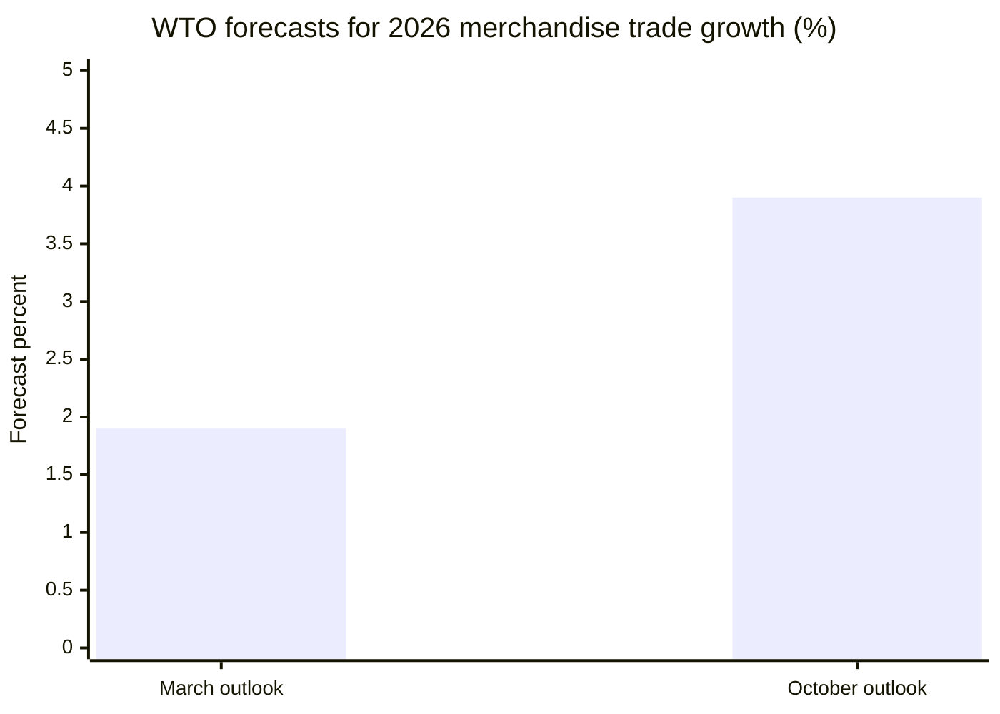
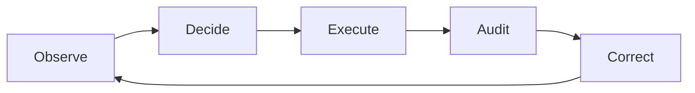

# Figures, Charts and Visual Materials

**Grand Research Institute | David A. Grand**  
**Companion to:** [Algorithmic Management, Institutional Leadership and the AI Paradox](./Research-Monograph-Full-Text.md)

The research paper is archived separately from its figures and visual materials for easier navigation and future revisions. This companion identifies the four figures in the original 28 page PDF, supplies accessible textual data or conceptual renderings, and preserves their analytical qualifications. **These are accessible companion representations, not reproductions of the original PDF graphics.** Consult the original PDF for the original graphical appearance.

## Figure 1. WTO merchandise trade growth forecast revision
**Original PDF:** page 10 | **Units:** projected percent growth in world merchandise trade volume in 2026

| WTO outlook vintage | Projection for 2026 |
|---|---:|
| March 2026 outlook | 1.9% |
| October 8, 2026 outlook | 3.9% |

**Interpretation:** These are forecasts made at different times for the same target year, not two observed growth outcomes. The revision alone does not establish causation by AI. Source referenced by the monograph: WTO, October 8, 2026.

## Figure 2. IEA data center electricity demand, base-case projections
**Original PDF:** page 12 | **Unit:** TWh per year

| Year | Electricity demand |
|---|---:|
| 2024 | Approximately 460 TWh, historical baseline |
| 2030 | More than 1,000 TWh, projected |
| 2035 | Around 1,300 TWh, projected |

**Interpretation:** The figures follow the reported approximate values in IEA (2025), *Energy and AI*. No exact 2030 point value is implied by the phrase “more than 1,000”; therefore a precise point estimate is deliberately not plotted here. Forecast uncertainty and scenario dependence remain material.

## Figure 3. Comparative algorithmic management research design
**Original PDF:** page 18 | **Status:** research instrument illustration only, not empirical findings.

| Domain | Allocation | Scoring | Visibility | Authorization | Appeal | Correction |
|---|---|---|---|---|---|---|
| Mobility platforms | To code | To code | To code | To code | To code | To code |
| Content recommendation | To code | To code | To code | To code | To code | To code |
| Delegated AI agents | To code | To code | To code | To code | To code | To code |
| International governance | To code | To code | To code | To code | To code | To code |

The original PDF contains a **synthetically shaded design grid**. The table above conveys the *coding architecture*, not its original shading or illustrative scores. Do not interpret empty cells as zero or as an absence of control. Sector-specific definitions and separate welfare outcomes are required.

## Figure 4. Governance maturity: management control functions
**Original PDF:** page 22 | **Status:** conceptual illustration, not a validated GRI maturity index.

The original figure uses **invented ordinal scores** to explain control maturity. Those scores are not transcribed here because the original illustration does not constitute measured performance. Each stage requires a decision owner, traceability, timeliness and appropriate contestability.

## Citation and academic integrity note

The original research monograph remains the authoritative source for its complete argument, visual layout, original chart styling, citations and qualifications. This companion maintains a distinct distinction between officially reported numbers, projections, research instruments and conceptual illustrations. The Institute's broader research spans approximately five years, with particularly concentrated academic development in the past two years.
