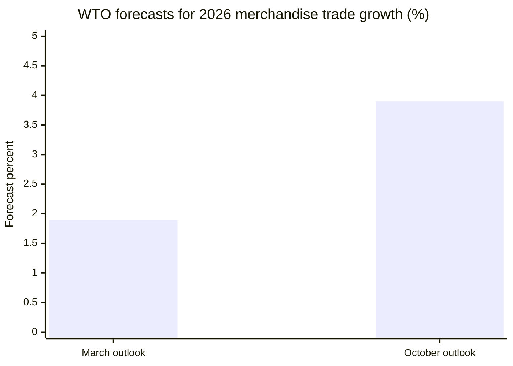
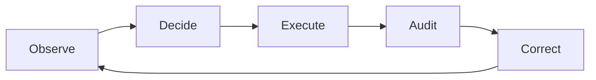

# Figures, Charts and Visual Materials

**Grand Research Institute | David A. Grand**  
**Companion to:** [Algorithmic Management, Institutional Leadership and the AI Paradox](./Research-Monograph-Full-Text.md)

The research paper is archived separately from its figures and visual materials for easier navigation and future revisions. This companion identifies the four figures in the original 28 page PDF, supplies accessible textual data or conceptual renderings, and preserves their analytical qualifications. **These are accessible companion representations, not reproductions of the original PDF graphics.** Consult the original PDF for the original graphical appearance.

## Figure 1. WTO merchandise trade growth forecast revision
**Original PDF:** page 10 | **Units:** projected percent growth in world merchandise trade volume in 2026

| WTO outlook vintage | Projection for 2026 |
|---|---:|
| March 2026 outlook | 1.9% |
| October 8, 2026 outlook | 3.9% |

**Interpretation:** These are forecasts made at different times for the same target year, not two observed growth outcomes. The revision alone does not establish causation by AI. Source referenced by the monograph: WTO, October 8, 2026.

## Figure 2. IEA data center electricity demand, base-case projections
**Original PDF:** page 12 | **Unit:** TWh per year

| Year | Electricity demand |
|---|---:|
| 2024 | Approximately 460 TWh, historical baseline |
| 2030 | More than 1,000 TWh, projected |
| 2035 | Around 1,300 TWh, projected |

**Interpretation:** The figures follow the reported approximate values in IEA (2025), *Energy and AI*. No exact 2030 point value is implied by the phrase “more than 1,000”; therefore a precise point estimate is deliberately not plotted here. Forecast uncertainty and scenario dependence remain material.

## Figure 3. Comparative algorithmic management research design
**Original PDF:** page 18 | **Status:** research instrument illustration only, not empirical findings.

| Domain | Allocation | Scoring | Visibility | Authorization | Appeal | Correction |
|---|---|---|---|---|---|---|
| Mobility platforms | To code | To code | To code | To code | To code | To code |
| Content recommendation | To code | To code | To code | To code | To code | To code |
| Delegated AI agents | To code | To code | To code | To code | To code | To code |
| International governance | To code | To code | To code | To code | To code | To code |

The original PDF contains a **synthetically shaded design grid**. The table above conveys the *coding architecture*, not its original shading or illustrative scores. Do not interpret empty cells as zero or as an absence of control. Sector-specific definitions and separate welfare outcomes are required.

## Figure 4. Governance maturity: management control functions
**Original PDF:** page 22 | **Status:** conceptual illustration, not a validated GRI maturity index.

The original figure uses **invented ordinal scores** to explain control maturity. Those scores are not transcribed here because the original illustration does not constitute measured performance. Each stage requires a decision owner, traceability, timeliness and appropriate contestability.

## Citation and academic integrity note

The original research monograph remains the authoritative source for its complete argument, visual layout, original chart styling, citations and qualifications. This companion maintains a distinct distinction between officially reported numbers, projections, research instruments and conceptual illustrations. The Institute's broader research spans approximately five years, with particularly concentrated academic development in the past two years.

## Visual series: From traditional management to algorithmic authority

**Research Journey visual supplement | Approved October 2026**  
**Creative direction and research lead:** David Grand, Grand Research Institute  
**Status:** Three approved editorial illustrations; image binaries prepared separately for repository upload. This Markdown file does not claim that image files are already hosted by GitHub.

This series accompanies the Institute's public communication connecting historic managerial discretion, algorithmically mediated information, and *The Back Door* as a fictional exploration of institutional consequences. Its illustrations are **AI generated conceptual images**, not authentic period photographs or verified advertisements placed on transit vehicles.

| Plate | Caption and research interpretation | Approved source image filename |
| --- | --- | --- |
| **V1. Traditional management** | Period styled executive discussion represents interpersonal bargaining, authority and managerial discretion. It is a composite illustration, not a photograph of a documented historical meeting. | `01-traditional-management.jpeg` |
| **V2. Algorithmic influence** | An imagined New York City bus advertisement reading “Some Doors Should Stay Closed” illustrates systems influencing communication, decisions and public attention. This does **not** establish that the depicted advertisement was actually displayed on an MTA bus. | `02-algorithmic-influence.jpeg` |
| **V3. Research and creative storytelling** | A promotional illustration for David Grand's forthcoming novel *The Back Door* connects the Institute's governance research to narrative exploration of algorithmic authority and its potential consequences. Fiction is not presented as empirical evidence. | `03-research-and-creative-storytelling.jpeg` |

**Presentation wording:** V1: “The opening television scene establishes a recognizable period of human authority, interpersonal relationships, and managerial discretion.” V2: “The bus signage, ‘Some Doors Should Stay Closed,’ creates a visual connection to systems that increasingly mediate communication, decisions, and public attention.” V3: “*The Back Door* becomes a bridge between GRI's research into algorithmic authority and a fictional exploration of its potential consequences.”

**Provenance note:** The three selected slide images were approved in the October 2026 GRI creative review. To maintain research integrity, classify these as communication graphics, not photographs, field observations, primary evidence or measured results. Their image files should be placed alongside the figures companion if the repository's binary upload capability becomes available. The separate approved image package carries these exact filenames.

