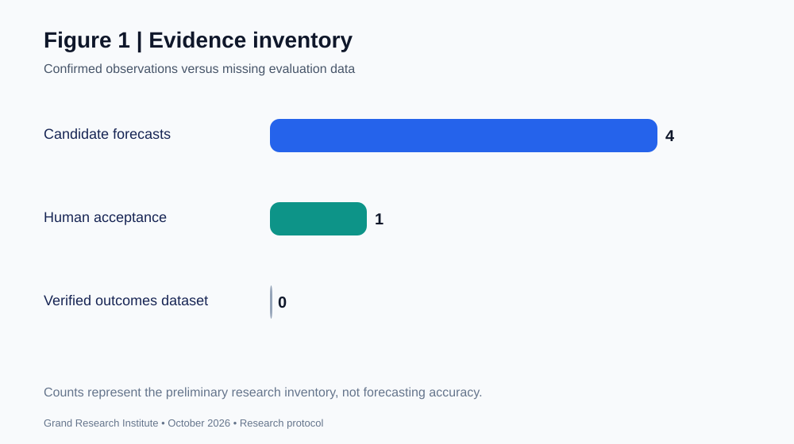
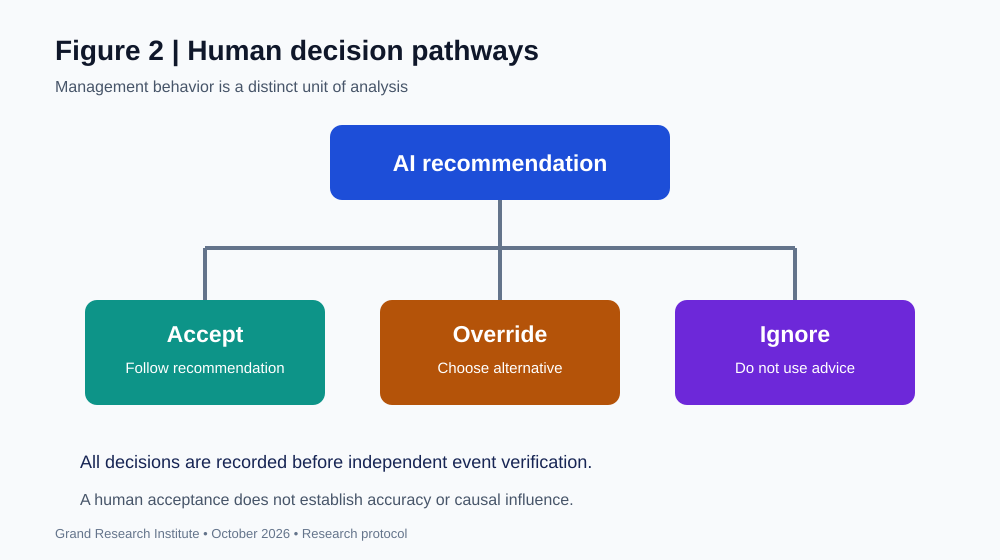
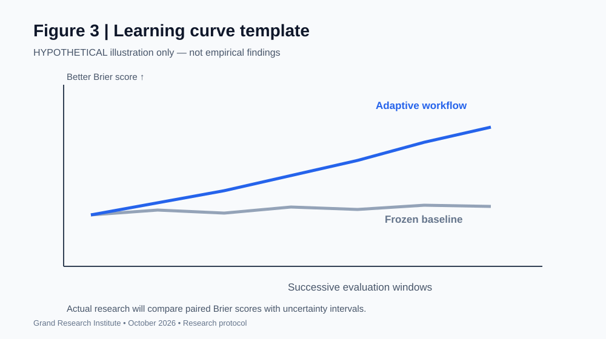
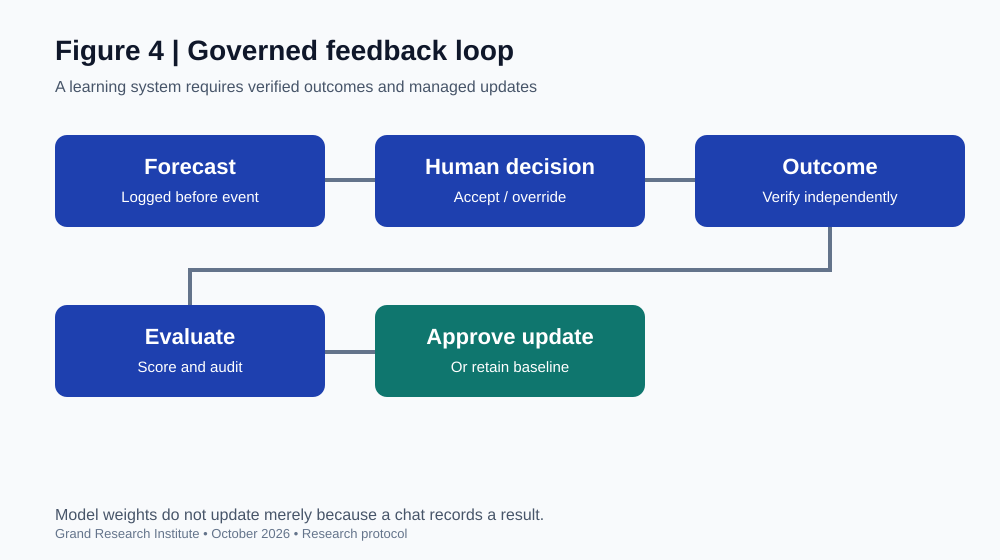

# Figures and Visual Materials

**Grand Research Institute | Research Journey**  
**Study:** [From Prediction to Algorithmic Management](./From-Prediction-to-Algorithmic-Management-2026-10-11.md)  
**Research lead:** David Grand | **Date:** October 11, 2026  
**Status:** Visual companion to an exploratory protocol

## Figure 1. Evidence inventory

Four candidate historical forecast statements were referenced in the preliminary framework, and one human acceptance decision was explicitly recorded. The inventory is not a verified prediction outcomes dataset. Missingness must not be treated as zero forecasting success.

## Figure 2. Human decision pathways

The core management question concerns the human response to algorithmic recommendations: accept, override, or ignore. Subsequent event outcomes must be assessed independently of the decision.

## Figure 3. Learning curve template

**Hypothetical illustration, not empirical evidence.** This figure represents how prospective rolling evaluation could distinguish an adaptive workflow from a frozen baseline. The actual study should use paired probabilistic scoring, model version logs, and uncertainty intervals.

## Figure 4. Governance and feedback loop

Model advice, management authority, independent outcome verification, scoring, and approval for model changes are separate stages. More inference compute, tool retrieval, or recorded conversational feedback does not alone demonstrate that model weights have learned.

## Research and reuse notes
Figures 2 and 4 are conceptual diagrams; Figure 1 is a preliminary evidence count; Figure 3 is expressly hypothetical. Do not cite these as established empirical findings. Data provenance and versioning are required before claims about calibration, causal influence, or learning improvement.

**[Return to the study overview](./README.md)**