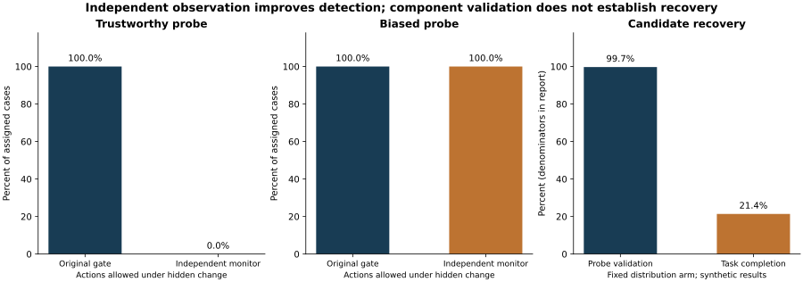

# Training a Tiger: Independent Assurance and Controlled Recovery

David A. Grand | Grand Research Institute | 28 October 2026

## Findings

The independent observation gate held every hidden severe friction case with trustworthy probe measurements across all five curricula. The original gate allowed all of those cases. When the probe measurement was biased to conceal the change, both gates allowed every case. The added observation improves detection only under its stated measurement assumptions.

The recovery mechanism produced candidates requiring human review. Approximately 99.7% passed its local validation checks, but only about 21.4% of assigned hidden shift cases completed the counterfactual task. The original model and every recovery candidate remain outside operational control. A successful component check is insufficient evidence for task level recovery.



## Frozen design and budgets

The protocol, monitor, experiment source and unit tests were frozen in [commit 4eb16e70](https://github.com/BazeletDave/ConsciousAI/commit/4eb16e70d5c1689346ced41e143da1ad11e5769d) before primary execution. This is a documented design freeze, not external preregistration or independent review. Original putting source, protocol and results hashes are retained and checked; those files were not edited.

Twenty new training seeds, 100 through 119, were used. Five curricula each received 6,000 training interactions per seed: 100 models and 600,000 training interactions. Eight conditions with 150 held out cases per seed yield 120,000 assigned evaluation cases across arms; within each seed the same cases and probe noise are shared. These are paired assignments, not 120,000 independent worlds. Intervals resample the 20 seeds with 4,000 bootstrap replicates. Evaluation and recovery do not update the learner.

The independent monitor receives one extra preflight probe attempt per case. Missing observations are counted separately from valid acquired probes. Thus the comparison is an additional information and intervention mechanism, not equal sensor budgets or a claim that the same model learned to recognize hidden hazards internally. No physical clock or real detection latency is modeled; the probe precedes the modeled task action. Recovery adds three calibration probes and two distinct validation probes only for held cases that remain within the declared task sensor and nominal input boundaries.

## Results across every curriculum

The action columns describe allowances in a synthetic diagnostic, not physical or legal safety findings. Recovery validation uses recovery attempts as its denominator; task completion uses all assigned hidden shift cases.

| Curriculum | Nominal task success | Hidden change: original allows | Hidden change: monitor allows | Biased probe: monitor allows | Recovery validation passes | Validated counterfactual task success |
| --- | --- | --- | --- | --- | --- | --- |
| Fixed distribution | 66.10% | 100.0% | 0.0% | 100.0% | 99.70% | 21.37% |
| Long to short with gate | 65.50% | 100.0% | 0.0% | 100.0% | 99.70% | 21.37% |
| Short to long with gate | 65.77% | 100.0% | 0.0% | 100.0% | 99.70% | 21.37% |
| Long to short equal exposure | 66.33% | 100.0% | 0.0% | 100.0% | 99.70% | 21.40% |
| Short to long equal exposure | 66.20% | 100.0% | 0.0% | 100.0% | 99.70% | 21.37% |

For the fixed distribution arm, recovery was attempted on 3,000 of 3,000 assigned hidden shift cases; 2,991 candidates passed validation and 641 validated candidates completed the counterfactual task. No candidate was operationally authorized.

## Why recovery validation was insufficient

Calibration and validation examined longitudinal stopping displacement at distinct speeds. The actual task also requires lateral accuracy on a graded surface. The validation omitted that task dimension, allowing many local passes followed by task misses. This is an explanatory analysis of the retained outcomes, not a tuned replacement protocol or a claim that physical recovery has been demonstrated.

Moderate surface shift cases, designated within scope by the simulation, were held about 47.4% to 50.5% of the time across arms. Mechanical jitter cases were held about 16.7% to 16.9%. Nominal unnecessary holds were zero in these sampled cases. These different operating costs must remain visible; nominal performance alone does not establish a general false hold rate.

## Curriculum ablation

Equal exposure arms received 1,200 trials in each distance stage, with opposite order and otherwise matched training budgets and disturbance generation. Short to long minus long to short nominal success was negative 0.133 percentage points, with a 95% seed bootstrap interval from negative 0.533 to positive 0.267 percentage points. No superiority or equivalence is established.

The new gated comparison was positive 0.267 percentage points, with an interval approximately zero to positive 0.567 percentage points. The long to short gated arm remained subject to the original mastery rule; this comparison concerns the combined order and gate package. The new seeds and protocol do not replace the original retained experiment or justify direct causal comparison with its aggregate rates.

## Assurance module boundary

The monitor accepts a fixed observable schema and rejects hidden condition, true friction and hazard label fields. Decisions use task sensor validity, nominal input limits, original model uncertainty and independent measured displacement disagreement. Simulator ground truth is used only to generate observations and calculate diagnostic outcomes.

Recovery states are HOLD or REVIEW_REQUIRED. Validation never grants operational authority. No human reviewer or approval has been invented. Biased sensor readings deliberately demonstrate a failure boundary: observation independence and measurement integrity require their own assurance.

## Reproduction

Python standard library only for the experiment and verification. Matplotlib was used solely for the retained figure.

```bash
python -m unittest -v
python verify.py
python verify.py --rerun
```

The last command repeats training and evaluation in memory and compares the full result digest. The recorded Python environment is in run_record.json. Cross runtime exact floating point identity is not guaranteed. results.json.gz contains the full retained run records, counters, candidate examples, confidence intervals and paired comparisons. The archive takes precedence during verification. experiment.py writes a new local results.json and should be used only in a separate copy; it does not replace the retained archive.

## Next research milestone

Preserve this experiment. A subsequent separately frozen study should test validation on the full task dimensions, sensor calibration and integrity, independent holdout reviewers, and recorded human rejection and release decisions. It must evaluate both missed hazards and unnecessary intervention. This synthetic result does not establish a robot, a general RL system, coaching effectiveness, clinical transfer, or real world operational safety.

Retained candidate examples are the first two eligible held cases per model and condition; they are not a representative failure sample. Regenerate this report and figure with python make_report.py after installing Matplotlib.
