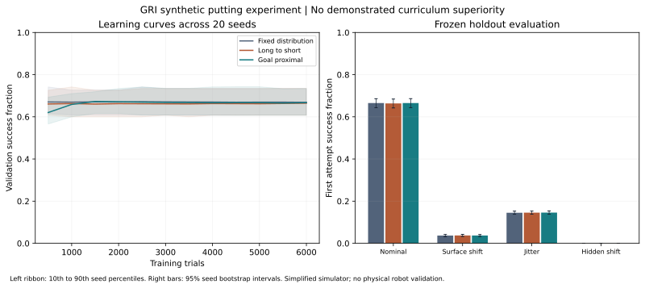

# GRI putting curriculum experiment

David A. Grand | Grand Research Institute | 28 October 2026

## Finding

The frozen synthetic experiment does not demonstrate superiority of the goal proximal curriculum. Nominal first attempt success was 66.52% for goal proximal, 66.36% for the long to short comparator, and 66.54% for the fixed distribution baseline.

The primary paired difference, goal proximal minus long to short, was 0.16 percentage points with a 95% seed bootstrap interval of negative 0.06 to positive 0.40 percentage points. The interval includes zero. Against fixed distribution, the difference was negative 0.02 percentage points with an interval of negative 0.28 to positive 0.22 percentage points. These findings do not establish equivalence or generalize beyond this experiment.



## Design and reproducibility

The protocol and core source hashes were frozen in run_manifest.json before the first execution. This is a documented local design freeze, not external preregistration. No outcome driven tuning was performed after the results were observed. The completed run was reproduced in memory with matching result digests in Python 3.12.14.

Run from this directory using Python 3.10 or newer, standard library only:

```bash
python -m unittest -v
python reproduce.py
python reproduce.py --rerun
```

To produce a new run in a separate copy, use python experiment.py. That command overwrites its local manifest and results. Preserve the delivered files before doing so. Exact digest reproduction was checked in the recorded Python environment; other runtimes may differ in floating point behavior.

The experiment comprises 20 independent training seeds, three arms, 6,000 training trials per arm and seed, and 250 held out cases in each of six conditions. This gives 60 trained models, 360,000 training interactions, and 90,000 first attempt holdout evaluations. Within each seed, all arms share the same world parameters and holdout cases. Confidence intervals resample the 20 seed results rather than treating every trial as independent.

The primary outcome and comparison, progression gate, checkpoint schedule, uncertainty threshold, holdout conditions and bootstrap settings were specified in protocol.json. Validation checkpoints use a separate synthetic set and do not update the model. Final evaluation also leaves the trained model unchanged.

## What is learned

All arms use the same model based single action controller. Recursive least squares learns a forward stopping response from observed outcomes. A separate fitted coefficient estimates lateral drift. The controller selects launch speed and angle from that learned response, with an identical exploration rule during training. This is online model learning with supervised outcome updates, not a demonstrated implementation of a general RL policy algorithm.

The fixed arm samples the entire declared distance range throughout training. The forward arm attempts long to short stages. The goal proximal arm attempts short to long stages. The latter two share the same minimum stage exposure and rolling proficiency gate. The word forward denotes this operational comparator; it is not a claim that conventional golf or curriculum learning universally uses that order.

## Gate behavior and learning efficiency

The long to short arm never passed its first stage in any seed. The goal proximal arm reached the last stage in 19 of 20 seeds; the remaining seed advanced three stages. This is an important protocol outcome: the comparison concerns an ordering plus mastery gate package, not isolated order with matched exposure to every stage. The gate may disadvantage a curriculum that starts with the hardest tasks. A subsequent fixed exposure ablation should investigate this without replacing the retained primary result.

The fixed and goal proximal arms reached the 60% checkpoint target in all 20 seeds; the long to short arm reached it in 19. Among seeds reaching the target, median first attainment was the first checkpoint at 500 trials for every arm. The checkpoint resolution therefore does not demonstrate a sample efficiency advantage and does not identify exact attainment time. A seed that never attained the target is retained as censored, not assigned an invented attainment time.

## Failure and assurance results

| Condition | Fixed success | Long to short success | Goal proximal success |
| --- | --- | --- | --- |
| Nominal | 66.54% | 66.36% | 66.52% |
| Surface shift | 3.68% | 3.74% | 3.70% |
| Mechanical jitter | 14.50% | 14.54% | 14.58% |
| Hidden severe friction shift | 0% | 0% | 0% |

All arms continued acting on every hidden severe friction case. Their learned parameter uncertainty did not detect the unobserved change. Explicitly out of scope distances and missing sensor flags were held in every case. Those holds follow the configured boundary rules and are not learned evidence of general hazard recognition.

Unsafe labels are simulation design labels based on the generated condition, independent of whether a putt happens to succeed. They are not legal or physical safety determinations. Nominal and moderate shift cases are designated within scope for this diagnostic; that label does not certify harmless outcomes. Raw stopping outcomes are calculated even for held cases as counterfactual simulation diagnostics. Autonomous success counts only successful cases that the gate allowed, retaining all assigned cases in its denominator.

On nominal misses, a reset retry succeeded in approximately 98.9% to 99.0% of cases. That retry begins at the remaining distance in a reset local coordinate frame. It does not model continuing ball dynamics or a complete physical recovery sequence. Results include exact miss and recovery denominators and selected failure records; displayed failure examples are the first three misses per condition and model, not a representative sample.

## Simulator limitations

The simulator models a local stopping position from launch speed, angle, friction, surface grade, a drag term and stochastic disturbance. Success means stopping within a specified radius. Cup capture, ball spin, 3D biomechanics, club impact, real turf, visual perception and embodied control are absent. The learner receives a friction estimate and grade variables directly. Its uncertainty is an uncalibrated parameter uncertainty heuristic. The low dimensional model and strong initial structure can make curriculum effects small.

This experiment tests an original GRI translation inspired by the [supplied book passages](../../../../Research-Governance/ConsciousAI-Research-Systems/learning_ledger/putting_and_escalation_review.md). It does not test Earl Woods's human coaching effectiveness, establish that a robot can reproduce Tiger Woods, or authorize training on book text. Mechanical and hidden surface perturbations are GRI experimental choices rather than mechanisms verified in the supplied passages.

## Institutional implication and next milestone

The measurable AI Paradox here is that reasonable nominal performance coexists with failure to recognize an unobserved condition change. Improving an internal confidence estimate alone does not establish the capacity to request help appropriately. A next experiment should compare an independent observation and intervention mechanism against the current gate, and separately ablate progression gating. Preserve these results as the baseline.

The dashboard publishes a checksum verified summary and the three hour research cycle records the frozen experiment's status. Collection does not rerun training, change these results, or promote any active dashboard model.
