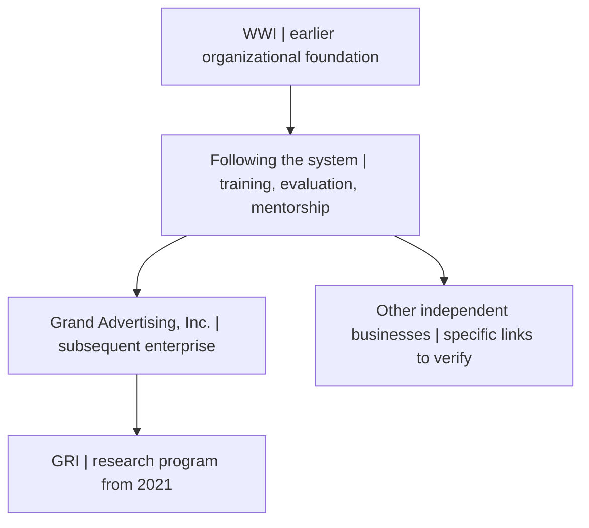
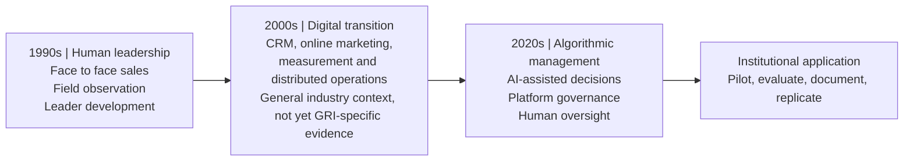
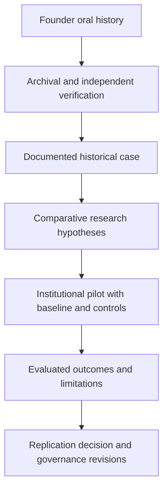

# From Human Leadership to Algorithmic Management | 1990s–2026

**Grand Research Institute (GRI) | Research Journey | Working historical case study | 16 October 2026**

**Status:** Founder oral history, deposited contemporaneous archival images, and conceptual comparative framework. Source claims and causal interpretations remain subject to verification.

## Historical Milestone 000 | WWI: The foundational operating system

**Historical distinction:** According to the founder's account, Wholesale Warehousing Industries (WWI) preceded and informed the structured management practices later used in Grand Advertising, Inc. and other independent businesses. WWI was not Grand Advertising. The organizing principle was described as **“following the system”**: standardized training, performance expectations, mentoring, leadership progression and market replication. Specific corporate and chronological relationships require further documentation.

### Archival evidence deposited October 2026

The following files were uploaded to the parent `GRI-Research-Journey` folder. Original images are retained under their uploaded filenames. Descriptions are preliminary, and the presence of a publication does not independently verify every statement within it.

| Source | File | Evidence category |
|---|---|---|
| *WWI Worldwide*, Vol. 2, Issue 20, April 2, 1993 | [Newsletter cover](../IMG_7175.jpeg) | Dated contemporaneous publication |
| *WWI Worldwide*, “Juice” regional reports | [Newsletter page](../IMG_7177.jpeg) | Contemporary reporting on people, leadership and markets |
| WWI distributorship listings | [Rankings page](../IMG_7176.jpeg) | Published performance figures; definitions and units require verification |
| Handwritten office and owner list | [Historical notes](../IMG_7178.jpeg) | Potential network reconstruction; names and dates require corroboration |
| Original historical photograph | [Business associates](../IMG_7185.jpeg) | Archival photographic evidence; identities and dates pending |
| Original historical photograph | [Group photograph](../IMG_7186.jpeg) | Archival photographic evidence; identities and dates pending |
| Original historical photograph | [Additional photograph](../IMG_7184.jpeg) | Archival photographic evidence; identities and dates pending |
| Additional uploaded source | [IMG_7170](../IMG_7170.jpeg) | Classification pending |
| Leadership model reference | [IMG_7171](../IMG_7171.jpeg) | Founder-supplied description of five-stage progression |
| Contemporary comparative reference | [IMG_7172](../IMG_7172.png) | Modern analysis, not a 1990s source |
| Generated multiera illustration | [Composite image](../F90718D8-3E72-46A6-A728-CC93DE7E7A31.png) | AI illustration, not historical evidence |

### Institutional lineage and research implications

The archive supports inquiry into how standardized human-managed systems transmitted operating rules, developed leaders, used performance metrics and expanded across markets. Comparing these mechanisms with algorithmic management is a **research hypothesis**, not a claim that the earlier businesses employed AI. The five steps and eight steps may have antecedents predating WWI; their precise origins remain unverified.

## Historical Milestone 001 | Grand Advertising, Inc. | Orlando, Florida | 1990s

*Figure 1. Grand Advertising, Inc., Orlando, Florida, 1990s. Composite visual incorporating a founder-provided historical storefront photograph and AI-generated illustrative representations of direct sales personnel, promotional materials, and the business setting. The depicted people and reconstructed activities are illustrative, not independently authenticated archival photographs. Image added to the GRI Research Journey on 16 October 2026.*

This milestone documents the founder's early practical experience with direct sales, leadership development, mentoring, field evaluation, and organizational replication. It is a historical antecedent to the Grand Research Institute's formal research program beginning in 2021, rather than evidence that the institute existed during the 1990s.

**Image archive:** [View original uploaded composite](../2A2F979B-015F-45C3-B193-DAB7C0B68D08.png). The original uploaded asset is retained without modification for traceability.

## Research question
How can practices of human leadership development, organizational replication, and accountable management inform institutional governance of increasingly autonomous AI systems?

## Historical account: Grand Advertising, Inc., Orlando, Florida
According to founder David Grand's retrospective account, Grand Advertising operated a structured direct sales and leadership development program beginning in the early 1990s. Independent distributors carried out face to face field campaigns and canvassing for clients reported to include the Florida Marlins, Tire Kingdom and Papa John's Pizza. Morning meetings emphasized motivation, a standardized five steps process and eight steps to success. Participants worked long field days and were evaluated on field execution and demonstrated ability to teach the system.

**Reported progression:** Independent distributor → team leader conducting field observation and mentorship → development of five team leaders → assistant manager learning recruitment, interviews, operations and compliance → opportunity to establish a new market office with client campaigns.

The founder reports geographic expansion from Orlando to several U.S. markets and Spain, and cites Nick Iovieno and John Miller as illustrative subsequent career trajectories. These are **attributed claims**, not independently established evidence of specific client contracts, organizational ranking, career causality or global scale. Interviews, archival records and third party documentation are required before publication as verified historical findings.

## Three eras: comparative visual

## Comparative framework

| Management dimension | 1990s: founder-reported Grand Advertising practices | 2000s: industry transition, research context only | 2020s: contemporary research questions |
|---|---|---|---|
| Customer engagement | Direct, in-person campaigns and canvassing | Digital marketing and CRM expansion | Algorithmically mediated outreach and recommendation |
| Training | Morning meetings, five steps, eight steps | Digital learning and recorded metrics | AI-supported learning with human validation |
| Evaluation | Field results and observed behavior | Dashboards and operational KPIs | Model evaluation, performance calibration and contestability |
| Leadership development | Mentoring, team formation, assistant management | Distributed and digitally coordinated teams | Human accountability for automated recommendations |
| Scaling | New offices, markets and client books | Networked operations | Governance across models, teams and institutions |

**Interpretation:** These are analytical comparisons, not a claim that the 1990s organization used AI or that the 2000s industry practices are documented Grand Advertising practices.

## Hypotheses and evidence plan
1. **H1:** Standardized training and direct observation supported the transfer of leadership capabilities. Test through archived materials and interviews with former participants.
2. **H2:** Promotion based on developing other leaders facilitated replication across markets. Test using dated office records and corroborated personnel histories.
3. **H3:** Human oversight practices from earlier leadership systems can inform present AI governance design. Test through a prospective institutional pilot with predefined outcomes.

**Evidence ladder:** Founder testimony → contemporaneous training documents, client contracts and dated campaign records → independent participant interviews → verified organizational outcomes → comparative analysis → prospective institutional implementation. No causal inference is warranted from testimonials alone.

## Proposed measurable institutional pilot
Define decision rights and escalation paths for an AI assisted management workflow; collect baseline measures; specify human override and audit procedures; evaluate decision quality, fairness, error correction and staff comprehension; publish methods, limitations and results before considering replication.

## Visual 2: research evidence and governance pathway

## Methodological and institutional boundaries
This study is part of the GRI Research Journey, whose contemporary AI research program began in 2021. Earlier leadership experience is its **historical antecedent**, not evidence that GRI's AI program existed in the 1990s. Mention of ASU, Thunderbird, WEF or any client does not establish endorsement or an institutional partnership. Distinguish current AI capabilities from speculative superintelligence and do not attribute human agency or autonomous goal setting without evidence.

## Research references for theoretical development
- World Economic Forum. *Future of Jobs Report 2025*. https://www.weforum.org/publications/the-future-of-jobs-report-2025/
- OECD. *OECD AI Principles*. https://oecd.ai/en/ai-principles
- NIST. *AI Risk Management Framework 1.0* (2023). https://doi.org/10.6028/NIST.AI.100-1

These references supply contextual frameworks, **not verification** of Grand Advertising history.

*Version 1.3 | 2026-10-16 | Added WWI institutional lineage and linked deposited archival evidence; detailed verification pending.*
