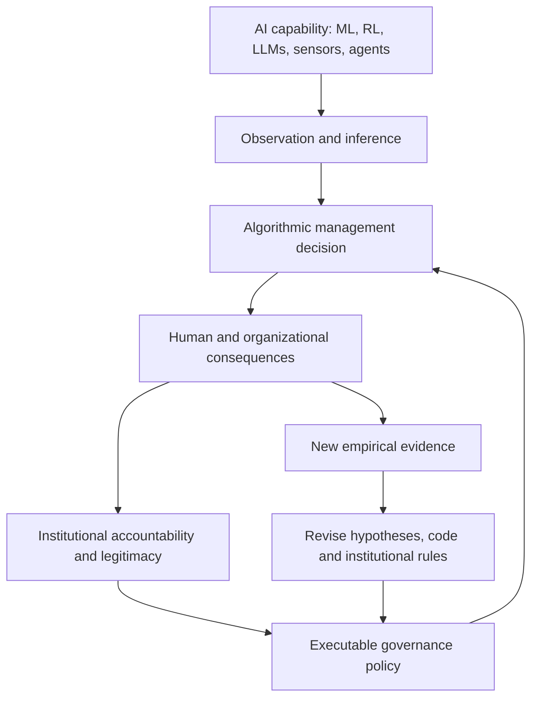

# Living Algorithmic Governance: The Here and Now
**Grand Research Institute | David A. Grand | 21 October 2026**  
**Status:** Independent working research agenda. Hypotheses and proposed software are not validated findings or deployed products.

## Executive thesis
The Fourth Industrial Revolution is not only a future AI scenario. Smartphone sensors, algorithmic labor platforms, commercial fleet telematics, autonomous systems and enterprise agents already influence human behavior, organizational incentives and institutional authority. The research opportunity is to design, implement and empirically test **executable governance**, then update theory as technologies, institutions and human responses coevolve.

This dated synthesis connects today's discussion of LLMs, reinforcement learning, DeepMind's historical development and Sebastian Mallaby's *The Infinity Machine* (including the chapter “Intuition”), smartphone distraction sensing, Uber safety analytics, commercial trucking, GLOBE and Mansour Javidan, the Nelson Model, the AI Paradox, the Fourth Industrial Revolution, and the NSA/PHP cybersecurity advisory discussion. Book passages, proprietary algorithms and the exact earlier news clippings are **not** independently verified here; they require source-specific entries before becoming evidence claims.

## Figure 1: The institutional feedback system


**Research cycle:** Observe → verify sources → identify competing explanations → develop hypotheses → prototype → test → audit → revise → preserve dated versions.

## Figure 2: Intervention authority scale
| Level | Mechanism | Illustrative use | Governance safeguard |
| --- | --- | --- | --- |
| 0 | Observe | Consented motion signals | Necessity and data minimization |
| 1 | Infer | Probable phone handling | Confidence and attribution validation |
| 2 | Warn | Nonpunitive distraction alert | Proportionality and false alarm review |
| 3 | Influence | Safety score linked to incentives | Transparency and contestability |
| 4 | Restrict | Account or job access decision | Due process and human review |
| 5 | Actuate | Physical vehicle intervention | Specific authorization and safety certification |

This is a proposed **ordinal conceptual scale**, not an empirically measured risk index. A research prototype should initially remain at levels 0–2.

## Present-day engineering case: iPhone, Uber and fleets
Apple's Core Motion framework exposes permitted motion data; location and device activity are governed by separate interfaces and permissions. Combining authorized sensors and contextual signals can support *probabilistic* distraction detection. Motion alone does not establish texting, identity of the phone handler or culpability. A third-party app cannot install unrestricted monitoring across every iPhone; platform controls, consent, privacy and background restrictions apply.

Uber and commercial fleet systems are useful cases for comparing observation, safety feedback, scoring, rewards and managerial authority. Their actual implementations, response latency and proprietary source code must be verified against primary product documentation; a generic code example is **not** Uber code. Remote fleet monitoring does not imply authority or capability to control vehicles remotely.

### Proposed reference policy engine (illustrative, not deployed)
```python
from dataclasses import dataclass

@dataclass(frozen=True)
class Event:
    moving: bool
    handling_detected: bool
    driver_attribution_verified: bool
    confidence: float
    policy_version: str

def decide(event: Event):
    if not event.driver_attribution_verified:
        action = "NO_ATTRIBUTION"
    elif not event.moving or not event.handling_detected:
        action = "NO_ACTION"
    elif event.confidence < 0.90:
        action = "INSUFFICIENT_EVIDENCE"
    else:
        action = "NONPUNITIVE_WARNING_PERMITTED"
    return {"action": action, "policy_version": event.policy_version}
```
The 0.90 threshold is an **unvalidated illustration**, not a vendor setting or safety standard. Research should use synthetic or properly consented data, without reading messages or actuating vehicle controls.

## Figure 3: Empirical dashboard specification
| Measure | Definition | Status |
| --- | --- | --- |
| Precision | True detections / all positive detections | To test |
| Recall | True detections / all target events | To test |
| False alarm rate | False warnings per driving hour | To test |
| Calibration | Agreement of predicted confidence with observed correctness | To test |
| Governance latency | Time from event to authorized response | To test |
| Unauthorized intervention rate | Actions outside policy / all actions | To test |
| Appeal effectiveness | Time and rate of correcting disputed consequential decisions | To test |
| Adaptation latency | Time from validated drift to controlled policy update | To test |

**No fabricated measurements:** these are chart-ready definitions, not collected results.

## Figure 4: Evidence maturity scale
| Grade | Definition |
| --- | --- |
| E0 | Concept or hypothesis |
| E1 | Public technical interface or specification |
| E2 | Documented vendor or institutional deployment |
| E3 | Independently reproducible test |
| E4 | Longitudinal operational validation with external scrutiny |

A publicly documented API (E1) does not establish a specific vendor deployment (E2). The GRI reference policy is currently a **proposed design**, not an E3 or E4 result.

## Theoretical integration
**Nelson Model:** formal and informal rules, actors, interests, power, commitment and institutional adaptation.  
**GLOBE / Mansour Javidan:** societal practices versus societal values, leadership expectations, power distance, uncertainty avoidance, performance orientation and institutional collectivism. National scores do not determine individual behavior; comparative studies require appropriate sampling and measurement equivalence.  
**Algorithmic management:** dispatch, scoring, incentives, access, labor economics and delegated authority.  
**Institutional governance:** authorization, contestability, source integrity, proportionality, auditability and remediation.  
**AI Paradox:** successful optimization may produce second-order effects that change the conditions of success or undermine legitimate oversight.

## Figure 5: Cross-domain research matrix
| Case | Algorithmic capability | Institutional question | Proposed method |
| --- | --- | --- | --- |
| Smartphone distraction | Sensor fusion and classification | Privacy, attribution, false positives | Offline labeled event simulation |
| Uber/platform work | Scoring and incentives | Economic effects and procedural fairness | Longitudinal comparative study |
| Commercial trucking | Driver and fleet telemetry | Employer authority and safety intervention | Policy and response audit |
| Autonomous mobility | Perception and planning | Safety assurance and accountability | Regression and invariant testing |
| Enterprise AI agents | Delegated tool actions | Permission boundaries and oversight | Authorization boundary tests |
| Cybersecurity response | Vulnerability detection and remediation | Institutional adaptation latency | Advisory-to-remediation chronology |
| Cross-border deployment | Standardized algorithms | Cultural expectations and legitimacy | GLOBE-informed comparative interviews |

## NSA/PHP advisory: cybersecurity governance connection
Today's earlier discussion included an **NSA-related PHP vulnerability warning**, exposure concerns and preliminary review of GRI hosting. Do not present the advisory's attribution, affected CVEs, version ranges or a clean bill of health as independently established without recovering the original primary notice and current service inventory. A preliminary observation of no identified PHP runtime is not a security audit or proof of no transitive exposure.

A source register should capture issuing authority, advisory identifier, CVEs, publication date, affected versions, asset inventory, patch status, retest evidence and remediation latency. This creates a second test environment for the same governance sequence: **detect → verify → authorize → intervene → audit → revise**. Earlier news clips also require individually dated citations and evidence grades before incorporation as verified claims.

## Falsifiable research propositions
1. Explicit executable policy boundaries reduce unauthorized automated actions when exposure and task complexity are controlled.
2. Human review and contestability reduce the persistence of erroneous consequential decisions.
3. Capability changes and environmental drift create measurable governance adaptation demands.
4. Perceived legitimacy of algorithmic authority varies with organizational context and culturally relevant leadership expectations, not nationality alone.
5. Linking safety classifications to economic incentives alters behavior and distributional outcomes.
6. Versioned evidence and policy code improve decision traceability compared with unversioned policy prose.

These are **GRI working hypotheses**, not established causal findings. Prespecify outcomes, alternatives, sample selection, ethical review and uncertainty.

## Next implementation milestones
1. Publish an event schema, provenance fields and versioned governance decision record.
2. Build an offline reference policy engine and tests for attribution, uncertainty and authorization.
3. Produce explicitly labeled synthetic event datasets, calibration plots and intervention matrices.
4. Verify the NSA/PHP primary advisory and document an evidence-backed response chronology.
5. Add a dashboard that charts only observed or transparently simulated metrics.
6. Develop GLOBE-informed comparative protocols and longitudinal institutional analysis.

## Academic and technical foundations
- NIST, *AI Risk Management Framework 1.0* (2023), https://doi.org/10.6028/NIST.AI.100-1
- Hevner et al., *Design Science in Information Systems Research*, *MIS Quarterly* 28(1) (2004), https://doi.org/10.2307/25148625
- House, Hanges, Javidan, Dorfman and Gupta (eds.), *Culture, Leadership, and Organizations: The GLOBE Study of 62 Societies* (Sage, 2004).
- Kellogg, Valentine and Christin, *Algorithms at Work: The New Contested Terrain of Control*, *Academy of Management Annals* 14(1) (2020), https://doi.org/10.5465/annals.2018.0174
- Apple, Core Motion, https://developer.apple.com/documentation/coremotion
- NHTSA, Distracted Driving, https://www.nhtsa.gov/risky-driving/distracted-driving
- Sebastian Mallaby, *The Infinity Machine*, historical reading context; specific chapter claims pending page verification.

**Integrity:** Sources above provide foundational frameworks, not verification of vendor internals or of the earlier NSA advisory. This work is independent GRI research. Thunderbird academic influences do not imply faculty or university endorsement.

[Integrated Research Journey](README.md) · [Institutional Power Amplification](2026-10-19-institutional-power-amplification-framework.md)

## Implemented research artifacts | 21 October 2026

The previously proposed offline governance engineering milestones now have [committed reference code, a synthetic experiment generator, automated tests, an event schema and evidence register](../Research-Governance/Executable-Governance/README.md). The package also generates a labeled SVG confusion matrix chart and machine-readable synthetic metrics when run. These are implemented **source artifacts**, not claims that tests have been executed in CI, that real driving data were evaluated, or that production governance has been deployed.

The NSA/PHP advisory remains **unverified pending the original notice and asset evidence**. Real-world deployment, longitudinal validation, external ethics review and comparative human-subject research are not represented as complete.
