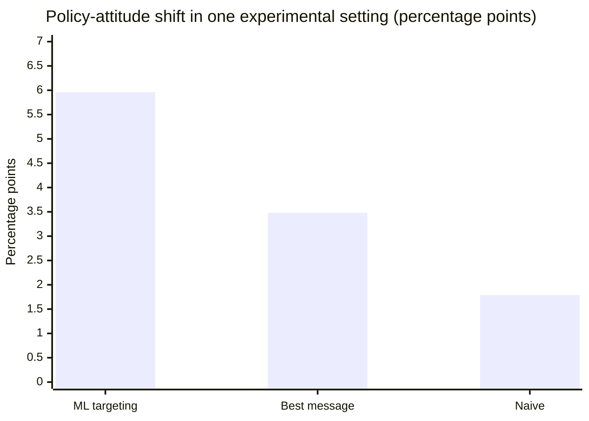
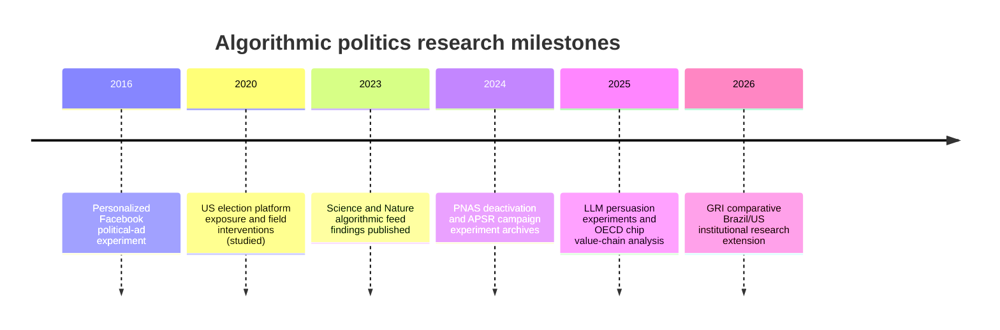
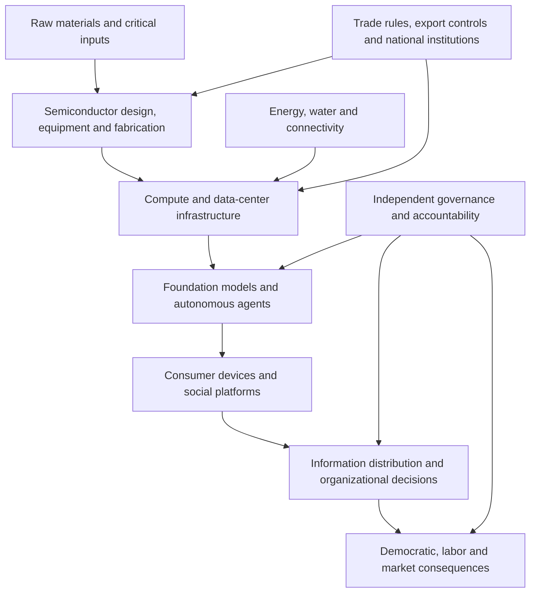

# Algorithmic Politics, AI Infrastructure and Institutional Accountability | 2016–2026

**Grand Research Institute (GRI) | Independent research working review | 26 October 2026**  
**Status:** Source-grounded research synthesis; not a causal attribution of an election outcome.  
**Scope:** Peer-reviewed studies, university-hosted scholarly research, and intergovernmental institutional analysis. Journal findings are attributed to their designs, populations, and time periods. This review is not a partisan advocacy document or a Thunderbird course submission.

## Abstract

Algorithmic politics connects the allocation of attention, political advertising, behavioral experimentation, automated communication and the infrastructure required to operate increasingly capable AI systems. GRI examines the resulting governance problem: capabilities for influencing what people see and how they communicate can advance faster than independent institutions can reconstruct, challenge and oversee those systems. The literature establishes meaningful effects on **exposure** and context-dependent effects on **persuasion**, while major randomized studies often find **small or null short-run effects** on polarization, turnout or candidate preference. The mechanisms must not be conflated with proof that any platform or AI system determined a particular election.

## A decade of evidence: annotated academic register

| ID | Year | Scholarly source | Research design and finding | Evidence boundary |
| --- | --- | --- | --- | --- |
| A1 | 2016 | Kruikemeier, Sezgin & Boerman, *Cyberpsychology, Behavior, and Social Networking*, [DOI 10.1089/cyber.2015.0652](https://doi.org/10.1089/cyber.2015.0652) | Online experiment (N=122) on recognition of personalized political ads; sponsored-label recall conditioned persuasion knowledge. | Advertising recognition, not electoral causation. |
| A2 | 2023 | González-Bailón et al., *Science*, [DOI 10.1126/science.ade7138](https://doi.org/10.1126/science.ade7138) | Analysis of political-news exposure among 208 million US Facebook users during 2020; ideological segregation increased from potential exposure to actual exposure and engagement. | Observational exposure patterns do not identify voting effects. |
| A3 | 2023 | Guess et al., *Science*, [DOI 10.1126/science.abp9364](https://doi.org/10.1126/science.abp9364) | Randomized chronological versus algorithmic Facebook/Instagram feeds; major changes to use and content exposure but no significant change in key political attitudes over three months. | Null short-run attitudinal findings; does not rule out other mechanisms or longer horizons. |
| A4 | 2023 | Nyhan et al., *Nature*, [DOI 10.1038/s41586-023-06297-w](https://doi.org/10.1038/s41586-023-06297-w) | Randomized reduction of like-minded content among 23,377 users changed exposure but not eight preregistered attitudinal outcomes. | Treatment is a specific feed intervention, not all possible algorithms. |
| A5 | 2023 | *Quantifying the potential persuasive returns to political microtargeting*, *PNAS*, [PubMed](https://pubmed.ncbi.nlm.nih.gov/37307486/) | Two issue-advocacy experiments; machine-learning message selection achieved an estimated average persuasion advantage of ~70% over a single-best-message comparator in one pooled comparison. | Context-specific experimental policy attitudes, **not 70% more votes**. |
| A6 | 2024 | Guess et al., *PNAS*, [DOI 10.1073/pnas.2321584121](https://doi.org/10.1073/pnas.2321584121) | Facebook (19,857 users) and Instagram (15,585 users) deactivation experiments in 2020; reduced online participation, near-zero estimated polarization/turnout effects; candidate-vote signal did not meet preregistered significance. | Do not describe nonsignificant candidate signal as a proven vote effect. |
| A7 | 2024 | *How Experiments Help Campaigns Persuade Voters*, *American Political Science Review*, [journal article](https://www.cambridge.org/core/journals/american-political-science-review/article/how-experiments-help-campaigns-persuade-voters-evidence-from-a-large-archive-of-campaigns-own-experiments/FF5BE6ED1553475F8321F7C4209357F7) | Archive of 146 experiments, 617 ads, 51 campaigns, >500,000 respondents; persuasive effects vary, and experimentation can help campaigns identify effective ads. | Data from 2018/2020 campaigns; no universal predictive formula. |
| A8 | 2024 | *The persuasive effects of political microtargeting in the age of generative artificial intelligence*, *PNAS Nexus*, [DOI 10.1093/pnasnexus/pgae035](https://doi.org/10.1093/pnasnexus/pgae035) | Evaluates claims about AI-era personalized political communication and Cambridge Analytica history. | Distinguish company claims about effectiveness from independently demonstrated effects. |
| A9 | 2025 | *LLM-generated messages can persuade humans on policy issues*, *Nature Communications*, [DOI 10.1038/s41467-025-61345-5](https://doi.org/10.1038/s41467-025-61345-5) | Three preregistered experiments, N=4,829; LLM-generated messages changed policy attitudes relative to neutral controls and performed comparably to lay-human messages. | Policy-attitude experiment, not proof of actual electoral deployment or result. |
| A10 | 2025/26 | *Persuading voters using human–artificial intelligence dialogues*, *Nature*, [DOI 10.1038/s41586-025-09771-9](https://doi.org/10.1038/s41586-025-09771-9) | Preregistered experiments in US, Canadian and Polish electoral contexts found conversational AI could alter reported candidate preferences; some generated claims were inaccurate. | Experimental persuasion is not observed nationwide election impact. |
| I1 | 2025 | OECD, *Mapping the semiconductor value chain*, [institutional study](https://www.oecd.org/en/publications/mapping-the-semiconductor-value-chain_4154cdbf-en.html) | Documents geographically concentrated inputs, global specialization, bottlenecks and trade dependencies in semiconductor production. | Supply-chain research, not direct evidence of electoral influence. |

### Figure 1. Distinct stages of algorithmic politics

**Identification warning:** Each arrow is a proposed mechanism, not an established causal coefficient. Confounding, selection and platform opacity can break inference between stages.

### Figure 2. Experimental persuasion effect in one policy-advocacy setting

**Source:** A5, first study / pooled comparison reported by the authors. **Unit:** percentage-point attitude change, not vote share; comparison is conditional on this study's issue-advocacy treatments.

| Message strategy | Reported change (percentage points) |
| --- | ---: |
| Machine-learning microtargeting | 5.96 |
| Single best message | 3.48 |
| Naive messaging | 1.79 |

**Figure limitations:** These are published estimates, not newly computed GRI observations. They should not be extrapolated to the Trump campaign, Brazil 2026, or a specific platform without a matching research design.

### Figure 3. Research timeline (publication and studied-election periods)

## Comparative cases and the Trump–Meta–Brazil connection

**2016 Trump/Cambridge Analytica:** The documented existence of political data analytics and microtargeted campaigning establishes an institutional and technological case; retrospective accounts of Cambridge Analytica's influence are contested. Study A8 cautions against equating vendors' claims with demonstrated electoral effects. Analyze campaign use, data governance, advertising, platform affordances and independently measured persuasion as separate variables.

**2020 US election:** A2–A4 and A6 provide large-scale evidence that platform ranking influences what users encounter, while interventions often do not measurably alter short-run political attitudes. These null findings are central to an honest GRI synthesis.

**Meta leadership and platform policy:** Zuckerberg's decisions can be studied using dated primary platform statements and regulatory records, but **those primary records belong in a separate institutional-events evidence ledger**. They are not substitutes for peer-reviewed empirical findings, and their inclusion does not imply covert political coordination.

**2026 Brazil:** The existing [Brazil electoral-platform case](2026-10-23-brazil-election-ai-platform-governance-tam505.md) remains an **unvalidated application**. A narrative of Lula's comeback does not prove Meta, automated accounts, or generative AI caused or secured the result. Obtain official electoral records and independent platform measures before quantitative attribution.

## Autonomous bots and generative AI: capability versus deployment

The move from scripted bots to LLM-powered agents can reduce content-production cost and support conversational personalization. A9 and A10 demonstrate **experimental persuasion capability**. They do not establish that a particular campaign deployed a coordinated bot network, that any alleged bot was autonomous, or that exposure translated into votes. Required evidence: platform enforcement reports, provenance records, public ad libraries, reproducible bot-identification criteria, false-positive audits, and where available independently verified campaign disclosures. A high-volume account is not by itself a bot.

## Global political economy: why chips, energy and trade belong in the same research map

GRI's broader AI Paradox extends below social platforms into the material economy: chip design, fabrication, advanced packaging, equipment, energy, cloud compute, and data-center networks. OECD study I1 identifies globally distributed specialization and concentrated inputs. This makes compute capability an institutional and trade-governance problem as well as a technical one.

This figure is **conceptual**, not a quantified network of trade flows. Do not infer ownership, monopoly, or specific state control from the diagram. DeepMind, device makers, chip firms, and national governments can be mapped later with verified institutional sources; a named book or author should not be cited until the bibliographic identity and passage are confirmed.

## Academic integrity as a governance analogy, not a surveillance justification

Link to GRI's [Academic Integrity and AI-Assisted Learning module](../Research-Governance/Academic-Integrity/README.md). In both education and politics, **mere exposure to a tool or detection of a digital event does not establish intent, misconduct, or causal harm**. AI embedded in operating systems, chips, devices and applications makes binary 'AI used / not used' classifications increasingly uninformative.

- **Educational governance:** Establish task-specific permissions, disclosure requirements, verified provenance, human review, correction and appeal. AI-assisted drafting is neither automatically permitted nor automatically prohibited; the syllabus, assignment and institutional policy control.
- **Political platform governance:** Establish what content or automated action occurred, what policy applied, whether targeting or coordination is verified, what outcomes were measured, and what contestability is available.
- **Shared GRI principle:** Evaluate **authorization → observable action → provenance → consequences → review → remediation**, not guilt by technology detection. Preserve privacy, avoid covert monitoring, and protect due process.
- **Boundary:** Educational plagiarism or assessment rules and political election law are distinct legal and ethical regimes. The comparison is about **institutional inference and procedural safeguards**, not legal equivalence.

## Proposed research design and data governance

1. Register hypotheses separately for exposure, persuasion, participation, and election outcomes; specify null hypotheses and counterexamples.
2. Use published experimental datasets or author-provided replication materials when licensed; never imply access to Meta private data.
3. Build an event-level evidence ledger: `study_id, doi, design, geography, study_period, sample, treatment, outcome, effect, uncertainty, preregistered, replication, conflict_disclosure, limitations, reviewed_at`.
4. For empirical graphs include denominator, uncertainty intervals, dates, population, citation, licensing and reproducible code. No invented time series or unsupported cross-country numerical comparisons.
5. Assess external validity and potential selection bias, platform access constraints, funding conflicts, researcher independence and null findings.
6. Keep GRI original hypotheses distinct from course teaching frameworks, independent publications and company assertions.

**GRI research question:** When algorithmic systems organize attention, persuasion and organizational choices at global scale, what evidence and institutional authority are required before a technical intervention can be attributed to a consequential human outcome?

**Related GRI context:** The repository's institutional leadership monograph, AI Paradox event file, academic integrity research and Brazil platform-governance case. These provide research genealogy; their assertions require their own underlying source validation before being treated as independently established.

**Publication status:** Working scholarly synthesis; no human-subject experiment, independent replication, original quantitative causal estimate, or election-specific AI attribution is claimed.
