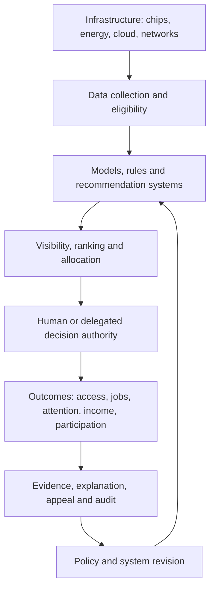
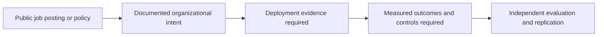

# From Algorithmic Politics to Institutional Decisions | GRI Cross-Sector Research Atlas

**Grand Research Institute | 26 October 2026 | Independent institutional research working paper**  
**Status:** Verified repository crosswalk + documented public-sector evidence + prospective comparative case protocols. This is not evidence that a particular employer uses AI to screen applicants or that a candidate has been evaluated by an algorithm.

## Executive proposition

The AI Governance Paradox is not restricted to elections. Across political communication, government services, hiring, sport and entertainment, education, and mobility, software systems increasingly structure what is **seen**, who is **considered**, what is **ranked**, and which decisions are **authorized**. Their technical performance may improve faster than institutions can explain or contest the effects. The research task is to distinguish genuine organizational benefits from governance failures using verifiable evidence.

**Research architecture:** Infrastructure → Data and access → Model or rule → Ranking / recommendation → Human authorization → Consequences → Contestation → Correction. No arrow is proof of an observed causal effect.

## 1. Evidence-based cross-sector case matrix

| Case | Verified basis | Research opportunity | Critical evidence boundary |
| --- | --- | --- | --- |
| **Political platforms** | [2016–2026 academic evidence review](2026-10-26-algorithmic-politics-decade-evidence-review.md): experiments on exposure, political targeting and persuasion | Compare information allocation with institutional legitimacy and public oversight | Algorithmic exposure does not itself establish vote causation |
| **US Treasury institutional AI** | [Treasury official AI program and January 2026 use-case inventory](https://home.treasury.gov/policy-issues/financial-markets-financial-institutions-and-fiscal-service/treasury-and-artificial-intelligence); [Treasury OIG FY2026 modernization discussion](https://oig.treasury.gov/system/files/2026-02/OIG-26-014-%28508%29.pdf) | Study use-case intake, review, high-impact safeguards, skills and governance maturity | No inference that Treasury uses AI to screen applicants without documented hiring-specific evidence |
| **Treasury bots as managed labor** | [US Bureau of Fiscal Service, *Human Resources for Bots?* (2018)](https://fiscal.treasury.gov/financial-management-solutions/financial-innovation-transformation-fit/blog/human-resources-for-bots) describes process ownership, segregation of duties and capacity management | Compare human and digital-worker authorization and audit requirements | RPA case is not evidence of autonomous LLM-agent deployment |
| **Miami Dolphins / Hard Rock Stadium** | [Senior Director, AI & Emerging Technologies public job description](https://www.linkedin.com/jobs/view/senior-director-ai-emerging-technologies-at-miami-dolphins-and-hard-rock-stadium-4474406639): enterprise AI roadmap, Microsoft Copilot, agents, governance and business value; [Predictive Insights Analyst role](https://www.teamworkonline.com/football-jobs/miami-dolphins-jobs/miami-dolphins/predictive-insights-analyst-job-2195462): pricing, forecasting, CRM scoring, A/B testing | Study public organizational demand for AI leadership, analytics capability and responsible implementation | Job descriptions describe intended responsibilities, **not deployed systems**, hiring outcomes or the identities of selected candidates |
| **Academic integrity** | [GRI executable governance research](../Research-Governance/Academic-Integrity/README.md) | Compare tool-use evidence, permission, disclosure, human review and appeal | Device telemetry or AI assistance alone cannot establish academic misconduct |
| **Mobility and platform work** | [GRI Uber/Lyft observational research](../Algorithmic-Management/Uber-Lyft-Research/README.md) | Compare algorithmic task allocation, income visibility and contestability | Participant observations do not establish internal platform code or intent |
| **Semiconductor and geopolitical infrastructure** | [OECD semiconductor value-chain study (2025)](https://www.oecd.org/en/publications/mapping-the-semiconductor-value-chain_4154cdbf-en.html) | Examine concentrated inputs, trade dependence, infrastructure power and downstream AI availability | No direct election or hiring effect can be inferred from supply-chain concentration |

### Figure A. Shared institutional decision pathway

This is a **conceptual causal map**, not an observed process at Treasury, the Dolphins, or Meta.

## 2. Treasury: separate three institutional questions

**Government AI operations.** Treasury publishes AI inventories, strategy and compliance materials; its OIG describes workforce adoption, enterprise tools and governance development. These are primary institutional sources for what the agency says it is doing, not peer-reviewed impact evaluations.

**AI workforce and recruitment.** Whether Treasury uses automated candidate ranking, resume screening, assessments, or applicant recommendations is a separate empirical question. The public materials cited above do **not** establish such a practice. Future work should examine federal hiring authorities, official agency disclosures, procurement records, impact assessments, and applicant rights; label unverified hypotheses explicitly.

**GRI engineering case.** [Treasury-TTB-Label-Verification](https://github.com/BazeletDave/Treasury-TTB-Label-Verification) preserves an illustrative engineering exercise; [GRI-Institutional-AI-Governance](https://github.com/BazeletDave/GRI-Institutional-AI-Governance) documents the transition into independent research. Neither is a Treasury-deployed service or an official government evaluation.

## 3. Dolphins / Hard Rock: organizational AI adoption versus hiring inference

The public Senior Director role describes a senior leadership mandate: build enterprise AI strategy, coordinate IT and business units, govern Microsoft Copilot and agents, and demonstrate measurable outcomes. The analyst role describes forecasting, pricing, experimentation and customer scoring. These provide a **case of institutional demand for AI capability**, not a verified account of the employer's recruitment technology.

**Prospective study questions:** What skills and governance responsibilities are specified in public job descriptions? Which systems are subsequently disclosed as implemented? Are governance, privacy, fairness, employee training and human review described? Do any lawful, public records substantiate automated recruitment decisions? Do not name purported successful applicants or infer screening from a rejected or accepted application.

### Figure B. Research evidence maturity

A posting supports **intent**; a deployed system requires independent deployment evidence; effectiveness requires outcome evaluation.

## 4. Cross-repository provenance map

| Repository | Verified current role | Integration boundary |
| --- | --- | --- |
| [ConsciousAI](https://github.com/BazeletDave/ConsciousAI) | Central scholarly research, governance methods, academic integrity and dashboard links | Master index; avoid implying all cross-repo software is deployed |
| [GRI-Institutional-AI-Governance](https://github.com/BazeletDave/GRI-Institutional-AI-Governance) | Institutional assurance program evolved from a Treasury exercise | Independent research, not agency endorsement |
| [Treasury-TTB-Label-Verification](https://github.com/BazeletDave/Treasury-TTB-Label-Verification) | Historical AI label-verification prototype materials | Illustrative exercise, not verified federal interviews |
| [from-code-to-consciousness](https://github.com/BazeletDave/from-code-to-consciousness) | Book and conceptual public scholarship on algorithmic power | Conceptual foundation, not independent empirical verification |
| [THE-BACK-DOOR](https://github.com/BazeletDave/THE-BACK-DOOR) | Creative storytelling and interactive work | Fictional narrative kept separate from research evidence |
| [ZERO](https://github.com/BazeletDave/ZERO) | Historical and current research themes, including safety and algorithmic governance | Claims of prior trials or performance require independent source verification |

This map reflects the **README descriptions inspected on October 26, 2026**. It does not claim a full audit of every file, commit, or service in every repository.

## 5. Institutional achievements versus red flags

**Documented accomplishments in this research program:** an openly inspectable research architecture; working academic-integrity governance prototype with explicit evidence limitations; a public governance dashboard linked from ConsciousAI; Treasury-origin engineering exercises reframed as research; a growing academic literature register; and reproducible-research plans. Deployment, validation and scientific publication are separate milestones.

**Governance warning indicators to test rather than assert:** undisclosed automated ranking; inadequate notice or explanation; proxy discrimination; absent human appeal; unclear model ownership; poor provenance; confounding between exposure and persuasion; false-positive AI detection; training/deployment data leakage; unsupported claims of organizational affiliation; concentration of compute or platform access; and systems promoted as validated without independent tests.

## 6. Proposed measurable research program

1. **Institutional adoption dataset:** Collect dated job postings, public AI use-case inventories, and governance disclosures; classify by sector, role, named technology, oversight duties, and evidence maturity. Avoid personal applicant records.
2. **Decision rights audit:** For each case, record decision owner, system type, authorization boundary, human override, appeal path, evidence retention and audit status.
3. **Quantitative visuals:** Plot *counts of documented organizational AI responsibilities by sector*, *evidence-maturity distribution*, and *share of documented use cases with explicit human-review controls* **only after** a complete, cited dataset is assembled. No synthetic metrics presented as institutional facts.
4. **Case comparison:** Use the same governance rubric across political platforms, public administration, enterprise sport, academia, mobility and AI infrastructure. Do not imply the legal duties are identical.
5. **Reproducibility:** Source URL, archived version, date, exact claim, methodology, limitations, reviewer, and change log per entry. Treat independent studies and institution-authored statements differently.

## Research integrity and ethics

No job-application material is evidence of an employer's actual screening process. No personal employment outcome should be used to infer discrimination or AI usage. Do not claim Treasury or Miami Dolphins collaboration, access or endorsement. Respect privacy, intellectual property and licensing. Academic AI assistance must follow course- and task-specific rules, not an assumption that ubiquitous AI automatically permits all assistance.

**Central thesis:** Institutional excellence requires measuring not only what AI makes possible, but who is authorized to act, how decisions are explained, how errors are corrected, and who remains accountable.
