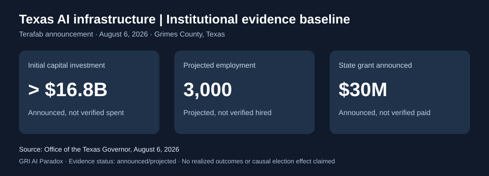
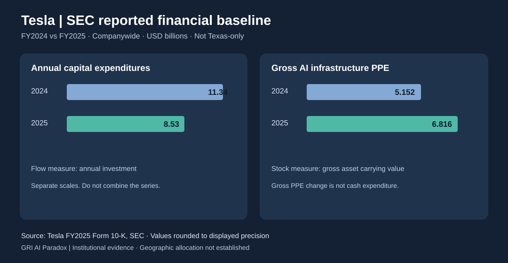

# AI Paradox | Texas AI infrastructure, institutional embeddedness and capital allocation
**Grand Research Institute (GRI) — continuing research record**  
**Author:** David A. Grand | Thunderbird School of Global Management graduate study context  
**Observation baseline:** November 3, 2026 | **Status:** prospective institutional event; outcomes and causal effects not established  
**Research home:** Existing AI Paradox and Integrated Research Journey. **No new research program.**

## Institutional purpose and GRI mission
GRI independently investigates artificial intelligence, algorithmic management, institutional power, global technological development, human decision authority, accountability, contestability and reproducible assurance. This extension asks whether geographically embedded AI infrastructure creates institutional dependencies that conventional technical optimization or initial site selection analysis may inadequately represent. The academic foundation informs independent GRI inquiry; neither Thunderbird, Arizona State University, Dr. Roy C. Nelson nor any case participant is represented as sponsoring, reviewing or endorsing this research.

## Research question
How do political and regulatory transitions affect the prospective economics, governance resilience and capital allocation options of a geographically concentrated but cross-jurisdictional AI industrial ecosystem?

**Event definition:** November 3, 2026, Texas general election, used as a dated institutional observation point, not as a presumed policy shock. Different offices (federal Senate, governor, legislature) possess different legal powers. Election results alone do not demonstrate policy change, adverse treatment or investment effects.

## TAM 505 comparative lens: Intel and subsequent infrastructure investment
The Intel site selection case studied in TAM 505 provides a pedagogical lens for evaluating ex ante location choices: infrastructure, workforce, incentives, logistics, regulation, political institutions, strategic fit and uncertainty. The contemporary Tesla/SpaceX/xAI ecosystem provides a distinct **ex post** question: how should management reassess future allocations after location-specific assets, supplier networks, infrastructure and regulatory relationships have accumulated? The precise Intel case version, Ted Telford's role and specific claims attributed to Dr. Roy C. Nelson require verification against authorized course materials before formal bibliographic citation. No proprietary case content is reproduced here.

**Analytical distinction:** historical sunk expenditure is not itself a relevant incremental cash flow; prospective switching costs, remaining capital requirements, regulatory exposure, real options and expected future returns are relevant. Political alignment and corporate political spending are potential governance variables, not evidence of causal effects or predicted electoral outcomes.

## Geographic and organizational boundaries
* **Tesla:** Gigafactory Texas in the Austin area; verify dated factory capacity, realized capital expenditures, employment and investment commitments from company filings and official records.
* **SpaceX:** Starbase and other Texas facilities; distinguish manufacturing, testing, launch operations and permits, and identify governing federal versus state agencies.
* **xAI/Grok:** Distinguish the AI model and service from physical compute infrastructure. The Colossus compute facility is associated with Memphis, Tennessee, not Texas; do not incorrectly attribute all xAI data center investment to Texas.
* **Semiconductors and energy:** Record each proposed or announced Texas project separately from permitted, under-construction and operational facilities. Distinguish projected expenditure and employment from realized figures.
* **Corporate boundaries:** Do not aggregate investments or political spending across legally distinct firms without explicit ownership, accounting and source justification.

## Testable propositions, not findings
**P1, institutional embeddedness:** greater location-specific investment and infrastructure interdependence can raise the prospective cost of reallocation after institutional change.  
**P2, governance adaptability:** firms with documented multi-jurisdictional contingency planning and transparent policy monitoring may have more options to adapt; this is not yet empirically tested.  
**P3, AI Paradox:** a location optimization system can maximize modeled ex ante economic performance while underrepresenting institutional transition risk, regulatory authority and the costs of irreversible decisions.  
**P4, alternative explanations:** changes in future investment may instead be driven by technology cycles, demand, energy prices, financing, tariffs, supply chains or federal policy, rather than Texas election outcomes.

## Reproducible evidence and visualization specification
Use the existing GRI source registry, evidence maturity taxonomy and independent assurance conventions. For each observation retain: `record_id`, `entity`, `facility`, `jurisdiction`, `event_date`, `observation_date`, `metric`, `value`, `unit`, `status` (announced/committed/realized/operational), `source_title`, `issuer`, `source_url`, `accessed_at`, `document_version`, `confidence`, `reviewer` and `limitations`. Missing values remain missing.

Prospective charts, **only after data validation**:
1. Dated map of verified facilities by legal entity, activity and jurisdiction.
2. Time series of announced commitments versus realized capital expenditure, never plotted as equivalent quantities.
3. Institutional event timeline linking election results, enacted policies, permit actions and independently observed corporate decisions.
4. Scenario sensitivity of incremental NPV to energy, incentives, compliance costs, discount rates and switching costs; label all assumptions.
5. Source and assurance coverage by evidence maturity, with missing-data flags.

No empirical chart, regression, causal claim, automated ingestion, machine learning retraining or dashboard deployment is asserted by this research note. An election event is not automatically a treatment; any causal study must predefine exposure, comparators, lags, confounders and falsification tests.

## Verified academic foundations and case provenance
**Nelson, R. C. (2000).** Intel's site selection decision in Latin America. *Thunderbird International Business Review, 42*(2), 227–249. Publisher DOI: https://doi.org/10.1002/1520-6874(200003/04)42:2%3C227::AID-TIE6%3E3.0.CO;2-4 . Accessible bibliographic record: https://international.vlex.com/vid/intel-s-site-selection-856419813 . The case identifies **Ted Telford as Intel's International Site Selection Analyst**, one of the principal site selection team members. Telford was a case participant, not its author. The study was prepared for classroom discussion; its publication does not constitute an assessment of effective or ineffective management. The case's four-country comparison and internal decision process must be analyzed through licensed materials rather than copied into this public repository.

**Nelson, R. C. (2009).** *Harnessing globalization: The promotion of nontraditional foreign direct investment in Latin America*. Pennsylvania State University Press. https://www.psupress.org/books/titles/978-0-271-03513-0.html . Publisher description documents comparative research on Brazil, Chile and Costa Rica, with attention to investment promotion agencies, institutional autonomy and technocratic independence. This offers a directly relevant institutional bridge from Intel's Latin American site selection to contemporary Texas industrial policy. Do not assert that Nelson evaluated Musk's investments.

**Intel (2026).** *How does Intel determine where to build its offices?* https://www.intel.com/content/www/us/en/support/articles/000092693.html . Intel identifies land and constructability, utilities and transportation, technical workforce, and permitting/investment conditions as contemporary selection criteria. This is a current company methodology statement, not evidence of the specific 1990s case criteria.

**Foundational theory:** North, D. C. (1990). *Institutions, Institutional Change and Economic Performance*. Cambridge University Press; Williamson, O. E. (1985). *The Economic Institutions of Capitalism*. Free Press; Dixit, A. K., & Pindyck, R. S. (1994). *Investment Under Uncertainty*. Princeton University Press. Apply these as analytical lenses, not evidence of observed Texas outcomes.

## Dated Texas primary source and quantitative evidence baseline
**Texas Office of the Governor (August 6, 2026):** https://gov.texas.gov/news/post/governor-abbott-announces-spacex-expansion-in-grimes-county . The state announced a **first phase exceeding $16.8 billion** for SpaceX's proposed Terafab semiconductor plant in Grimes County, **3,000 projected jobs**, and a **$30 million Texas Enterprise Fund grant**; the announcement also identifies eligibility under the JETI program. These figures represent announced project commitments and projected outcomes, **not independently verified realized capital expenditure, employment, or disbursements**. The governor's announcement attributes the location decision to business climate, workforce, infrastructure and logistics. Treat that as the issuer's account, not an independently demonstrated causal ranking.

**Reuters (August 6, 2026):** https://www.investing.com/news/stock-market-news/spacex-says-terafab-to-be-built-in-texas-with-initial-investment-of-168-billion-4842929 . Independent reporting describes the planned combined SpaceX/Tesla investment. Ownership, obligations, cash expenditures and grant conditions require project agreements and audited disclosures before company-level allocation or time-series aggregation.

**Election observation (November 3, 2026):** https://apps.texastribune.org/features/2026/texas-general-election-live-results-2026/ . The Texas Tribune explains the office-specific races and the distinction between live Associated Press calls and final counts. For GRI, retain a baseline record today, then use certified Texas Secretary of State results for any finalized institutional event data. Do not infer policy change or election results from the date alone.

## Chart-ready evidence matrix (source-qualified)
| Date | Entity / jurisdiction | Measure | Value | Unit | Evidence status | Primary source |
| --- | --- | --- | ---: | --- | --- | --- |
| 2026-08-06 | SpaceX / Terafab / Grimes County, TX | First-phase investment announced | 16.8 | USD billions, lower bound | Announced, not spent | Texas Governor |
| 2026-08-06 | SpaceX / Terafab / Grimes County, TX | Jobs projected | 3000 | positions | Projected, not verified hires | Texas Governor |
| 2026-08-06 | SpaceX / Terafab / Grimes County, TX | Texas Enterprise Fund grant announced | 30 | USD millions | Announced, not paid | Texas Governor |
| 2026-11-03 | Texas / statewide | General election observation | NA | event | Outcome pending verification | Texas Secretary of State, pending |

The $16.8 billion is a **lower-bound announcement**, not a measured expenditure. Charts must never depict it as realized spending. No numerical geographic concentration index can be estimated without a defined universe of facilities and comparable asset values.

## Chart specification and verification requirements
1. **Announced project measures:** display the three verified Terafab metrics in separate panels or separate unit-labeled series; do not compare dollars and job counts on one unqualified axis.
2. **Facility geography:** map only independently confirmed sites, with distinct legal entities and project status; mark Memphis compute infrastructure separately from Texas manufacturing.
3. **Institutional timeline:** label November 3 as election date; add certified outcomes, enacted policies and company decisions only as later dated records with source provenance.
4. **Forward-looking scenarios:** use illustrative parameter ranges and explicitly label them hypothetical. Do not present a causal election effect or investment forecast.
5. **Independent reproducibility:** archive source titles, issuers, document versions, accessed dates, source hashes where available, data extraction decisions, uncertainty flags and reviewer signoff. Generate reproducible graphics only from the versioned evidence table, with unit and status checks.

## Governance controls and next observations
Preserve an election-day baseline separately from certified results. After certification, document which offices changed control and their statutory authority; then monitor actual legislative, administrative, incentive and permitting decisions. Record contrary evidence and unchanged policies. Any policy-to-investment association requires explicit competing explanations and human review. Maintain academic independence, protect confidential course materials and GRI intellectual property, and require reproducible evidence before elevating hypotheses to findings.

**Integration:** This record extends existing GRI AI Paradox, institutional governance, Kiongozi/comparative development and independent assurance analysis. It is not a new program, a partisan assessment or a claim of validated causal impact.

### Source-qualified visual exhibit

This descriptive exhibit uses three separate metric cards rather than a common quantitative axis because the measures have different units and evidence status. It does not represent realized spending, employment or grant payments.

## November 3 additional verified SEC and election evidence
**Tesla, Inc., FY2025 Form 10-K (SEC, filed 2026):** https://www.sec.gov/Archives/edgar/data/1318605/000162828026003952/tsla-20251231.htm . SEC disclosure establishes:
* Tesla FY2025 capital expenditure **$8.53 billion**, versus **$11.34 billion** in FY2024, **companywide**, not Texas-specific.
* FY2025 gross property, plant and equipment **AI infrastructure $6.816 billion**, versus **$5.152 billion** at FY2024 year end. These are companywide gross carrying amounts; the difference is **$1.664 billion** in reported balances, not a measure of Texas expenditure or net cash spending.
* Tesla's FY2025 filing forecast **2026 capital expenditure in excess of $20 billion**, companywide. This is management guidance as of filing, not realized FY2026 expenditure; check subsequent quarterly reports for updated guidance and actual spending.
* Tesla identifies its **Cortex** training cluster at Gigafactory Texas and construction of **Cortex 2**. This directly documents Texas AI compute exposure, distinct from xAI's Memphis Colossus.
* Tesla reports a **20-year Travis County agreement (2020)** with grants equivalent to **70–80% of eligible county property taxes paid**, and a **10-year Del Valle Independent School District agreement (2020)** limiting a portion of taxable value, both contingent on economic development requirements. Tesla describes the 2023–2025 property-tax grant funding as immaterial. Review original agreements before inferring future incentives or their treatment under political transition.
* Tesla reports **$430 million revenue** and **$285 million cost of revenues** from 2025 xAI purchases of Megapack products. This is evidence of related-party commercial transactions, not a Texas-only revenue figure.
* Tesla disclosed a **January 2026 agreement to invest approximately $2 billion in xAI preferred stock**. Do not conflate a financial investment with Texas construction expenditure, or infer completion without later filings.
* Tesla identifies its Austin Gigafactory as an owned principal manufacturing facility, while also listing facilities in California, Nevada, New York, Germany and China. This is direct evidence against an all-Texas characterization.

**Official election authority:** Texas Governor's August 10, 2026 general election proclamation, hosted by the Texas Secretary of State: https://www.sos.state.tx.us/elections/forms/proclamation-general-election-2026.pdf . The official election date is November 3, 2026. The Texas Tribune's election results explainer (https://apps.texastribune.org/features/2026/texas-general-election-live-results-2026/) distinguishes Associated Press projections from final certification. As of this morning, no election outcome is entered in the GRI baseline.

### Additional reproducible financial observations
| Period | Reporting entity | Metric | Value | Unit | Classification | Geographic scope | Source |
| --- | --- | --- | ---: | --- | --- | --- | --- |
| FY2024 | Tesla | Capital expenditure | 11.34 | USD billions | Realized | Companywide | SEC 2025 10-K |
| FY2025 | Tesla | Capital expenditure | 8.53 | USD billions | Realized | Companywide | SEC 2025 10-K |
| FY2024 end | Tesla | AI infrastructure, gross PPE | 5.152 | USD billions | Reported balance | Companywide | SEC 2025 10-K |
| FY2025 end | Tesla | AI infrastructure, gross PPE | 6.816 | USD billions | Reported balance | Companywide | SEC 2025 10-K |
| FY2025 | Tesla and xAI | Related-party sales revenue | 430 | USD millions | Realized reported revenue | Not Texas-specific | SEC 2025 10-K |
| FY2025 | Tesla and xAI | Related-party cost of revenue | 285 | USD millions | Realized reported cost | Not Texas-specific | SEC 2025 10-K |
| January 2026 | Tesla and xAI | Preferred equity investment agreement | 2.0 | USD billions approximately | Agreement disclosed | Financial investment, not Texas plant capex | SEC 2025 10-K |
| FY2026 forecast in 2025 10-K | Tesla | Capital expenditure outlook | 20 | USD billions, lower bound | Forward guidance | Companywide | SEC 2025 10-K |

**Interpretive guardrail:** Companywide financials cannot be used to calculate Texas-specific capital concentration without a location-level asset register. Announced Terafab commitments must not be added to Tesla's companywide capital expenditure or xAI equity transactions without accounting for overlap, ownership and realization. Related-party transactions do not demonstrate governance failure. Corporate political activity does not, without further evidence, establish the causes of site selection or investment changes.

### Chart: verified companywide Tesla capital expenditure
The following descriptive chart uses a consistent metric, reporting entity and unit, with SEC FY2025 comparative data. It is not a Texas capital expenditure chart.

| Fiscal year | Capital expenditure, USD billions |
| --- | ---: |
| 2024 | 11.34 |
| 2025 | 8.53 |

### Chart: reported gross AI infrastructure property and equipment
| Year-end | Gross AI infrastructure PPE, USD billions |
| --- | ---: |
| 2024 | 5.152 |
| 2025 | 6.816 |

The two series are **not interchangeable**: annual capital expenditure is a cash-flow-related investment metric, whereas gross AI infrastructure PPE is a stock of recorded assets. The 2025 gross balance is not proof of the amount invested in Texas. 

### SEC financial comparison visualization

This reproducible descriptive graphic preserves the distinction between annual capital expenditures and gross AI infrastructure PPE balances. Neither series identifies Texas-only expenditure.

## Frozen pre-election methodology and dataset

The [November 3 preregistered institutional observation protocol](2026-11-03-texas-institutional-pre-election-protocol.md) freezes the hypotheses, office-specific institutional event definitions, comparison rules, confounders, evidentiary thresholds and planned exhibits before election returns. The [source-qualified machine-readable evidence baseline](texas-ai-infrastructure-pre-election-evidence.csv) contains dated SEC and Texas government observations and a deliberately blank election result. Later observations must be appended with provenance rather than retroactively altering the baseline.

## November 5, 2026 | Ecosystem integration and democratic infrastructure governance

**Status:** Subsequent descriptive extension of the November 3 research record. The frozen observation protocol and original CSV remain unchanged. The additional questions below are exploratory after the election, not retroactively preregistered findings.

### Institutional proposition

David A. Grand's observation concerns the breadth of a Musk associated industrial ecosystem: model development, training compute, inference chips, vehicles, software updates, energy systems, satellite connectivity, and tunneling. The research question is whether coordination across such activities changes institutional dependence and bargaining relationships when public priorities or governing coalitions change. This is a bounded extension of the existing AI Paradox and institutional embeddedness inquiry.

Use the legal entity, reporting period, facility, function, and jurisdiction as the unit of evidence. A shared founder or executive does not establish common legal ownership, unrestricted data sharing, a single integrated technical architecture, or personal ownership of every asset. Document corporate reorganizations and actual contracts before linking obligations or aggregating expenditure. Distinguish chip design, semiconductor fabrication, training, inference, software deployment, and physical transport.

### Source qualified ecosystem observations

| Activity | Primary source and observation | Boundary and next evidence |
| --- | --- | --- |
| Training and vehicle inference | [Tesla FY2025 Form 10-K](https://www.sec.gov/Archives/edgar/data/1318605/000162828026003952/tsla-20251231.htm), Technology and Infrastructure sections, describes custom inference chips, vehicle software updates, Cortex at Gigafactory Texas, and Cortex 2 construction. | Issuer disclosure as of filing. It does not establish every vehicle's hardware version, autonomous capability, model training objectives, or present completion status. |
| Semiconductor production dependencies | The same filing describes a Samsung collaboration for advanced semiconductors. The existing Texas baseline separately records the announced Terafab project. | Designing chips does not establish independent fabrication. A planned factory is not operating capacity; verify supplier contracts, production milestones, and each entity's obligations. |
| Energy and software control | Tesla's filing describes storage products and remotely controlled energy software. | Product functionality and related party transactions do not demonstrate that every training facility uses the same energy system or that one organization controls the grid. |
| Physical interface between businesses | [The Boring Company project page](https://www.boringcompany.com/tunnels) identifies the Austin Cybertunnel at Tesla's factory as operational, and separately lists research tunnels and projects outside Texas. | This is a company reported physical interface. Operating performance, public approvals, and independent safety evidence require separate review. It does not establish a nationwide integrated underground network. |
| Satellite communications | The FCC's [January 9, 2026 announcement](https://docs.fcc.gov/public/attachments/DOC-417881A1.pdf) identifies a Starlink system authorization; [DA 26-36](https://docs.fcc.gov/public/attachments/DA-26-36A1.pdf) is the underlying regulatory record to examine. | Official publication was identified through the FCC index; full order retrieval was unavailable in this review. Authorization, launch, operation, coverage, and integration with other businesses are different claims. No fleet or integration count is entered here. |

The company and regulatory sources establish discrete activities or identify evidence for further review. They do not establish that all layers form one data pipeline, that all infrastructure is in Texas, or that model behavior expresses an executive's political preferences. Training governance requires evidence about data selection, objectives, labeling, feedback, evaluation, and update authority beyond the location or ownership of compute.

### Public opposition and governing authority

[Hinojosa's campaign data center platform](https://ginafortexas.com/priority/data-centers/), reviewed November 5, calls for a moratorium until legislative protections and community participation are established. This is primary evidence of a campaign position. Its accusations, predictions, and claims about other actors remain campaign assertions, not independently established findings. A campaign promise is not an enacted restriction.

[Abbott's August 3 directive announcement](https://gov.texas.gov/news/post/governor-abbott-directs-comprehensive-data-center-audit) states that PUCT and ERCOT should audit projects advancing through grid interconnection before projects move forward. It requests information on incentives, power, water, effects on neighboring communities, and controlling interests. This is evidence of a pre-election governmental response under Republican leadership, not proof of uniform implementation or a new consequence caused by the election. Review the signed directive and agency implementation before coding a binding project level effect.

[Texas Tribune's November 4 reporting](https://www.texastribune.org/2026/11/04/data-center-texas-pause-gina-hinojosa-governor-policies/) supplies secondary context about proposed extensions of restrictions and opposition across political groups. [Business Insider's November 4 headline](https://www.businessinsider.com/elon-musk-midterms-spending-texas-losses-2026-11) is a journalistic interpretation of electoral spending and outcomes, not an institutional impact measure. The [Texas Secretary of State results page](https://electionresults.sos.state.tx.us/results.html), reviewed November 5, reports Hinojosa ahead of Abbott. No certified result artifact was obtained for this extension; retain the existing reported versus certified distinction.

Do not generalize that every winning candidate opposed AI infrastructure, that all opposition targeted Musk, or that data center concerns caused the election outcome. Concerns about electricity costs, water, public subsidies, transparency, local authority, employment, and the distribution of benefits are distinct mechanisms. Requests for conditions or a temporary pause are not equivalent to rejection of AI. Preserve office specific proposals and contrary evidence, including pre-election regulatory activity.

### What happens next: observations rather than predictions

| Institutional step | Evidence needed before recording a consequence |
| --- | --- |
| Electoral transition | Dated office specific returns, certification, assumption of office, and applicable powers |
| Public commitment | Original platform, speech, proposal, or documented consultation; policy status explicit |
| Governing action | Enacted law, signed directive, agency order, budget, executed agreement, or judicial decision with scope and effective date |
| Project exposure | Named entity and facility, permit or interconnection stage, exemptions, contract terms, and responsible authority |
| Corporate response | Dated filing or decision to proceed, adapt, defer, relocate, challenge, or cancel; distinguish plans from execution |
| Measured consequence | Comparable costs, timing, capacity, reliability, employment, environmental measures, and access to remedy, with independent checks |

Potential responses include compliance investment, negotiated operating conditions, alternative siting, litigation, project redesign, or unchanged plans. These are scenarios for observation, not forecasts about any firm. Semiconductor factories, vehicle facilities, data centers, satellite systems, and tunnels have different jurisdictions and permissions; a restriction affecting one cannot automatically be applied to all others.

### Exploratory research questions and counterevidence

1. Does coordination across model, hardware, energy, connectivity, and deployment activities reduce supplier dependence while increasing exposure to shared infrastructure or public authority? Measure actual interfaces and correlated failure pathways before asserting concentration.
2. Do political transitions change documented project conditions, or do similar concerns and controls persist across parties? Include unchanged policies and the pre-election audit as counterevidence to a simple partisan explanation.
3. Do public participation, disclosure, and enforceable cost allocation change approval time, operating conditions, and perceived legitimacy? Measure each separately and avoid assuming that faster approval or stronger opposition is inherently better governance.
4. Does geographical diversification preserve service continuity and capital options after a documented policy change? Control for demand, financing, technology, energy prices, and federal developments.
5. Can institutions independently evaluate model training and deployment decisions where critical technical capacity is concentrated? Ownership maps alone cannot answer questions about training data, objectives, security, fairness, or accountability.

The [AI Paradox ecosystem framework](../institutional-ai-governance-assurance/accelerating-ai-governance-paradox-living-research-framework.md#from-open-source-opportunity-to-national-and-enterprise-ecosystem-control) and [Kiongozi World Bank protocol](../Research-Governance/Institutional-Source-Registry/KIONGOZI_WORLD_BANK_AFRICA_EMPIRICAL_PROTOCOL.md) supply the comparative connection. Countries and enterprises may gain capacity through open models or internal infrastructure while remaining dependent on energy, suppliers, skills, public institutions, and community acceptance. The Texas case permits examination of how those dependencies evolve; it does not yet demonstrate a causal electoral effect or a validated institutional outcome. GRI's analysis remains independent and nonpartisan.

### Comparative continuation: irreversible investment and international platforms

The [existing global infrastructure research](2026-11-03-global-ai-capital-infrastructure-institutional-intelligence.md#november-5-2026--site-selection-cloud-ecosystems-and-international-platform-dependence) extends this Texas inquiry through Nelson's Intel case, asset specificity, prospective switching costs, real options, AWS regional operating arrangements, and PDD/Temu's international corporate and marketplace structure. It also records an indexed FCC notice identifying a January 2026 orbital data center application. This predates the November election, preventing the later political remark from being treated as the origin of that proposal. Full application and subsequent authorization review remain open. The frozen protocol and original baseline are unchanged.

## November 6, 2026 | Evidence maturity review of Texas data center institutional exposure

**Scope:** Bounded continuation of this existing Texas institutional event and AI Paradox research. This section does not establish causal financial losses, realized construction impairment, or independent replication.

### Supported observations

1. **Documented regulatory action:** On September 21, 2026, the Texas Governor directed TCEQ to halt permits sought by data centers pending ERCOT and Texas Water Development Board audits. This is an official executive directive, not a quantified estimate of investment losses. Primary source: https://gov.texas.gov/news/post/governor-abbott-directs-tceq-to-halt-data-center-permits .
2. **Institutional transition and prospective policy:** November 4 reporting documents governor-elect Gina Hinojosa's proposed continuation or expansion of approval restrictions. A campaign proposal is not an enacted future statute or proof of particular project cancellation. Sources: https://www.texastribune.org/2026/11/04/data-center-texas-pause-gina-hinojosa-governor-policies/ ; https://www.reuters.com/world/us/texas-data-centers-face-uncertain-future-after-hinojosa-wins-governors-race-2026-11-04/ .
3. **Infrastructure dependency:** Electricity interconnection, water, permitting, and infrastructure cost allocation are explicit subjects of the Texas state review. The scale of interconnection requests is not equivalent to approved capacity, operational demand, or realized investment. See official governor directive above and ERCOT documentation: https://www.ercot.com/ .
4. **Financial accounting boundary:** A stock market capitalization decline does not equal a corporate cash outflow, realized loss on an AI facility, or project impairment. Historical sunk expenditures are distinct from prospective incremental cash flows and switching costs. The existing Tesla SEC financial table above remains companywide, not a Texas allocation.

### Theoretical propositions retained without promotion to findings

* Institutional transition may change the option value of deferring, staging, or relocating prospective AI infrastructure investment (Dixit and Pindyck); project-level inputs are not yet measured.
* Asset specificity and geographic concentration may increase exposure to regulatory change (Williamson); no verified firm-level concentration ratio or switching-cost estimate is available here.
* Nelson's comparative institutional site-selection scholarship provides an analytical lens, not evidence that he studied the 2026 Texas election or these companies.
* The AI Paradox proposition that compute expansion can outpace governance capacity remains a research hypothesis until institutional capacity and technological development are measured on comparable terms.

### Independent verification still required

| Claim or metric | Evidence needed | Publication rule |
| --- | --- | --- |
| Musk political spending in Texas | FEC filings, recipient committees, dates, beneficiaries, and clear geographic allocation | Do not present a national expenditure as Texas-only |
| November 2026 market value change | Dated security prices, share counts, trading calendars, entity boundaries, and alternative market drivers | Do not attribute the change solely to election outcomes |
| Texas project economic exposure | Permits, ERCOT queue and audit status, project agreements, company disclosures, realized capital spending, and grants actually disbursed | Separate announced, committed, spent, permitted, and operating |
| Policy-caused delay or impairment | Project-level before/after evidence, comparable unaffected projects, contemporaneous company explanations, and rival causes | Do not infer causal effects from temporal sequence |
| Reproducible quantitative exhibits | Versioned source snapshot, extraction log, calculation code, independent reviewer record | Do not label as independently reproduced before replay |

**Interpretation:** The September permit directive is an observed institutional constraint. The November political transition changes the policy uncertainty set, but incremental costs, project delays, financial losses, and investment reallocations remain unmeasured. Distinguish primary observations, issuer statements, third-party reporting, and GRI interpretation. No new project, README promotion, live monitoring, dashboard deployment, or independently certified result is asserted.

### November 6 financial reconstruction and causal audit | Source-qualified addendum

**Political spending reconciliation.** CNN's October 16 reporting of Senate Leadership Fund's Q3 FEC filing identifies Musk receipts of **$75 million on September 9** and **$83 million on September 23, 2026**. Corresponding transfers to Texas PAC of **$75 million on September 10** and **$83 million on September 24** sum to **$158 million**, not $168 million. Source: https://abc17news.com/politics/national-politics/cnn-us-politics/2026/10/16/musk-contributed-more-than-150-million-to-bolster-gop-in-texas-senate-race-filings-show/ . Separately, the Washington Post reported an aggregate **$168 million** Musk donation to Senate Leadership Fund as of October 21, so the $10 million difference must be reconciled to later filings and reporting periods rather than silently attributed to Texas PAC. Source: https://www.washingtonpost.com/politics/2026/10/21/musk-backed-pacs-have-spent-over-400-million-advertising/ . The Associated Press reported at least **$445 million** in 2026 political support on November 6; this is a separately scoped, media-reconstructed total, not an independently reproduced FEC transaction ledger. https://apnews.com/article/2bae8618952e9688a5f33ce422a063a2 . **Status: transaction sequence corroborated by reporting on FEC filings; direct independent FEC record download and complete donor ledger reconciliation outstanding.** Do not add PAC-to-PAC transfers to donor contributions: that would double count flows.

**Market capitalization reconstruction.** A dated Tesla price and share-count table reports November 3 closing price **$398.50**, November 5 **$343.69**, and **3.953 billion** shares outstanding (rounded). Using consistent shares, the Tesla market capitalization change is **(343.69 − 398.50) × 3.953 = −$216.65 billion**, approximate because shares are rounded. Source: https://www.financecharts.com/stocks/TSLA/summary/market-cap . Fortune reports a **$456 billion combined Tesla and SpaceX** market capitalization decrease from November 3 through 5; this is independently *reported*, not independently reproduced from both securities' exchange closing data and precise share counts. Source: https://fortune.com/2026/11/06/elon-musk-midterms-spacex-tesla-stock-drop/ . Fortune also reports approximately **$113 billion** decline in Musk's estimated personal wealth; wealth estimates, corporate market values and cash losses are distinct measures. **Status: Tesla component approximately reproduced using secondary historical data; SpaceX component and combined $456 billion total not independently reproduced from original price/share records.** The difference between Fortune's rounded Tesla capitalization and the secondary data estimate is a source reconciliation issue, not evidence of an additional loss.

**Observed regulatory impact versus project-level economic damage.** The September 21 Texas governor directive halted data center permitting pending audits: https://gov.texas.gov/news/post/governor-abbott-directs-tceq-to-halt-data-center-permits . October 22 reporting identifies a **Sitespan LLC** data center stormwater permit on Bolton Road near San Antonio issued October 13 and subsequently **suspended**; this is a reported project-specific administrative impact, not a measured construction delay, cost overrun, cancellation, or asset impairment. Source: https://www.tpr.org/economy-and-labor/2026-10-22/despite-abbott-moratorium-texas-kept-on-issuing-data-center-permits-now-the-state-agency-is-shutting-down-its-automatic-filing-system . The Texas Tribune reports competing claims about permit processing and agency compliance: https://www.texastribune.org/2026/10/20/data-center-permits-tceq-abbott-texas-pause/ . **Status: regulatory action verified; one reported project-level permit suspension; financial consequences unquantified.** Verify TCEQ docket and company project records before elevating the specific suspension to a primary-source finding.

**Causal inference decision.** The 2026 election preceded the November 4–5 selloff, but the market also experienced a broad AI-sector decline. Reuters describes investor concern about regulatory scrutiny; it does not isolate an election treatment effect. https://www.investing.com/news/stock-market-news/spacex-tesla-extend-losses-as-midterm-results-cloud-data-center-merger-outlook-5005412 . An event study would require security-specific abnormal returns against appropriate factor/sector benchmarks, event timing, confounders, and sensitivity windows. **No quantified causal fraction of the valuation decline can presently be attributed to Musk's donations, the Texas election, or the permitting directive.** The September permit directive predates the election and must not be attributed to the November outcome.

**Publication gate:** This addendum is a documented research verification review, not an independently certified FEC audit, a complete two-security price reconstruction, or a verified project financial loss assessment. Keep all such claims provisional pending original filings, securities data and permit docket reproduction.
