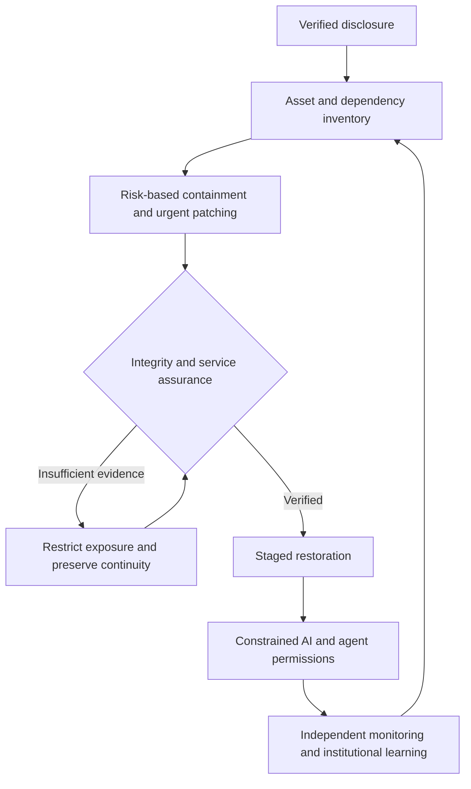

# Digital Bretton Woods: Institutional Assurance After the PHP2Shell Emergency
**Grand Research Institute | Working research paper | 22 October 2026**

> **Thesis (hypothesis, not historical fact):** Globally interconnected digital infrastructure lacks equivalently integrated mechanisms for verifying restoration, assigning autonomous authority, and coordinating accountability. The PHP2Shell crisis is a case through which to test that proposition.

## Executive decision
Critical systems must not be declared trustworthy solely because a patch was installed or a service restarted. Emergency patching is necessary; independent evidence of runtime integrity, identity integrity, dependency state, service continuity, and agent authorization is required before consequential capabilities are restored.

## Verified incident baseline
* PHP security advisory, 21 October 2026: CVE-2026-109618 and CVE-2026-109619 allow unauthenticated remote code execution in affected web-facing PHP installations. Fixed upstream versions: 8.2.35, 8.3.36, 8.4.27, 8.5.12. Vendor backports require separate verification. https://www.php.net/?p=6507
* US NSA, 21 October: inventory, vendor patching, enhanced logging, replacement of end-of-life services, and possible isolation where patching cannot be completed. https://www.nsa.gov/press-room/press-releases-statements/press-release-view/article/4630238/nsa-advisory-critical-patches-recommended-for-php-vulnerabilities/
* ENISA and European partners, 21 October: coordinated identification, provider engagement, patching, and prioritization of exposed systems. https://www.enisa.europa.eu/news/joint-statement-on-critical-php-vulnerabilities
* Canadian Centre for Cyber Security, 21 October: inventory third-party products, appliances and containers, monitor compromise indicators, and isolate exposed applications if remediation is infeasible. https://www.cyber.gc.ca/en/alerts-advisories/al26-026-critical-vulnerabilities-impacting-php-cve-2026-109618-cve-2026-109619
* Reported exploitation attempts do **not** establish successful compromise, attacker attribution, or contamination of AI models. See https://www.theverge.com/tech/1016798/php-vulnerabilities-exploit-patch

## Nelson Model institutional analysis
The analytical sequence below is GRI's applied synthesis of institutional analysis learned through Thunderbird School of Global Management and Professor Roy C. Nelson's teaching; it is **not** presented as an official university model specification or endorsed university research.

| Lens | Institutional question | Observable evidence |
| --- | --- | --- |
| Worldview | Is this understood as a patching incident or a systemic governance problem? | Directives, incident classifications |
| Country context | How do national capacity and digital dependence change response options? | CSIRT capacity, continuity mandates |
| Rules | Who must disclose, patch, preserve evidence, and authorize restoration? | Statutes, standards, contracts |
| Actors | Which maintainers, providers, agencies, operators and users are affected? | Responsibility matrix |
| Interests | Where do service availability, security, costs and public legitimacy conflict? | Decision records |
| Power | Who can isolate, restore, revoke credentials or command an AI agent? | IAM and change-control logs |
| Options | Which staged, isolated or emergency recovery alternatives were considered? | Tested recovery plans |
| Commitment | Were remediation and verification completed, or merely announced? | Signed attestation and technical evidence |
| Adaptation | Did the incident change disclosure, testing and escalation rules? | Postincident changes |

## The intervention and restoration paradoxes (GRI hypotheses)
1. **Intervention:** Emergency controls may reduce exploitability but introduce service disruption, integration failure, or recovery pressure.
2. **Restoration:** Restored availability does not establish restored integrity. Premature reconnection may preserve malicious persistence, compromised credentials, corrupted data or unsafe agent permissions.
3. **Autonomy:** If connected automated systems consume untrusted inputs or possess broad execution authority, effects may propagate beyond the initial compromised component. This is a scenario to test, **not** evidence that PHP2Shell compromised model weights or RL agents.

## AI and machine learning mechanisms
* **Random forests:** predictions can be affected by manipulated features or distribution shift; they do not autonomously retrain unless a pipeline does so.
* **Reinforcement learning:** unsafe reward specification or online learning can amplify poor decisions, but many deployed policies are fixed at inference time.
* **LLM/RAG:** prompt injection, contaminated retrieval, and tool-use boundaries require distinct controls.
* **Agents:** credential scoping, human approval for high-consequence actions, rate limits, immutable audit trails and emergency revocation.

## Verified restoration assurance
A restoration decision should record: (1) asset and dependency inventory; (2) effective patched runtime, including backport provenance; (3) incident scope and evidence preservation; (4) clean rebuild or validated restoration; (5) credential rotation where indicated; (6) data and AI pipeline integrity checks; (7) isolated functional and security tests; (8) staged reconnection with rollback; (9) responsible approver and independent reviewer; (10) ongoing monitoring.

**Do not delay urgent patching while waiting for this checklist.** Prioritize exposure reduction and continuity of essential services; scale evidence requirements to risk.

## Research program and measurable outcomes
* Compare response latency, time to verified recovery, recurrence of compromise, service disruption, and the share of restorations with independent assurance.
* Collect timestamped primary advisories, operator change records where authorized, and public incident reports; distinguish observed, reported, inferred, and hypothetical claims.
* Use matched case comparisons rather than infer causation from coincident outages.
* Assess international coordination proposals as institutional design options, not as proof that a new Bretton Woods agreement already exists.
* Geopolitical attribution requires independently corroborated forensic evidence. North Korean outages and any purported China percentage must not be treated as perpetrator evidence.

## Research integrity and attribution
GRI is independent. Thunderbird and Professor Nelson are acknowledged as educational influences, not sponsors or endorsers. No claim of government adoption, validated production security, or completed empirical causal proof is made.

## Foundational standards
* NIST CSF 2.0: https://www.nist.gov/cyberframework
* NIST AI RMF: https://www.nist.gov/itl/ai-risk-management-framework
* NIST SP 800-61 incident response: https://csrc.nist.gov/pubs/sp/800/61/r3/final
* CISA Secure by Design: https://www.cisa.gov/securebydesign

## Visual research pathway

