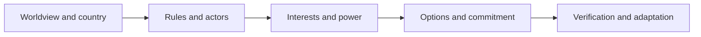

# Digital Bretton Woods | Institutional Recovery Research
**22 October 2026**

[Read the working paper and Nelson Model assessment](./2026-10-22-digital-bretton-woods-institutional-recovery.md)

This independent GRI research examines the PHP2Shell incident as a contemporary case in institutional power, digital interdependence, cybersecurity intervention, and verified restoration. The Digital Bretton Woods analogy is a research hypothesis. No claim is made that the incident caused a universal internet shutdown or that AI systems were compromised.

## Evidence versus hypotheses
| Claim | Classification |
| --- | --- |
| PHP2Shell critical PHP advisories and upstream patches | Verified vendor advisory |
| US, EU and Canadian agency remediation guidance | Verified official guidance |
| Recovery may preserve compromised credentials or contaminated data | Technical risk hypothesis requiring case evidence |
| Connected agents can amplify unauthorized actions if granted permissions | Conditional architectural risk |
| Attribution to North Korea or China | Not established by the cited evidence |

## Decision sequence

## Deliverables
* [Institutional research paper](./2026-10-22-digital-bretton-woods-institutional-recovery.md)
* [Evidence register (CSV)](./2026-10-22-digital-bretton-woods-evidence.csv)
* Charts: Mermaid causal diagrams in this index and paper. Empirical trend charts require validated time series and are not fabricated.

**Academic attribution:** Nelson Model is GRI's applied synthesis of instruction received at Thunderbird; no faculty or university endorsement is implied.
