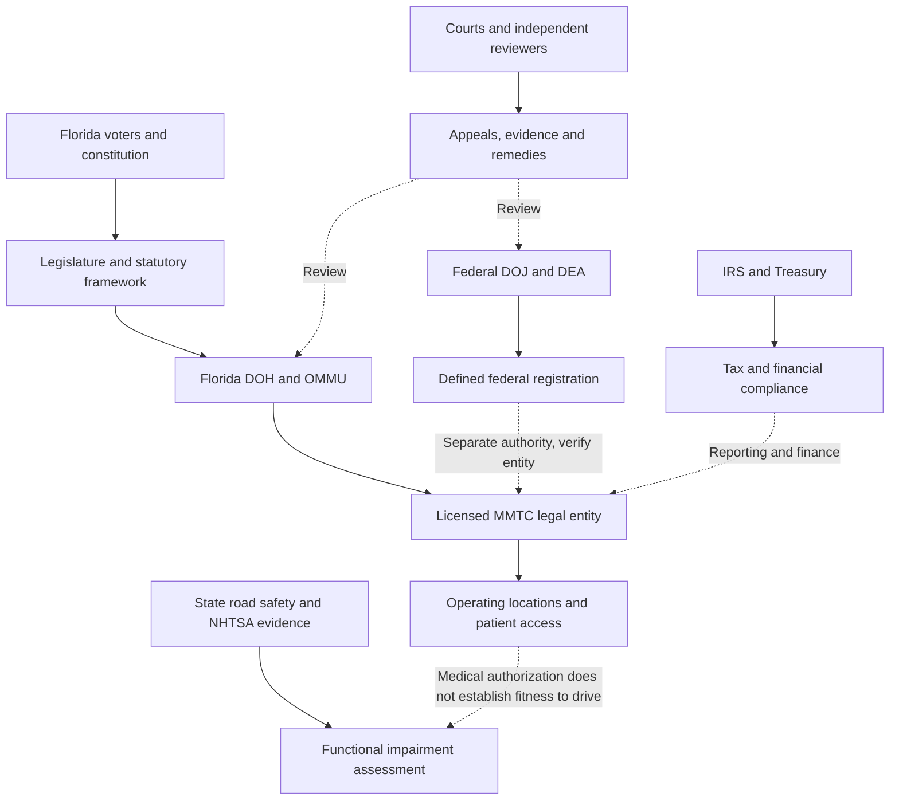

# GRI BZLT Americas FLA Institutional | Reproducible Financial and Governance Exhibits

**Evidence cut:** 31 October 2026. **Scope:** Existing institutional adaptation research, not a new project. **Status:** Public primary source financial and election data verified; historical entity-level Florida license lineage remains an open verification task.

## Exhibit 1. Public issuer revenue, 2024 and 2025

| Issuer | 2024 consolidated revenue (USD millions) | 2025 consolidated revenue (USD millions) | Change |
| --- | ---: | ---: | ---: |
| Trulieve | 1,186.490 | 1,181.180 | -0.45% |
| Curaleaf | 1,334.299 | 1,268.135 | -4.96% |
| Verano | 878.585 | 821.504 | -6.50% |

**Interpretation:** The values are issuer wide consolidated revenue, **not Florida revenue, dispensary sales, medical only revenue, or a combined industry market size**. Changes are arithmetic comparisons, not evidence of a regulatory effect. Curaleaf's reported revenue includes management fee income; use issuer definitions. All three report USD. Source references are recorded for every data row in [evidence CSV](BZLT-Americas-FLA-Institutional-Evidence.csv). SEC annual filings for [Trulieve](https://www.sec.gov/Archives/edgar/data/1754195/000175419526000019/tcnnf-20251231.htm) and [Curaleaf](https://www.sec.gov/Archives/edgar/data/1756770/000175677026000079/curlf-20260805_d2.htm); [Verano full year results](https://investors.verano.com/news-releases/news-release-details/verano-announces-fourth-quarter-and-full-year-2025-financial) (issuer statement, with U.S. GAAP financials). No company is represented as an identified October 2026 DEA registrant.

## Exhibit 2. Florida's 2024 adult use constitutional vote

| Outcome | Certified votes | Share |
| --- | ---: | ---: |
| Yes | 5,950,589 | 55.90% |
| No | 4,693,524 | 44.10% |
| Total | 10,644,113 | 100.00% |

The amendment did not reach the 60% approval threshold. These are **votes**, not estimated customers, patient registrations, recreational sales or compliance outcomes. Source: [Florida Division of Elections official results](https://results.elections.myflorida.com/DetailRpt.Asp?DATAMODE=&DIST=&ELECTIONDATE=11%2F5%2F2024&GRP=&PARTY=&RACE=A03).

## Exhibit 3. Authorized adult use comparator: Colorado 2025

| Measure | 2025 total |
| --- | ---: |
| Medical plus retail marijuana sales | $1,206,869,062 |
| Marijuana tax and fee receipts | $236,449,405 |
| Receipts divided by reported sales (descriptive ratio only) | 19.59% |

[Colorado Department of Revenue, February 19, 2026](https://tax.colorado.gov/press-release/marijuana-sales-generate-over-236m-in-tax-fee-revenue-figures-for-2025). The ratio is **not an effective tax rate**: Colorado's receipts combine several tax bases and fees, including excise taxes on wholesale transfers. Colorado's total includes medical and adult use and is **not comparable to a Florida recreational sales series**, which does not exist as an authorized market.

## Exhibit 4. Institutional authority and assurance flow

The diagram represents **jurisdictional responsibilities and assurance questions**, not confirmed data exchange, active auditing or endorsement.

## Historical license evidence ledger

| Period | Event | Primary source to verify | Current verification status |
| --- | --- | --- | --- |
| 2014 | Limited low THC dispensing organization framework | Florida Laws 2014 chapter 157, historical statute | Statutory framework identified; exact enacted text and eligibility provisions require dated reconciliation |
| 2015 | Five original dispensing organization approvals dated November 23: Hackney Nursery Company (Trulieve), Chestnut Hill Tree Farm (CHT Medical), Knox Nursery (Knox Medical), Alpha Foliage (Surterra), Costa Nursery Farms (Modern Health Concepts) | [Florida DOH 2015 application and award register](https://knowthefactsmmj.com/mmtc/application-process/); [Florida legislative implementation timeline](https://www.leg.state.fl.us/data/committees/Senate/meeting_packets/JAPC20171207.pdf) | **Original license entities and award date verified in government records**; subsequent transfers and present ownership not yet reconciled |
| 2016 | Amendment 2 expands constitutional medical access | Florida certified 2016 election results, amendment text | Constitutional event established; certified vote figures not entered |
| 2017 | MMTC implementing framework and vertical integration | Florida Laws 2017 special session chapter and historical §381.986 | Legal framework established; historical text to reconcile |
| 2021 | *Florigrown* litigation | Florida Supreme Court published opinion | Judicial event identified; operative holdings require citation to opinion text |
| 2024 | Adult use Amendment 3 fails | Florida Division of Elections | Certified vote totals verified |
| 2026 | Federal registration announcement | DOJ original release and DEA registration records | Individual Florida registrants and financial effects **unverified** |

**Historical limitation:** The 2015 legal entities and award date are verified from Florida government records. Later changes of ownership and any link to 2026 federal registrants require separate dated documents; do not infer them from the contemporary brand.

## Reproduction instructions

The accompanying [CSV](BZLT-Americas-FLA-Institutional-Evidence.csv) stores metric, period, reporting scope, units, primary URL and verification note. Run the dependency free [exhibit generator](bzlt_exhibits.py) from this folder to print the two year issuer revenue comparison, ballot share, and Colorado receipts to sales ratio. No network, credentials, personal data, background monitoring or production assurance connection is required.

**Assurance gates:** A01 legal authority, A02 exact entity and license, A03 ownership and reporting perimeter, A04 arithmetic and source reconciliation, A05 public health and impairment distinction, A06 contestability and remedy, A07 independent reproduction. Passing arithmetic checks is not a compliance audit or external certification.
