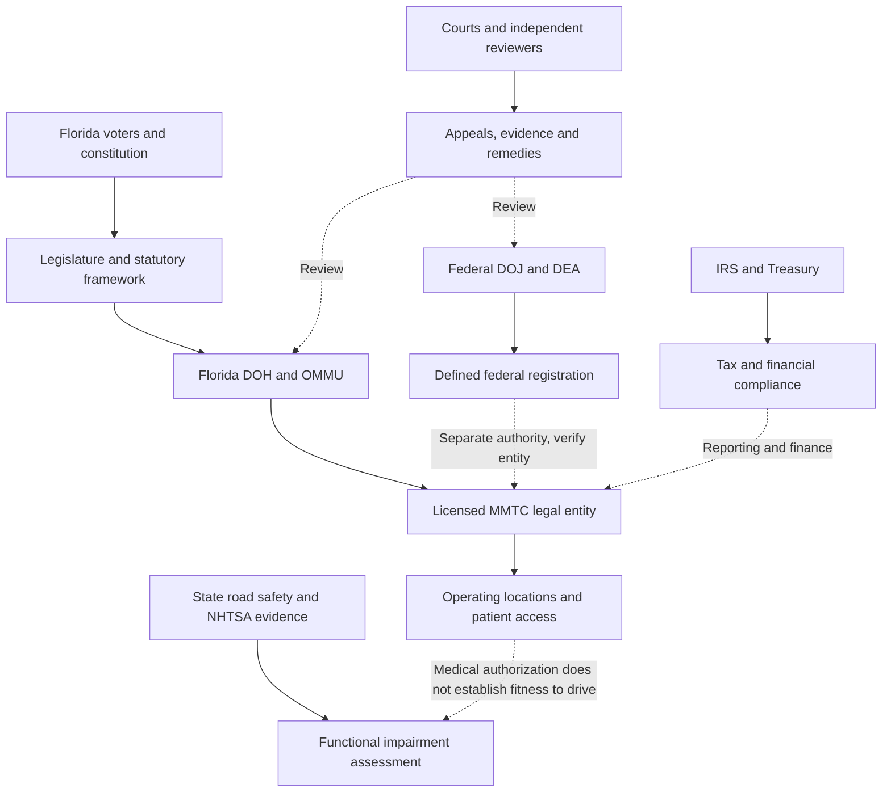
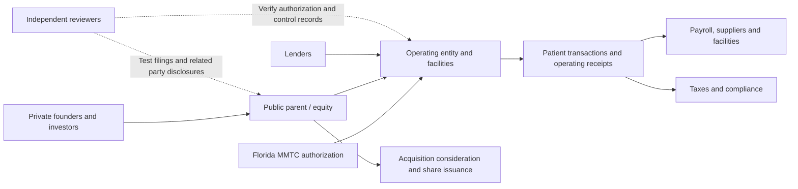

# GRI BZLT Americas FLA Institutional | Reproducible Financial and Governance Exhibits

**Evidence cut:** 31 October 2026. **Scope:** Existing institutional adaptation research, not a new project. **Status:** Public primary source financial and election data verified; historical entity-level Florida license lineage remains an open verification task.

## Exhibit 1. Public issuer revenue, 2024 and 2025

| Issuer | 2024 consolidated revenue (USD millions) | 2025 consolidated revenue (USD millions) | Change |
| --- | ---: | ---: | ---: |
| Trulieve | 1,186.490 | 1,181.180 | -0.45% |
| Curaleaf | 1,334.299 | 1,268.135 | -4.96% |
| Verano | 878.585 | 821.504 | -6.50% |

**Interpretation:** The values are issuer wide consolidated revenue, **not Florida revenue, dispensary sales, medical only revenue, or a combined industry market size**. Changes are arithmetic comparisons, not evidence of a regulatory effect. Curaleaf's reported revenue includes management fee income; use issuer definitions. All three report USD. Source references are recorded for every data row in [evidence CSV](BZLT-Americas-FLA-Institutional-Evidence.csv). SEC annual filings for [Trulieve](https://www.sec.gov/Archives/edgar/data/1754195/000175419526000019/tcnnf-20251231.htm) and [Curaleaf](https://www.sec.gov/Archives/edgar/data/1756770/000175677026000079/curlf-20260805_d2.htm); [Verano full year results](https://investors.verano.com/news-releases/news-release-details/verano-announces-fourth-quarter-and-full-year-2025-financial) (issuer statement, with U.S. GAAP financials). No company is represented as an identified October 2026 DEA registrant.

## Exhibit 2. Florida's 2024 adult use constitutional vote

| Outcome | Certified votes | Share |
| --- | ---: | ---: |
| Yes | 5,950,589 | 55.90% |
| No | 4,693,524 | 44.10% |
| Total | 10,644,113 | 100.00% |

The amendment did not reach the 60% approval threshold. These are **votes**, not estimated customers, patient registrations, recreational sales or compliance outcomes. Source: [Florida Division of Elections official results](https://results.elections.myflorida.com/DetailRpt.Asp?DATAMODE=&DIST=&ELECTIONDATE=11%2F5%2F2024&GRP=&PARTY=&RACE=A03).

## Exhibit 3. Authorized adult use comparator: Colorado 2025

| Measure | 2025 total |
| --- | ---: |
| Medical plus retail marijuana sales | $1,206,869,062 |
| Marijuana tax and fee receipts | $236,449,405 |
| Receipts divided by reported sales (descriptive ratio only) | 19.59% |

[Colorado Department of Revenue, February 19, 2026](https://tax.colorado.gov/press-release/marijuana-sales-generate-over-236m-in-tax-fee-revenue-figures-for-2025). The ratio is **not an effective tax rate**: Colorado's receipts combine several tax bases and fees, including excise taxes on wholesale transfers. Colorado's total includes medical and adult use and is **not comparable to a Florida recreational sales series**, which does not exist as an authorized market.

## Exhibit 4. Institutional authority and assurance flow

The diagram represents **jurisdictional responsibilities and assurance questions**, not confirmed data exchange, active auditing or endorsement.

## Historical license evidence ledger

| Period | Event | Primary source to verify | Current verification status |
| --- | --- | --- | --- |
| 2014 | Limited low THC dispensing organization framework | Florida Laws 2014 chapter 157, historical statute | Statutory framework identified; exact enacted text and eligibility provisions require dated reconciliation |
| 2015 | Five original dispensing organization approvals dated November 23: Hackney Nursery Company (Trulieve), Chestnut Hill Tree Farm (CHT Medical), Knox Nursery (Knox Medical), Alpha Foliage (Surterra), Costa Nursery Farms (Modern Health Concepts) | [Florida DOH 2015 application and award register](https://knowthefactsmmj.com/mmtc/application-process/); [Florida legislative implementation timeline](https://www.leg.state.fl.us/data/committees/Senate/meeting_packets/JAPC20171207.pdf) | **Original license entities and award date verified in government records**; subsequent transfers and present ownership not yet reconciled |
| 2016 | Amendment 2 expands constitutional medical access | Florida certified 2016 election results, amendment text | Constitutional event established; certified vote figures not entered |
| 2017 | MMTC implementing framework and vertical integration | Florida Laws 2017 special session chapter and historical §381.986 | Legal framework established; historical text to reconcile |
| 2021 | *Florigrown* litigation | Florida Supreme Court published opinion | Judicial event identified; operative holdings require citation to opinion text |
| 2024 | Adult use Amendment 3 fails | Florida Division of Elections | Certified vote totals verified |
| 2026 | Federal registration announcement | DOJ original release and DEA registration records | Individual Florida registrants and financial effects **unverified** |

**Historical limitation:** The 2015 legal entities and award date are verified from Florida government records. Later changes of ownership and any link to 2026 federal registrants require separate dated documents; do not infer them from the contemporary brand.

## Reproduction instructions

The accompanying [CSV](BZLT-Americas-FLA-Institutional-Evidence.csv) stores metric, period, reporting scope, units, primary URL and verification note. Run the dependency free [exhibit generator](bzlt_exhibits.py) from this folder to print the two year issuer revenue comparison, ballot share, and Colorado receipts to sales ratio. No network, credentials, personal data, background monitoring or production assurance connection is required.

**Assurance gates:** A01 legal authority, A02 exact entity and license, A03 ownership and reporting perimeter, A04 arithmetic and source reconciliation, A05 public health and impairment distinction, A06 contestability and remedy, A07 independent reproduction. Passing arithmetic checks is not a compliance audit or external certification.

## Exhibit 5. Reconstructed corporate lineage and transaction controls

**3 Boys Farm is not an acquired Verano license.** This distinction is essential to prevent a false ownership graph.

| Date | Documented event | Financial terms or scope | Evidence classification |
| --- | --- | --- | --- |
| July 2018 | Scythian proposed acquiring CannCure, then acquiring 3 Boys Farms | Letter of intent; not evidence of completed closing | [Issuer filing](https://www.sec.gov/Archives/edgar/data/1710138/000149315218010645/ex99-1.htm) |
| October 2018 | Verano announced planned consolidation including 3 Boys Farms | Proposed financing of $120m and contribution structure | [Verano announcement](https://www.globenewswire.com/news-release/2018/10/23/1625281/0/en/Verano-Holdings-Launched-to-Consolidate-National-Cannabis-Assets-with-120-Million-Financing-and-Acquisition-of-Florida-Licenses.html) |
| March 2019 | SOL Global reported Florida DOH approval for transfer involving CannCure / 3 Boys | Approval announcement; completion of share acquisition not established by this announcement alone | [SOL Global release](https://www.prnewswire.com/news-releases/sol-global-announces-receipt-of-approval-for-sale-and-transfer-of-florida-3-boys-farms-operations-and-assets-300809876.html) |
| April 2019 | SOL Global terminated planned sale of 3 Boys Farms to Verano | Proposed $100m in Verano Class B units **not realized as that sale** | [SOL Global termination release](https://www.prnewswire.com/news-releases/sol-global-signs-termination-agreement-with-verano-holdings-over-sale-of-3-boys-farms-300821758.html) |
| April 2021 | Cresco Labs acquired Bluma Wellness, parent of 3 Boys Farm / One Plant | **$238.1m total accounting consideration**; $213m was the January announced equity value; 8 dispensaries at acquisition | [Cresco SEC disclosure](https://www.sec.gov/Archives/edgar/data/1832928/000119312523154406/d505188dex992.htm) |
| 2021 onward | One Plant retail locations rebranded Sunnyside | Brand change; not a new original license | [Cresco SEC annual filing](https://www.sec.gov/Archives/edgar/data/1832928/000183292823000003/cresco-aifx2022.htm) |

**Current entity crosswalk:** 3 Boys Farm, LLC → Bluma Wellness Inc. → Cresco Labs Inc. (2021 acquisition). The Florida [Sunbiz record for 3 Boys Farm LLC](https://search.sunbiz.org/Inquiry/CorporationSearch/SearchResultDetail?aggregateId=flal-l18000037389-eccd45a0-3ddc-43fe-9f4d-fb75f740d326&directionType=ForwardList&inquirytype=EntityName&listNameOrder=3BOYSAGIRLGOURMETINFUSEAPPLESA+L200001657930&searchNameOrder=3BOYSFARM+L180000373890&searchTerm=3B+MANAGEMENT%2C+LLC) identifies Cannabis Cures Investments LLC as manager and Charles Bachtell as CEO in its public filing display. This corroborates a contemporary governance relationship but is not a complete beneficial ownership register.

### Trulieve: Florida nursery origins, Quincy and public capital

* **2015 license lineage:** Hackney Nursery Company was among the original Florida dispensing organization awardees. Trulieve's [2021 SEC prospectus](https://www.sec.gov/Archives/edgar/data/1754195/000119312521032509/d32577d424b3.htm) identifies George Hackney and Thad Beshears as founding participants; distinguish nursery founders, executive officers and external associates. Kim Rivers is the company's chief executive and a central leader, but do not label every named associate a shareholder without an equity record.
* **Quincy facility governance:** A [2020 SEC filing](https://www.sec.gov/Archives/edgar/data/1754195/000095012320012585/filename1.htm) discloses a Quincy cultivation lease with One More Wish LLC, directly or indirectly owned by Kim Rivers, George Hackney and Richard May, with aggregate rents disclosed. This is a **related party disclosure and control testing subject**, not evidence of wrongdoing. Review approval procedures, lease terms, beneficial ownership and independent board review.
* **2018 public listing:** A [2025 SEC registration statement](https://www.sec.gov/Archives/edgar/data/1754195/000162828025033530/trulieve-sx3asr.htm) recounts the September 21, 2018 merger and share exchange through which Trulieve US became a wholly owned subsidiary of the Canadian issuer. Trulieve began CSE trading September 25, 2018. The same filing identifies Quincy as the corporate head office and names material subsidiaries.
* **Harvest Health acquisition:** [May 2021 announced implied equity value](https://www.sec.gov/Archives/edgar/data/1760439/000119312521155596/d61305dex992.htm) was approximately **$2.1bn**; [October 1, 2021 completed consideration](https://www.sec.gov/Archives/edgar/data/1754195/000095017022004989/tcnnf-20211231.htm) was approximately **$1.4bn**, principally equity issued. These are different valuation dates, not conflicting cash purchase prices. The 2021 filing reports 50,921,236 Trulieve shares issued and $13m transaction costs.
* **Tikun Olam:** [Trulieve September 23, 2026 announcement](https://www.trulieve.com/discover/blog/trulieve-welcomes-tikun-olam) describes an **exclusive partnership**, not a purchase of the Tikun Olam company. Licensing terms, royalties and ownership transfer should remain **undisclosed / unverified** unless a definitive agreement or filing establishes them.

### Verano / MÜV: a separate Florida chain

Verano's [2020 merger announcement](https://www.globenewswire.com/news-release/2020/11/11/2124578/0/en/Verano-Holdings-Announces-Agreement-to-Acquire-and-Combine-Operations-with-AltMed-in-Florida-and-Arizona-Creating-One-of-the-Largest-U-S-Private-Cannabis-Companies.html) identifies Alternative Medical Enterprises, Plants of Ruskin and affiliated businesses as the Florida and Arizona combination. Its [2023 annual report](https://www.sec.gov/Archives/edgar/data/1848416/000149315224016980/ars.pdf) describes the February 2021 reverse takeover and subsidiary structure. **Do not join the terminated 3 Boys Farm transaction to the completed AltMed chain.**

### Financial flow assurance

**Transaction arithmetic:** 2021 Cresco / Bluma **$238.1m** and Trulieve / Harvest **~$1.4bn** are completed consideration disclosed in company filings; **$213m** and **~$2.1bn** are earlier announced valuations. They should not be summed as equivalent cash flows. The $100m 3 Boys / Verano proposed units were terminated. For Quincy related party leases, preserve each filing's period and payment units rather than converting or aggregating without reconciliation.

### Federal registration status as of 31 October 2026

The [DOJ October 30 release](https://www.justice.gov/opa/pr/justice-department-announces-issuance-federal-registrations-medical-marijuana-dispensaries) confirms more than 900 registrations across seven states, but **does not identify individual Florida recipients**. DEA's public timely applicant list describes state, activity and control number rather than corporate names, and timely application **does not prove registration**. Secondary counts report 748 Florida dispensary applications, 45 manufacturers and 19 distributors, totaling 812 timely applications; **none of these is a verified Florida approval count**. Until a named DEA registration record or company specific certificate is available, mark Trulieve, Cresco/3 Boys and Verano federal registration status **unknown**.

### Federal change: conditional scenario, not booked financial impact

* **Medical only eligible activity:** For qualifying federally registered operations under the April 2026 order, analyze possible changes to §280E treatment, financing, recordkeeping, inventories and security, subject to actual effective legal and tax guidance.
* **Adult use:** Recreational sales are not authorized by this federal action; a multi-state issuer may need legal entity, activity, inventory and accounting segregation across medical and adult use business lines.
* **Manufacturing and distribution:** DOJ describes additional inspections, production controls and quotas. A registered dispensary does not automatically establish a registered cultivation or manufacturing facility.
* **Sensitivity model:** For a verified eligible segment, a hypothetical deduction benefit is `eligible deductible operating expense × applicable marginal tax rate`, subject to actual tax law, timing, apportionment and taxable income. Do not present this as a realized tax saving, assume a specific rate, or apply it to total company revenue.

### Reproduction status

The public dataset and standard library reproduction logic were executed in a fresh local container on October 31, 2026. Results: Trulieve -0.45%, Curaleaf -4.96%, Verano -6.50% year over year consolidated revenue; Florida 2024 Amendment 3 yes share 55.90%; Colorado receipts to sales descriptive ratio 19.59%. The script's unique metric assertions and ballot threshold assertion passed. **This is a separate execution environment, not independent human attestation or an external audit.** Source row accuracy remains a distinct verification task.

## Exhibit 6. Florida political economy, beneficial ownership and Pigford licensing

**Method:** Analyze persons and organizations only where documentary evidence establishes a defined role. A family relationship, campaign contribution, lobbying registration or commercial association does not by itself establish corruption, improper influence, beneficial ownership or a violation. Record date, capacity, entity, transaction, decision authority, and source for each connection.

### Trulieve, Quincy and Tallahassee: distinguish three records

1. **Corporate leadership and securities:** [Trulieve's investor biography](https://investors.trulieve.com/executive-leadership) identifies Kim Rivers as founder, board chair and CEO since 2015. [Trulieve's 2025 proxy](https://www.sec.gov/Archives/edgar/data/1754195/000175419525000011/trul-20250429.htm) identifies the board's independence assessments. Review super voting rights, board committees and related party transaction approvals in period specific filings.
2. **Real estate and cultivation:** Use the SEC disclosed Quincy lease with One More Wish LLC to trace actual lessor ownership, tenant, land or facility title, rent, and approval. A corporate lease does not alone prove personal title to farmland; county parcel and deed records are required.
3. **Federal public corruption case:** [DOJ's sentencing release](https://www.justice.gov/usao-ndfl/pr/john-thomas-burnette-sentenced-36-months-federal-prison) establishes J.T. Burnette's 2021 conviction and sentence in a Tallahassee public corruption case. [Trulieve's SEC Exhibit 10.17](https://www.sec.gov/Archives/edgar/data/1754195/000119312521007334/d32577dex1017.htm) discloses the historical subpoenas concerning Kim Rivers and states she had not been charged. **Do not attribute Burnette's conviction to Rivers or Trulieve**, or infer that the underlying criminal conduct involved medical marijuana licensing. A defense sentencing memorandum disputed attribution of Trulieve share ownership; resolve beneficial ownership from contemporaneous issuer filings, not prosecutorial or defense assertions alone.

### Black farmer licensing: institutional equality and administrative due process

Florida's Pigford/Black Farmers Litigation pathway is a distinct statutory licensing channel, not a generic minority ownership label. The [2018 Florida Senate summary of HB 6049](https://www.flsenate.gov/Committees/billsummaries/2018/html/6049) records removal of an association membership prerequisite and retention of the five year Florida business requirement. The [official OMMU Pigford application register](https://knowthefactsmmj.com/mmtc/2022-pigford-bfl-mmtc-application-process/) identifies twelve 2022 applications and public redacted files.

[Florida DOH's 2025 legislative licensing presentation](https://www.flsenate.gov/Committees/DownloadMeetingDocument/4072) records **two awards July 11, 2023** and **two awards November 22, 2024**, plus administrative challenges and cure periods. These are **award events**, not proof that all licensees began cultivation or retail operations. The 2023 recipients Terry Donell Gwinn and Shedrick McGriff were independently reported by [Health News Florida](https://health.wusf.usf.edu/health-news-florida/2023-07-24/wait-ends-for-two-black-farmers-who-receive-licenses-to-grow-medical-marijuana). The Moton Hopkins estate and Hatchett Creek litigation illustrates the distinction between applicant scoring, eligibility at decision time, heirs' interests and procedural remedies; review subsequent judicial developments before treating an earlier ruling as final status.

**Assurance tests:** Trace application eligibility and fee schedules by legal version; award and denial dates; scoring and deficiency letters; notice and appeal rights; statutory amendment; ownership and financing; actual cultivation and dispensing authorization. Compare equal treatment and practical access without inferring discrimination solely from a numerical difference. The historical federal Pigford litigation concerned USDA lending discrimination; the Florida cannabis license framework is a **subsequent state policy response**, not the original Pigford settlement itself.

### Political, lobbying and cross state governance register

* **Nikki Fried:** Public role as Florida agriculture commissioner and 2021 critic of the Pigford license fee, reported by [Central Florida Public Media](https://www.cfpublic.org/2021-10-26/ag-commissioner-nikki-fried-says-medical-marijuana-treatment-center-license-application-rules-are-discriminatory). Distinguish advocacy and regulator jurisdiction from the DOH licensing decision.
* **Florida legislature and lobbyists:** Record sponsors, committee votes, agency rulemaking, registered lobbyist principals, contracts and contributions only from Florida Legislature, ethics, lobbying and election databases. No inference of a quid pro quo without specific evidence.
* **Named leads requiring disambiguation:** Jake Bergman, Courtney Coppola and Patricia Nelson. Do **not** attach an ownership, lobbying or regulatory role until an exact identity, legal entity, time period and documentary source are matched. Likewise the user reference to 'Tim Rivers' husband JP' requires correction: the documented CEO is **Kim Rivers** and the DOJ record identifies **John Thomas (J.T.) Burnette**; do not merge distinct persons.
* **Multi state operator comparison:** Florida remains the legal and ownership anchor. For Colorado and California, map each issuer's **state specific licensees, subsidiaries, cultivation/retail authorizations, tax structures and regulator enforcement systems**, rather than assuming a single Florida license extends interstate. Compare medical and adult use operations separately. Interstate commercial presence does not itself prove interstate transfer of regulated product.

**Assurance status:** This exhibit records documentary relationships and statutory pathways; it does not certify beneficial ownership, quantify political influence, or establish that lobbying or family relationships caused a licensing outcome. County land deeds, full ownership ledgers, specific lobbying engagements, new awardee operations and named federal registrations remain open evidence requirements.
