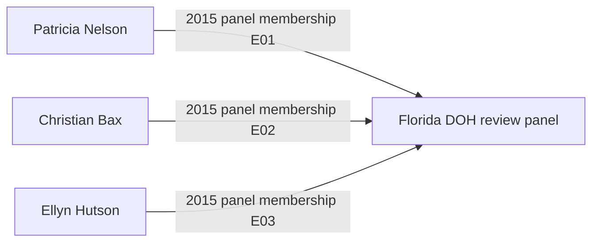
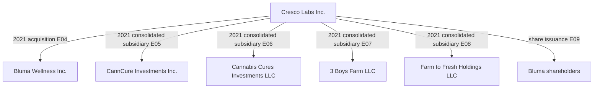
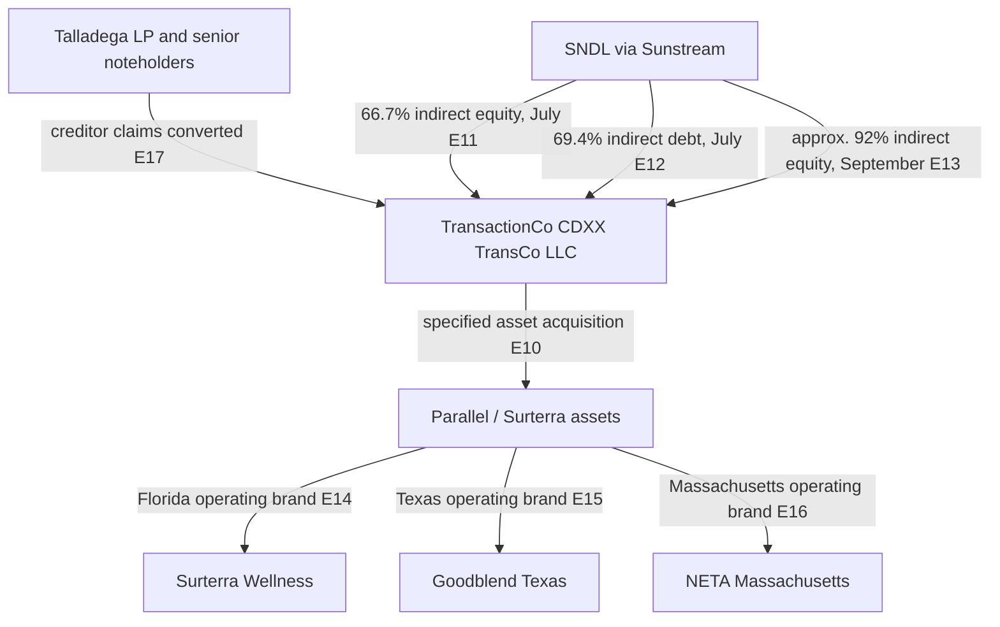
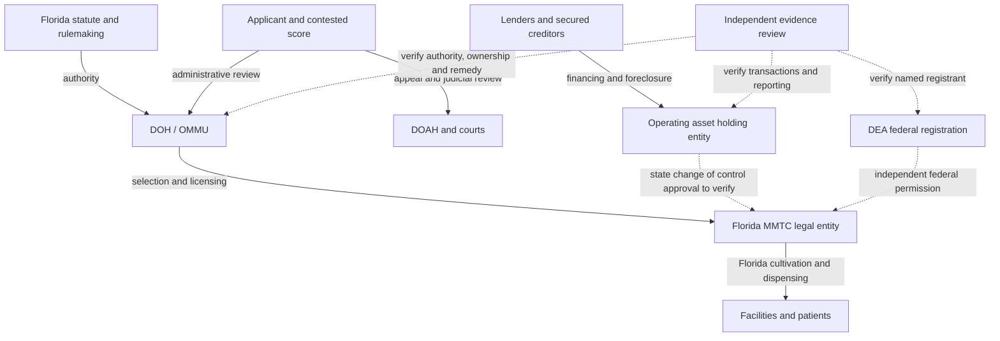

# GRI BZLT Americas FLA Institutional | Dated relationship graph

**Evidence cut:** 31 October 2026. **Status:** Sourced public record network, not a completed beneficial ownership audit. This is an exhibit within the existing institutional research collection.

[Machine readable edge register](BZLT-Dated-Relationships.csv) records `edge_id, effective_date, source_entity, relation, target_entity, edge_type, source_url, evidence_note`. Each edge has a dated, retrievable source. The relationship labels distinguish legal ownership, accounting consolidation, asset transfers, finance, operating brands and government roles. Inferred relationships are omitted.

## Graph A. Florida's 2015 license review authority

**Important source conflict:** The 2015 DOH announcement initially identified Ann Filloon as a panelist, whereas the later administrative proceeding identifies Ellyn Hutson as a scorer. Do not collapse an *announced panel* into an *actual scoring panel*. Reconcile using dated appointment and scoring documents before declaring the complete review history.

## Graph B. 3 Boys Farm and Cresco: accounting control at year end 2021

The year end subsidiary list shows **consolidated ownership**, not the immediate parent of each company. The graph therefore intentionally does **not** draw an unverified direct Bluma to 3 Boys legal ownership edge. The April 2021 transaction issued 15,875,449 Cresco shares in exchange for 184,814,281 Bluma shares.

## Graph C. Parallel / Surterra creditor restructuring in 2026

The July and September percentages are **different as of dates**, not simultaneous ownership percentages. The 2026 restructuring reportedly extinguished approximately $842 million of Parallel debt (E19); this is not cash received by former shareholders. The 2021 $150 million secured loan is recorded separately (E18). A creditor foreclosure does not imply SNDL bought all original Parallel shares.

## Assurance and reproduction rules

1. **Time:** Every edge has an as of date; no assumption that it persists today.
2. **Source:** Every edge ID resolves to a URL and a narrowly described documentary claim in the CSV.
3. **Control:** Consolidated ownership is distinct from immediate legal parent, voting control, beneficial owner, land title, operating brand and regulatory license.
4. **Finance:** Equity share issuance, secured loan, debt extinguishment and asset purchase are distinct financial transactions. Do not add their reported values into a single investment total.
5. **Officials and lobbying:** Government panel membership is not a personal financial relationship. Add lobbying engagements only after a named principal and date are verified from a registration.
6. **Open edges:** Jake Bergmann founder equity percentages; Trulieve and Quincy farm parcels; Kim Rivers related party interests; Courtney Coppola client specific lobbying engagements; Patricia Nelson's final review participation; Pigford licensee ownership; named Florida DEA registrations; and Colorado/California state license subsidiaries all require exact entity/date/source reconciliation. These are **not drawn as facts** in this graph.
7. **Review:** Reproduce by opening each CSV source URL, locating the stated relationship and recording reviewer, review date, document snapshot/hash and exceptions. A cited edge is not automatically independently audited.

**Related exhibits:** [Florida financial, governance and Pigford research](BZLT-Americas-FLA-Institutional-Exhibits.md). No personal data, new service, monitoring pipeline or client information is introduced.

## October 2026 research extension: licensing contestability, creditor governance and federal dual authority

**Evidence cut:** 31 October 2026. Each proposition below distinguishes an official record, issuer disclosure, secondary analysis and a research hypothesis. This is a continuation of the Florida foundation, not a new project.

### Case A. Florida MMTC licensing and contestability

The [Florida OMMU official website](https://knowthefactsmmj.com/) identifies DOH/OMMU as the state authority for medical treatment center licensing, the patient registry and certified testing laboratories. The [Florida administrative rule docket for Rule 64-4.214](https://flrules.org/gateway/ruleNo.asp?id=64-4.214) records a September 11, 2026 proposed rule and a future **November 2, 2026** effective date. **As of this October 31 evidence cut, do not describe that rule as already effective.**

A [May 12, 2026 practitioner analysis](https://vicentellp.com/insights/florida-mmtc-licensing-update-alj-recommends-score-adjustments-for-8-applicants/) describes the 2023 application round, 2024 notices of intent and an administrative law judge's recommended adjustments to eight applicants' scores. This is **secondary interpretation of an administrative proceeding**, not proof of final awards or wrongdoing. Obtain the recommended order, exceptions, DOH final order and subsequent appellate docket before drawing an outcome edge.

**Assurance test BZLT A08:** For each contested applicant, record application ID, original score, disputed rubric section, recommended adjustment, final agency disposition, appellate status, license effective date and actual commencement of operations. Compare the reasons given, appeal opportunity and consistency of treatment. A notice of intent is not an operating license.

### Case B. Creditor restructuring as institutional control

The [July 27, 2026 SNDL issuer release](https://sndl.com/news/news-details/2026/SNDL-Announces-Completion-of-Parallel-Asset-Acquisition-and-Positions-for-Nasdaq-Consolidated-U-S--Medical-Cannabis-Operations/default.aspx) describes specified Parallel operating assets in Florida, Texas and Massachusetts: **43 Surterra Florida dispensaries** and approximately **175,000 square feet** of Florida cultivation and production facilities at that date; ten Texas retail or pickup locations; and three Massachusetts dispensaries. The same issuer reported approximately **US$150 million annualized revenue**, which is a company estimate for the acquired asset platform, **not audited realized annual revenue or Florida revenue**.

The issuer reported a **US$150 million** Talladega secured loan originated May 7, 2021, and approximately **US$842 million** of Parallel debt obligations extinguished in the 2026 restructuring. SNDL cautioned that closing did not immediately consolidate the medical business into its financial statements, because direct control and accounting classification remained subject to further steps. The [SEC filed transaction announcement](https://www.sec.gov/Archives/edgar/data/1766600/000117184326004890/exh_991.htm) identifies SH Parent, Surterra Holdings and CDXX TransCo as transaction parties.

**Assurance test BZLT A09:** Separate loan principal, security interest, creditor priority, foreclosure asset perimeter, acquired equity interests, license transfer/change of control approvals, facility title, issuer accounting perimeter and beneficial owners at each dated step. A reported debt extinguishment is not an equivalent cash acquisition price. No inference that the Florida MMTC license itself changed hands without the regulator's relevant approval record.

### Case C. Federal medical registration and dual compliance

The [October 30, 2026 DOJ announcement](https://www.justice.gov/opa/pr/justice-department-announces-issuance-federal-registrations-medical-marijuana-dispensaries) states more than 900 initial qualifying medical dispensary registrations across seven states, including Florida. It imposes federal registration requirements such as security, inventory controls and recordkeeping; manufacturing and distribution applications undergo additional review. **It does not publish named Florida registrants in the announcement**, and state licensure is not proof of DEA registration. The federal action does not authorize adult use marijuana.

**Assurance test BZLT A10:** Map state legal license holder, facility address, DEA registrant legal name, registration activity, issue and expiry date, federal inventory/security controls and any regulator action. Mark named approvals *unverified* until independently confirmed by a certificate or official registrant record. Model possible tax and capital effects as scenarios only.

### Graph D. Institutional control transitions and assurance gates

Dotted edges are **questions to verify**, not established ownership or registration relationships. The DOAH / court path represents review mechanisms, not a claim that a specific appeal succeeded.

### Research propositions and safeguards

1. **Entry and fairness:** A licensing expansion can create new entry opportunities while still producing disputes over scoring consistency. Test final agency decisions, not practitioner predictions.
2. **Financial control:** Creditor enforcement can materially change economic control of multistate operating assets without a conventional cash share purchase. Test regulatory permissions separately.
3. **Dual sovereignty:** Federal medical registration and Florida medical authorization may overlap but do not substitute for one another. Compare specific compliance duties.
4. **Public value:** Licenses and facility counts do not prove access, clinical outcomes, safety, fair competition or institutional legitimacy. Use outcome denominators and independent evidence.
5. **Data minimization:** Use public corporate, property and regulatory records; do not collect private patient records, unverified personal allegations or confidential operating methods.

**Source provenance:** Florida OMMU and administrative rule docket are official state sources; DOJ is a federal primary source; SNDL and SEC exhibit are issuer disclosures; Vicente LLP is practitioner secondary analysis. No independent human audit is claimed.
