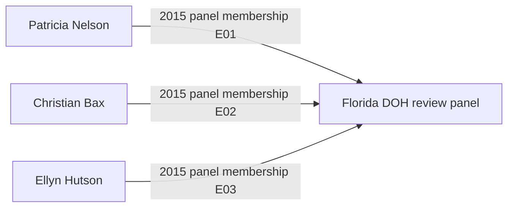
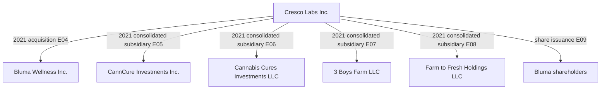
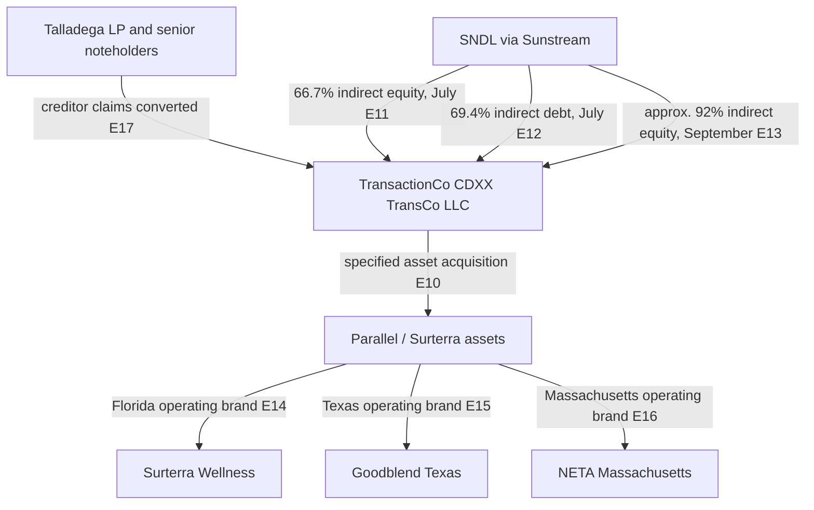

# GRI BZLT Americas FLA Institutional | Dated relationship graph

**Evidence cut:** 31 October 2026. **Status:** Sourced public record network, not a completed beneficial ownership audit. This is an exhibit within the existing institutional research collection.

[Machine readable edge register](BZLT-Dated-Relationships.csv) records `edge_id, effective_date, source_entity, relation, target_entity, edge_type, source_url, evidence_note`. Each edge has a dated, retrievable source. The relationship labels distinguish legal ownership, accounting consolidation, asset transfers, finance, operating brands and government roles. Inferred relationships are omitted.

## Graph A. Florida's 2015 license review authority

**Important source conflict:** The 2015 DOH announcement initially identified Ann Filloon as a panelist, whereas the later administrative proceeding identifies Ellyn Hutson as a scorer. Do not collapse an *announced panel* into an *actual scoring panel*. Reconcile using dated appointment and scoring documents before declaring the complete review history.

## Graph B. 3 Boys Farm and Cresco: accounting control at year end 2021

The year end subsidiary list shows **consolidated ownership**, not the immediate parent of each company. The graph therefore intentionally does **not** draw an unverified direct Bluma to 3 Boys legal ownership edge. The April 2021 transaction issued 15,875,449 Cresco shares in exchange for 184,814,281 Bluma shares.

## Graph C. Parallel / Surterra creditor restructuring in 2026

The July and September percentages are **different as of dates**, not simultaneous ownership percentages. The 2026 restructuring reportedly extinguished approximately $842 million of Parallel debt (E19); this is not cash received by former shareholders. The 2021 $150 million secured loan is recorded separately (E18). A creditor foreclosure does not imply SNDL bought all original Parallel shares.

## Assurance and reproduction rules

1. **Time:** Every edge has an as of date; no assumption that it persists today.
2. **Source:** Every edge ID resolves to a URL and a narrowly described documentary claim in the CSV.
3. **Control:** Consolidated ownership is distinct from immediate legal parent, voting control, beneficial owner, land title, operating brand and regulatory license.
4. **Finance:** Equity share issuance, secured loan, debt extinguishment and asset purchase are distinct financial transactions. Do not add their reported values into a single investment total.
5. **Officials and lobbying:** Government panel membership is not a personal financial relationship. Add lobbying engagements only after a named principal and date are verified from a registration.
6. **Open edges:** Jake Bergmann founder equity percentages; Trulieve and Quincy farm parcels; Kim Rivers related party interests; Courtney Coppola client specific lobbying engagements; Patricia Nelson's final review participation; Pigford licensee ownership; named Florida DEA registrations; and Colorado/California state license subsidiaries all require exact entity/date/source reconciliation. These are **not drawn as facts** in this graph.
7. **Review:** Reproduce by opening each CSV source URL, locating the stated relationship and recording reviewer, review date, document snapshot/hash and exceptions. A cited edge is not automatically independently audited.

**Related exhibits:** [Florida financial, governance and Pigford research](BZLT-Americas-FLA-Institutional-Exhibits.md). No personal data, new service, monitoring pipeline or client information is introduced.
