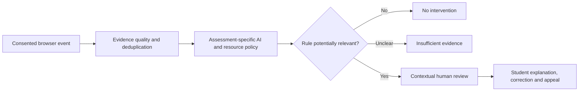

# Academic Integrity and AI-Assisted Learning | Executable Governance Case

**Grand Research Institute | 21 October 2026 | Independent working prototype**

This implementation connects browser telemetry and the user's Python academic-integrity decision model with the [GRI Living Algorithmic Governance research](../../Integrated-Research-Journey/2026-10-21-algorithmic-governance-living-research.md). It asks how schools and universities can **authorize and teach responsible AI use** while maintaining clear assessment rules, fair review and due process.

## Research premise

**A detected browser event is not evidence of cheating by itself.** Paste, copy, tab switching and window blur cannot identify ChatGPT, Gemini or another external application, nor determine whether an action is permitted. Browser DOM events are observational signals, not a misconduct classifier.

## Implemented files

- `integrity.py`: policy-aware decision engine; preserves the five proposed flag categories while withholding warnings, proctor escalation and sanctions on telemetry alone.
- `test_integrity.py`: executable tests covering authorized AI/paste behavior, restricted-resource assessments, missing notice, low confidence and invalid inputs.
- `ExamTelemetryTracker.js`: browser event collector with required notice, no clipboard text capture and explicit cleanup.
- `README.md`: research methods, limitations and institutional implementation guidance.

### Run tests

```bash
cd GRI-Research-Journey/Research-Governance/Academic-Integrity
python -m unittest discover -p 'test_*.py' -v
```

No third-party dependencies are required for the Python model.

## Figure 1. Governance boundary



## Institutional policy model

| Assessment rule | Example | Governance treatment |
| --- | --- | --- |
| AI permitted | Brainstorming, practice, permitted drafting | Do not infer wrongdoing from tool access |
| AI permitted with disclosure | Cite or describe AI assistance | Evaluate disclosure using submission evidence, not tab counts |
| AI restricted | Only specified tools or stages | Provide explicit scope, training and accessible alternatives |
| AI prohibited | Closed-book or unaided assessment | Telemetry may trigger contextual review but cannot establish misconduct |
| Policy unspecified | Ambiguous syllabus or instructions | Clarify policy before adverse inference |

An institution must distinguish **teaching with AI**, **assessing AI literacy**, and **evaluating unaided mastery**. These are different educational objectives and need different, clearly communicated rules.

## Figure 2. Research measurement plan

| Construct | Proposed operational measure | Status |
| --- | --- | --- |
| False suspicion | Authorized events incorrectly sent to review | Defined; not measured |
| Detection fidelity | Observed DOM event matches expected browser behavior | To test |
| Policy consistency | Same inputs and policy yield same outcome | Deterministic implementation |
| Student procedural fairness | Ability to see and contest an adverse interpretation | Requires institutional workflow |
| Accessibility impact | Differential burden from assistive technology | Requires participant research |
| Governance adaptation | Time to revise policy after new AI capability or appeal evidence | Requires longitudinal records |

## Research safeguards

- Give clear advance notice and use a lawful basis for collection; do not treat notice alone as legal consent.
- Minimize event data, protect access, define retention/deletion periods and avoid clipboard content capture.
- Avoid continuous monitoring outside the assessment context; do not use hidden or covert surveillance.
- Provide accessible alternatives and accommodation review.
- Avoid unsupported numerical misconduct probabilities and automatic disciplinary findings.
- Require independent, contextual human review, student response and appeal for consequential decisions.
- Treat FERPA and other applicable educational privacy and data protection obligations as matters for institutional counsel and policy specialists, not claims of compliance by this prototype.

## Academic and research connection

This case extends GRI's algorithmic management research from Uber driving telemetry to educational authority: **observation → inference → institutional policy → review → accountability → adaptation**. The Nelson Model supports analysis of institutional rules and legitimacy. GLOBE offers comparative questions about leadership expectations and authority without stereotyping students. NIST AI RMF supports structured risk management. The prototype is not a university product or an endorsement by any academic institution.

**Status:** Code committed. Execution of the tests, institutional policy approval, actual deployment, real-world effectiveness and compliance review are **not** claimed.
