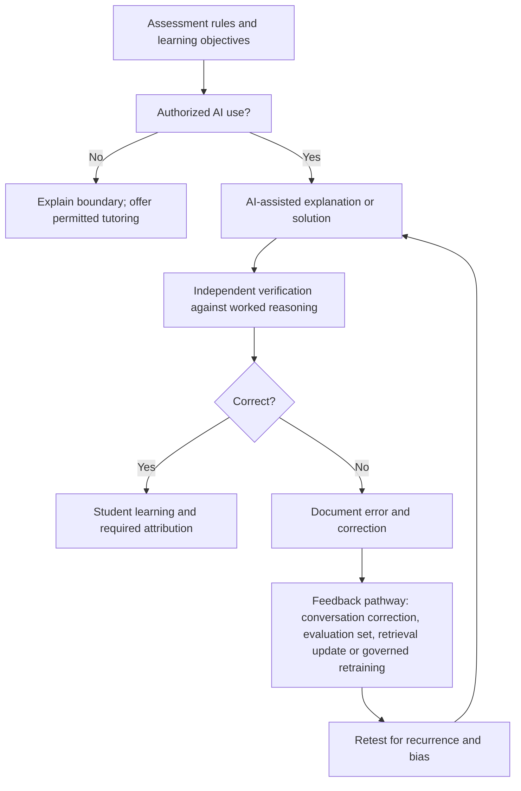
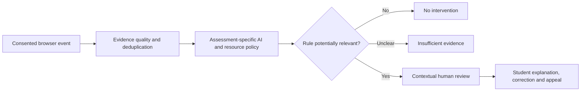

# Academic Integrity and AI-Assisted Learning | Executable Governance Case

**Grand Research Institute | 21 October 2026 | Independent working prototype**

This implementation connects browser telemetry and the user's Python academic-integrity decision model with the [GRI Living Algorithmic Governance research](../../Integrated-Research-Journey/2026-10-21-algorithmic-governance-living-research.md). It asks how schools and universities can **authorize and teach responsible AI use** while maintaining clear assessment rules, fair review and due process.

## Core research case: syllabus-governed AI assistance in graduate education

This is the **primary institutional governance case** in this module; browser telemetry is a secondary, narrower example. Founder David Grand describes an instructional practice developed during Thunderbird graduate coursework, including a class with David Slocum: configuring ChatGPT with the student's academic and research context, explicit ethical commitments, and course-specific instructions so the assistant can support permitted learning while challenging requests that could breach academic integrity. This is a **participant-reported educational practice**, not a claim of a formally deployed university system, a verified faculty-authored protocol, or an institutional endorsement.

### Operational protocol: configure before use

1. **Read the current syllabus and assignment directions.** Extract the instructor's actual AI-use permissions, prohibited assistance, collaboration rules, citation and disclosure requirements, and assessment-specific restrictions. Where rules are silent or ambiguous, request clarification rather than inventing permission.
2. **Establish the academic role and boundaries.** State the user's role as a graduate learner and independent researcher; instruct the assistant to prioritize source fidelity, original student judgment, academic integrity, and institutional codes of ethics. Biographical claims do not create exemptions.
3. **Translate rules into task-level authorization.** Distinguish brainstorming, explanation, practice, source discovery, editing, drafting, answer generation and live assessment assistance. The same AI operation may be permissible in one course or assignment and prohibited in another.
4. **Apply a pre-response policy check.** Before providing potentially consequential assistance, check the task against the relevant rule; when disallowed, explain the boundary and offer permitted conceptual guidance. The assistant's refusal is a safeguard, **not a guarantee** of compliance.
5. **Verify, attribute and disclose.** Students remain responsible for checking factual and numerical claims, using permitted sources, preserving their own reasoning, and making any required AI-use disclosures.
6. **Audit and revise.** When a policy, assignment or tool changes, update the assistant instructions and document the revision. Instructor and institutional policies remain authoritative over a prompt's self-description.

### Illustrative ten-question mathematics case: error propagation and feedback

A high-school student receives ten mathematics questions, asks an AI assistant for answers, submits them, and receives eight correct and two incorrect. **Whether the original AI use violates academic integrity depends on the specific assessment rules.** The two wrong answers expose a second governance issue: a model can produce incorrect output confidently, and neither submission nor a student's silent discovery of the error guarantees a durable correction to the AI system.



**Learning mechanisms must not be conflated:**

| Feedback mechanism | What it can change | What it does not establish |
| --- | --- | --- |
| Correcting an answer in the current conversation | Subsequent reasoning within the available context | That the foundation model's weights changed |
| Recording a verified error in an evaluation dataset | Future testing and failure-rate analysis | That the production model automatically improved |
| Updating an approved retrieval source or course knowledge base | Information supplied to future authorized responses | That every model response will use it correctly |
| Governed fine-tuning or retraining | Model behavior after a separate training and deployment process | That all errors, bias or distribution shifts are eliminated |

### Institutional excellence and algorithmic management

The institution manages the full cycle: **academic policy → student and faculty instruction → AI authorization → educational activity → error detection → review and appeal → verified feedback → policy adaptation**. This connects classroom AI use with GRI's broader research on algorithmic management, the Nelson Model, organizational authority, human oversight, and legitimacy.

The objective is not to treat all AI assistance as misconduct. It is to make permissible assistance clear, preserve unaided assessment where required, improve AI literacy, and establish accountability when tools or rules fail. Instructors retain authority over their own assignments; student rights, accessibility and due process remain essential.

**Research maturity:** The classroom configuration is a reported practitioner case; the Python policy engine and JavaScript collector are committed prototypes; the ten-question scenario is illustrative unless original assessment records are provided. No longitudinal educational outcome or model-retraining effect is claimed.

## Research premise

**A detected browser event is not evidence of cheating by itself.** Paste, copy, tab switching and window blur cannot identify ChatGPT, Gemini or another external application, nor determine whether an action is permitted. Browser DOM events are observational signals, not a misconduct classifier.

## Implemented files

- `integrity.py`: policy-aware decision engine; preserves the five proposed flag categories while withholding warnings, proctor escalation and sanctions on telemetry alone.
- `test_integrity.py`: executable tests covering authorized AI/paste behavior, restricted-resource assessments, missing notice, low confidence and invalid inputs.
- `ExamTelemetryTracker.js`: browser event collector with required notice, no clipboard text capture and explicit cleanup.
- `README.md`: research methods, limitations and institutional implementation guidance.

### Run tests

```bash
cd GRI-Research-Journey/Research-Governance/Academic-Integrity
python -m unittest discover -p 'test_*.py' -v
```

No third-party dependencies are required for the Python model.

## Figure 1. Governance boundary



## Institutional policy model

| Assessment rule | Example | Governance treatment |
| --- | --- | --- |
| AI permitted | Brainstorming, practice, permitted drafting | Do not infer wrongdoing from tool access |
| AI permitted with disclosure | Cite or describe AI assistance | Evaluate disclosure using submission evidence, not tab counts |
| AI restricted | Only specified tools or stages | Provide explicit scope, training and accessible alternatives |
| AI prohibited | Closed-book or unaided assessment | Telemetry may trigger contextual review but cannot establish misconduct |
| Policy unspecified | Ambiguous syllabus or instructions | Clarify policy before adverse inference |

An institution must distinguish **teaching with AI**, **assessing AI literacy**, and **evaluating unaided mastery**. These are different educational objectives and need different, clearly communicated rules.

## Figure 2. Research measurement plan

| Construct | Proposed operational measure | Status |
| --- | --- | --- |
| False suspicion | Authorized events incorrectly sent to review | Defined; not measured |
| Detection fidelity | Observed DOM event matches expected browser behavior | To test |
| Policy consistency | Same inputs and policy yield same outcome | Deterministic implementation |
| Student procedural fairness | Ability to see and contest an adverse interpretation | Requires institutional workflow |
| Accessibility impact | Differential burden from assistive technology | Requires participant research |
| Governance adaptation | Time to revise policy after new AI capability or appeal evidence | Requires longitudinal records |

## Research safeguards

- Give clear advance notice and use a lawful basis for collection; do not treat notice alone as legal consent.
- Minimize event data, protect access, define retention/deletion periods and avoid clipboard content capture.
- Avoid continuous monitoring outside the assessment context; do not use hidden or covert surveillance.
- Provide accessible alternatives and accommodation review.
- Avoid unsupported numerical misconduct probabilities and automatic disciplinary findings.
- Require independent, contextual human review, student response and appeal for consequential decisions.
- Treat FERPA and other applicable educational privacy and data protection obligations as matters for institutional counsel and policy specialists, not claims of compliance by this prototype.

## Academic and research connection

This case extends GRI's algorithmic management research from Uber driving telemetry to educational authority: **observation → inference → institutional policy → review → accountability → adaptation**. The Nelson Model supports analysis of institutional rules and legitimacy. GLOBE offers comparative questions about leadership expectations and authority without stereotyping students. NIST AI RMF supports structured risk management. The prototype is not a university product or an endorsement by any academic institution.

**Status:** Code committed. Execution of the tests, institutional policy approval, actual deployment, real-world effectiveness and compliance review are **not** claimed.
