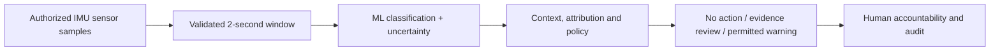

# IMU Motion Classification | Reproducible Synthetic Research

**Grand Research Institute | 21 October 2026 | Research prototype**

This module extends [Executable Governance](../Executable-Governance/README.md) and [Academic Integrity](../Academic-Integrity/README.md) with an offline, three-class accelerometer/gyroscope classifier. It demonstrates how *sensor inference* can be separated from *institutional decision authority*. It is not Uber source code, not an iPhone monitoring application, and not a validated detector of student or driver behavior.

## What was implemented

- Six-axis, 2-second IMU windows at **50 Hz** (100 samples).
- Eleven features including acceleration/rotation magnitude, variance, dynamic energy and actual FFT band power.
- Reproducible synthetic data generation for idle, brief bump and sustained handling-like patterns.
- Random Forest with cross-validated sigmoid calibration; model scores still require out-of-sample calibration assessment.
- Stratified synthetic holdout, classification report and confusion matrix.
- Unit tests for deterministic generation, feature validation and training/inference.

```bash
cd GRI-Research-Journey/Research-Governance/Motion-Classification
python -m pip install -r requirements.txt
python -m unittest discover -p 'test_*.py' -v
python motion_classifier.py
```

**Important limitation:** Simulated classes have deliberately distinctive distributions. A high holdout score can indicate that the model recognizes the *simulator's assumptions*, not that it identifies real-world handling. The demonstration does not include subject, device, orientation, vehicle vibration, accessibility, or cross-session validation. The train/test split is synthetic only.

## Governance boundary



**No automatic accusations or sanctions.** Motion classification cannot identify the actor, intention, use of ChatGPT or Gemini, cheating, texting, or any specific application. The classifier's confidence is not a probability of misconduct. Connecting to the policy engine requires a separately reviewed adapter that maps evidence into a context-specific authorized decision.

## Research questions

1. How does classifier calibration change across devices, participants and contexts?
2. How do false-positive rates change when phone orientation and environmental vibrations vary?
3. When does a correct sensor classification become an unjustified institutional inference?
4. Can executable governance prevent high-confidence but contextually invalid interventions?

For real-world research: secure informed participation, pre-register evaluation metrics, split by participant/device/session, independently label ground truth, assess calibration and subgroup performance, and conduct appropriate privacy and ethics review.

[Living Algorithmic Governance research](../../Integrated-Research-Journey/2026-10-21-algorithmic-governance-living-research.md)
