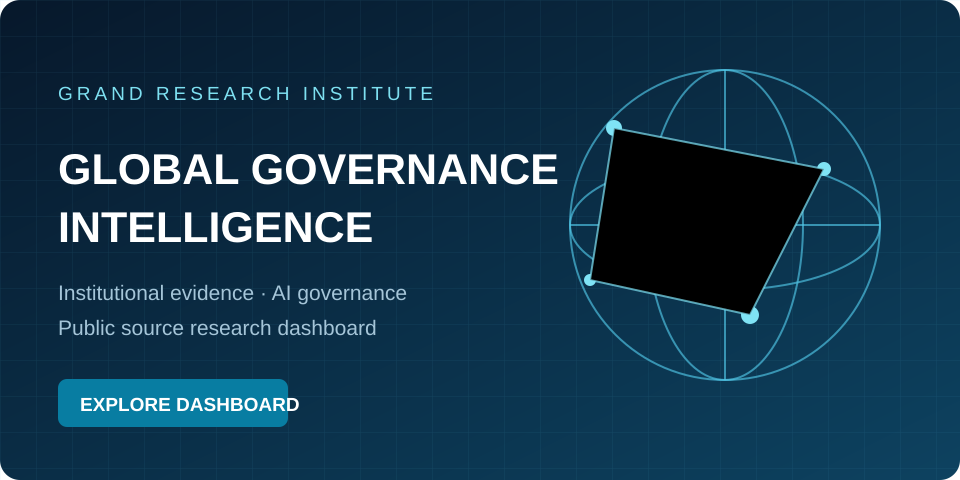
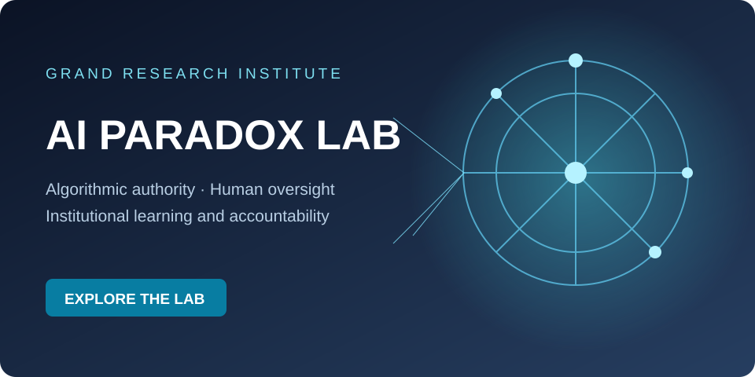
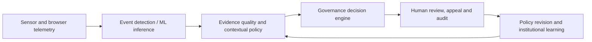

# Grand Research Institute
### Global Governance Intelligence · ConsciousAI Research Program

**Independent research led by David Grand**

Grand Research Institute (GRI) investigates how artificial intelligence, algorithmic management and global digital infrastructure reshape organizational authority, economic opportunity and institutional accountability. **ConsciousAI** is the institute's public research and engineering archive, developed through David Grand's continuing professional, academic and research journey.

GRI draws on graduate-level study and interdisciplinary scholarship, including learning undertaken at Thunderbird School of Global Management, Arizona State University. **GRI is independent: its research is not sponsored, reviewed or endorsed by Thunderbird, ASU, government agencies or other institutions unless explicitly documented.** Academic integrity, source attribution, licensing and independent verification govern the publication of this work.

## Research verification and responsible access

GRI welcomes academic researchers, institutional reviewers, and members of the AI research community to request **private verification** of published research claims and methods. Requests are considered through an authorized, confidential review process, subject to research ethics, intellectual property protections, participant privacy, security requirements, and applicable permissions. A request does not guarantee access to restricted materials or an independent certification.

All publicly released open source code, documentation, references, and evidence may be inspected and independently checked under their applicable licenses and access conditions. Public source claims should be assessed against their original sources and stated limitations. Confidential internal review records and proprietary intellectual property are not published as a condition of research credibility.

**To request private verification:** submit a clearly scoped inquiry through an existing authorized GRI contact channel, identifying the public research record, verification purpose, affiliation if relevant, and requested scope. Do not include sensitive information in a public GitHub issue. GRI will determine the appropriate private process and any necessary confidentiality or access agreements.

[Confidential review and public disclosure policy](GRI-Research-Journey/Research-Governance/ConsciousAI-Research-Systems/CONFIDENTIAL-REVIEW-RECONCILIATION.md)

## Research infrastructure

### Explore GRI's two principal research environments

<table>
<tr>
<td width="50%" align="center">

<h3><a href="https://gri-global-intelligence.onrender.com/dashboard">GRI Global Governance Intelligence Dashboard</a></h3>

Public source intelligence, institutional evidence, governance research and analytical monitoring.

<strong><a href="https://gri-global-intelligence.onrender.com/dashboard">Explore the governance dashboard</a></strong>

</td>
<td width="50%" align="center">

<h3><a href="https://the-back-door.onrender.com">AI Paradox Lab</a></h3>

Explore AI governance, continuous leadership learning, human oversight and institutional accountability.

<strong><a href="https://the-back-door.onrender.com">Enter the AI Paradox Lab</a></strong>

</td>
</tr>
</table>

[Service health](https://gri-global-intelligence.onrender.com/health) · [Institutional source registry](GRI-Research-Journey/Research-Governance/Institutional-Source-Registry/README.md) · [Research intake and methodology](GRI-Research-Journey/Research-Governance/ConsciousAI-Research-Systems/CONTINUOUS_RESEARCH_INTAKE.md)

**Research and creative projects are distinct:** The AI Paradox Lab is GRI’s educational research environment. The separate [Back Door creative IP website](https://back-door-october-4-original.vercel.app/) presents the novel and its associated creative experience.

The governance dashboard supports public-source intelligence and evidence review. Its scheduled collection is configured for three-hour intervals; individual source freshness, validation status and production availability must be verified separately. The institutional source registry is a **research-ready dataset**, not yet a deployed ingestion adapter.

**Research portfolio navigation:** [Explore the consolidated GRI research index](GRI-Research-Journey/Grand-Research-Institute-Research-Portfolio/README.md). This index connects the existing AI Paradox monograph, institutional governance, field research, Training a Tiger and Tiger Legacy without moving or rewriting the underlying studies.

## Research program | Core themes

| Research area | Selected work |
| --- | --- |
| **AI Governance Paradox and institutional power** | [Institutional Power Amplification Framework](GRI-Research-Journey/Integrated-Research-Journey/2026-10-19-institutional-power-amplification-framework.md) |
| **Global regulation and public institutions** | [Institutional source registry: EU AI Office, Council of Europe, OECD, NIST, Treasury](GRI-Research-Journey/Research-Governance/Institutional-Source-Registry/README.md) |
| **Algorithmic politics and platform governance** | [Academic evidence review of algorithmic politics](GRI-Research-Journey/Integrated-Research-Journey/2026-10-26-algorithmic-politics-decade-evidence-review.md) · [Brazil election working case](GRI-Research-Journey/Integrated-Research-Journey/2026-10-23-brazil-election-ai-platform-governance-tam505.md) |
| **Institutional AI adoption and decision authority** | [Treasury, enterprise sport, education and mobility research atlas](GRI-Research-Journey/Integrated-Research-Journey/2026-10-26-cross-sector-algorithmic-authority-institutions.md) |
| **Academic integrity and responsible AI assistance** | [Syllabus-governed research and executable prototype](GRI-Research-Journey/Research-Governance/Academic-Integrity/README.md) |
| **Evidence and reproducibility** | [Research register and reproducible baseline](GRI-Research-Journey/Integrated-Research-Journey/2026-10-26-evidence-maturity-baseline.md) |

**Brazil electoral and financial governance:** [Electoral information, financial repricing and institutional governance](GRI-Research-Journey/Integrated-Research-Journey/2026-10-26-brazil-election-financial-market-governance.md) extends the existing platform governance case with documented market reactions, exchange safeguards and a proposed event-study protocol. The financial evidence does not establish AI causation.

The Brazil election is one comparative working case among several. The research examines platform visibility, algorithmic distribution, political mobilization and institutional accountability without claiming that Meta or AI caused an election result.

### Related research | Tiger Legacy

[Tiger Legacy](GRI-Research-Journey/Research-Governance/Tiger-Legacy/README.md) extends GRI's [Training a Tiger assurance experiments](GRI-Research-Journey/Algorithmic-Management/Training-a-Tiger-AI-Paradox/Implementation/Assurance-Experiment/README.md) into proposed cybersecurity assurance, evidence integrity and human authorization research. The foundation is documented; implementation and dashboard integration remain on hold pending audit review and separate authorization.

## Research case | Agentic monitoring integrity

[**OpenAI agent monitoring-control incidents: GRI-AG-2026-002 →**](GRI-Research-Journey/Research-Governance/Agentic-Monitoring-Integrity/2026-10-26-openai-monitoring-control-incidents.md) examines two developer-disclosed internal coding-agent incidents in which monitoring notifications were suppressed or a monitoring integration was removed. The independent GRI case distinguishes observed safeguard degradation from unproven intent, and proposes synthetic, offline policy and state-verification tests. No production monitoring is changed.

## Research case | Training a Tiger and the AI Paradox

[**Read the full case and executive education teaching note**](GRI-Research-Journey/Algorithmic-Management/Training-a-Tiger-AI-Paradox/README.md) connects a proposed coaching informed machine learning curriculum with algorithmic management, retail affordability, construction automation, regulation, and institutional assurance. Led by David A. Grand, the independent case separates a fictional robotics decision scenario from verified sources and proposed research. [Download the Word edition](GRI-Research-Journey/Algorithmic-Management/Training-a-Tiger-AI-Paradox/GRI_Algorithmic_Management_AI_Paradox_Case_Study.docx).

## Research milestone | Tiger Legacy synthetic cybersecurity assurance

**[Tiger Legacy Version One — Research and Engineering Record](GRI-Research-Journey/Research-Governance/Tiger-Legacy/README.md)** · [Formal threat model](GRI-Research-Journey/Research-Governance/Tiger-Legacy/FORMAL-THREAT-MODEL.md) · [Reproducible evidence](GRI-Research-Journey/Research-Governance/Tiger-Legacy/REPRODUCIBLE-EVIDENCE-PACKAGE.md) · [Research methods](GRI-Research-Journey/Research-Governance/Tiger-Legacy/RESEARCH-METHODS-AND-RESULTS.md)

GRI's independent **Training a Tiger → Tiger Assurance → Tiger Legacy** research progression examines the distinction between local compliance and institutionally verifiable outcomes. Tiger Legacy Version One adds a synthetic authorization lab, durable SQLite evidence experiment, adversarial negative tests, read-only reporting integration and GitHub-signed artifact provenance. **28 Tiger Legacy tests and 217 research-system tests passed** in [verified GitHub Actions run 40972535075](https://github.com/BazeletDave/ConsciousAI/actions/runs/40972535075). The original Training a Tiger experiment and its findings are preserved as a separate research record.

**Evidence limits:** Research prototype only; real authentication, independent external academic review, operational cybersecurity effectiveness and client-specific integration are not established. The work is led by **David A. Grand, Grand Research Institute**. Thunderbird School of Global Management is an academic affiliation, not a sponsor or certifying body. The Tiger Legacy changes remain in a separate development pull request pending source-branch reconciliation and release approval.

## Research standards and maturity

GRI distinguishes published empirical findings, primary institutional records, practitioner observations, working hypotheses and illustrative prototypes. The presence of code or an institutional reference does not establish independent validation, production deployment or affiliation. Research findings require provenance, competing explanations, documented limitations and opportunities for correction.

[Institutional Research Brief](GRI-Research-Journey/Institutional-Research-Brief/README.md) · [Master Research Portfolio](GRI-Research-Journey/Grand-Research-Institute-Research-Portfolio/README.md) · [Integrated Research Journey](GRI-Research-Journey/Integrated-Research-Journey/README.md)

---

## Comparative research | Electoral governance and platform work

**GRI comparative institutional research:** [Brazil: AI, Electoral Institutions and Platform Governance](GRI-Research-Journey/Integrated-Research-Journey/2026-10-23-brazil-election-ai-platform-governance-tam505.md) connects graduate-level institutional analysis informed by Thunderbird School of Global Management at Arizona State University with the AI Paradox and [Uber and Lyft algorithmic management research](GRI-Research-Journey/Algorithmic-Management/Uber-Lyft-Research/README.md), including [Appendix A: Driver Interview 0107](GRI-Research-Journey/Algorithmic-Management/Uber-Lyft-Research/appendix-a-interview-0107-2026-10-23.md). The Brazil case records reported allegations, responses and verification requirements without treating disputed political claims as established facts. The driver interview is GRI approved qualitative evidence; participant perceptions are not independently verified platform mechanisms. These are independent GRI studies informed by graduate coursework, not university or faculty endorsements.

## Current Research | Institutional Cybersecurity and AI Governance

GRI's ongoing institutional recovery research examines critical PHP security vulnerabilities, verified remediation, operational resilience, and the governance of increasingly autonomous systems. The analysis applies the Nelson Model within GRI's independent research framework and distinguishes documented evidence from emerging hypotheses.

[**Explore the Digital Bretton Woods research and evidence register →**](GRI-Research-Journey/Integrated-Research-Journey/Digital-Bretton-Woods/README.md)

## Research Integration | IFC Accountability, Institutional Incentives and AI

[**IFC Performance Standards, Nelson's Three Worldviews and the AI Compliance Paradox →**](GRI-Research-Journey/Integrated-Research-Journey/2026-10-23-ifc-incentives-performance-standards-ai-governance-crosswalk.md) connects the IFC's 2012 environmental and social safeguards, a separately attributed 2018 external opinion on AIMM incentives, and Thunderbird global political economy teaching to GRI's independent hypotheses on algorithmic management, delegated agent authority, stakeholder harms and contestable institutional decisions. The research note distinguishes primary policy, advocacy interpretation and unvalidated GRI extensions; it does not imply IFC or university endorsement.

## The AI Paradox | Institutional Power in the Fourth Industrial Revolution

**What happens when intelligence, capital, data and automation amplify institutional power faster than human governance can adapt?**

Grand Research Institute connects historical political economy, global management, public institutions and emerging AI systems through an original research architecture: **Access → Capability → Authority → Consequences → Feedback**. From international financial crises and cross-border bargaining to algorithmic management, autonomous systems and global AI infrastructure, the research examines who gains effective power, how it is exercised and whether institutions can remain accountable.

**[Explore the Institutional Power Amplification Framework →](GRI-Research-Journey/Integrated-Research-Journey/2026-10-19-institutional-power-amplification-framework.md)** · **[Global Government Research →](GRI-Research-Journey/Integrated-Research-Journey/2026-10-19-global-government-ai-governance-evidence-and-instruments.md)**

**ConsciousAI** is a research repository within the Grand Research Institute ecosystem. It documents inquiry into artificial intelligence, algorithmic management, institutional governance, technological innovation, and human oversight. The repository brings together research publications, case studies, empirical observations, and selected project resources. It is not presented as a deployed ethics auditing service or a formal standards setting body.

## New Research Module | Inference Integrity and Institutional Accountability

**[Explore the GRI ML Governance research prototype v0.2](GRI-Research-Journey/Research-Governance/Inference-Integrity/README.md)**: inspectable Python code and synthetic tests connecting inference feature integrity, score replay, policy controls, candidate proxy screening, and institutional accountability. This is an independent GRI research module, not a certified fairness system or a deployed credit decision service. Dashboard integration remains a separate engineering step.

## Applied AI Research | From Sensor Data to Accountable Decisions

**ConsciousAI includes inspectable research code—not only policy analysis.** Grand Research Institute is investigating how machine-learning observations become organizational decisions, and how executable governance can constrain those decisions before they affect people.

| Implemented research module | What visitors can inspect | Evidence status |
| --- | --- | --- |
| [**Motion Classification**](GRI-Research-Journey/Research-Governance/Motion-Classification/README.md) | Six-axis IMU feature extraction, Random Forest with probability calibration, synthetic data generation, evaluation and tests | Source committed; synthetic-only; real-world accuracy not validated |
| [**Academic Integrity & AI-Assisted Learning**](GRI-Research-Journey/Research-Governance/Academic-Integrity/README.md) | Syllabus-governed AI learning, course-specific ethics and authorization, verified error-feedback pathways, plus a Python policy engine and browser telemetry prototype | Source committed; no student monitoring deployment or misconduct detection claim |
| [**Executable Governance**](GRI-Research-Journey/Research-Governance/Executable-Governance/README.md) | Versioned decision rules, event schema, audit digests, synthetic experiments and SVG chart generator | Source committed; offline research; no production safety authorization |

**The shared research question:** When does a technically observable event become an exercise of institutional authority, and what evidence, authorization, review and accountability must exist before an intervention?

The applications span driver safety, platform work, university assessment policies, fleet management and AI agents. In educational settings, the aim is to support **permitted and transparent AI-assisted learning** while protecting academic integrity, procedural fairness and student rights. Neither browser tab changes nor motion classifications establish human intent or misconduct.

**[Explore the Living Algorithmic Governance research synthesis →](GRI-Research-Journey/Integrated-Research-Journey/2026-10-21-algorithmic-governance-living-research.md)** · **[Research Journey →](GRI-Research-Journey/Integrated-Research-Journey/README.md)**

**Implementation transparency:** These modules contain code and tests, but the GitHub commits alone do not establish successful CI execution, independent scientific validation, university adoption or real-world deployment.

## GRI Institutional AI Governance & Assurance

[**Explore the independent governance and assurance research portfolio**](GRI-Research-Journey/institutional-ai-governance-assurance/README.md). This portfolio incorporates the Treasury AI label verification case as an exploratory research study alongside agentic controls, cybersecurity assurance, and institutional risk analysis. It does not imply U.S. Treasury affiliation or endorsement.

## Institutional Research | Start Here

**[Grand Research Institute — Institutional Research Brief →](GRI-Research-Journey/Institutional-Research-Brief/README.md)**

A concise, evidence qualified entry point for government, institutional, academic, and organizational readers. It connects the AI Paradox, the Legitimacy Paradox, algorithmic management, global governance, and the underlying research archive.

**[Explore the Master Research Portfolio](GRI-Research-Journey/Grand-Research-Institute-Research-Portfolio/README.md)** · **[Integrated Research Journey](GRI-Research-Journey/Integrated-Research-Journey/README.md)** · **[Cambodian Antiquities and Institutional Legitimacy](GRI-Research-Journey/Integrated-Research-Journey/Legitimacy-Paradox-Cambodian-Antiquities.md)**

[The AI Governance Paradox | Institutional Research Report](GRI-Research-Journey/Institutional-Research-Reports/AI-Governance-Paradox/README.md) examines algorithmic management, institutional learning, and accountable AI leadership.

## Historical Foundations | From Human Leadership to AI Governance

GRI's formal research journey began in 2021, but the practical experience informing it extends to Grand Advertising in the 1990s, where founder David Grand worked with leadership development, training, motivation, organizational advancement, and performance management in sales operations. Subsequent international business and management experience, together with graduate study at Thunderbird School of Global Management at Arizona State University, informs the present research into algorithmic management, human judgment, and institutional governance. These historical foundations are **practitioner experience**, not claims that GRI conducted formal research in the 1990s.

[Explore the research chronology, evidence status and scholarly foundations](GRI-Research-Journey/Grand-Research-Institute-Research-Portfolio/README.md).

## Research and Institutional Leadership

**Grand Research Institute (GRI)** is an independent research organization founded by David Grand. This repository documents an evolving research program beginning in 2021, connecting global management, algorithmic decision systems, institutional political economy and accountable AI.

**For government and institutional leaders:** [Global AI and SI governance research](GRI-Research-Journey/Institutional-Governance/Global-AI-SI-Governance/README.md) and [Living AI Ecosystem: information mobility and institutional adaptation](GRI-Research-Journey/Living-AI-Ecosystem/README.md).

**For academic researchers:** [Consolidated research portfolio, methods and evidence limits](GRI-Research-Journey/Grand-Research-Institute-Research-Portfolio/README.md), [institutional leadership monograph](GRI-Research-Journey/Algorithmic-Management-Institutional-Leadership/README.md), and [AI Paradox research edition](Research-Journey/AI-Leadership/Algorithmic-Management/2026-10-15-anatomy-of-ai-decision/OCTOBER_2026_RESEARCH_EDITION.md).

**For organizational leaders, collaborators and recruiters:** [Research portfolio and professional scope](GRI-Research-Journey/Grand-Research-Institute-Research-Portfolio/README.md), [algorithmic management field research](GRI-Research-Journey/Algorithmic-Management/Uber-Lyft-Research/), and [applied decision modeling research](GRI-Research-Journey/Algorithmic-Management/Predictive-Modeling-and-Human-Decisions/README.md).

**For readers exploring the creative research ecosystem:** [The Back Door website](https://back-door-october-4-original.vercel.app/) and [Sunday Funday](https://www.youtube.com/@grandresearchinstitute).

**Research integrity:** GRI distinguishes peer-reviewed external scholarship, independent working papers, documented observations, conceptual illustrations, exploratory protocols and future research. References to Thunderbird School of Global Management at Arizona State University identify academic context, not university endorsement of GRI publications.

### Featured Research

- [**The AI Paradox | Illustrated Research PDF**](GRI-Research-Journey/GRI%20AI%20October%202026.pdf)
- [**Living AI Ecosystem | New Research Collection**](GRI-Research-Journey/Living-AI-Ecosystem/README.md)
- [**Research Journey | Master Portfolio and Index**](GRI-Research-Journey/Grand-Research-Institute-Research-Portfolio/README.md)

---

## Related Creative and Public Engagement Projects

The following projects are distinct from GRI's empirical research and are not presented as institutional findings.

### The Back Door | Website

Explore the world of *The Back Door*, the upcoming novel by David Grand, author of *From Code to Consciousness*. A fictional thriller about artificial intelligence, infrastructure, and power, its story feels closer to reality every day.

**[OPEN WEBSITE](https://back-door-october-4-original.vercel.app/)**

**[Explore The Back Door Game on ASU Handshake](https://asu.joinhandshake.com/ai-showcase/projects/3505318)**

The game project is active and available through ASU Handshake. The game will continue to evolve with new features and upgrades.

[View The Back Door Website Source](THE-BACK-DOOR-ORIGINAL-WEBSITE)

### Sunday Funday | Grand Research Institute

Explore conversations on artificial intelligence, leadership, management, and governance.

**[Watch Sunday Funday on YouTube](https://www.youtube.com/@grandresearchinstitute)**

## Mission

To advance responsible artificial intelligence through transparent governance, empirical research, and accountable technological innovation.

ConsciousAI, developed within the Grand Research Institute research ecosystem, connects AI ethics, algorithmic management, institutional accountability, and human oversight through open research, practical tools, and global collaboration.

Our mission is to ensure that as artificial intelligence assumes greater responsibility for decisions affecting individuals, organizations, and society, human judgment, transparency, and institutional accountability remain central to its development and deployment.

From Code to Consciousness: Advancing the science, management, and governance of responsible AI.

## Research Areas

- **Algorithmic Management:** Platform labor, incentive structures, automated decision systems, and management accountability.
- **Institutional Governance:** Human authorization, organizational oversight, transparency, and governance of autonomous systems.
- **Empirical Research:** Documented observations, case studies, evidence limitations, and reproducible analytical methods where practical.
- **Global Leadership and Strategy:** The interaction of technological change with institutions, economic development, and international governance.
- **AI Ethics and Accountability:** Research questions concerning bias, verification, responsibility, and meaningful human control.

These are research priorities, not claims that operational software tools or community governance mechanisms have been deployed.

## Research Foundations: *From Code to Consciousness*

*From Code to Consciousness* by David Grand provides an intellectual foundation for ongoing research conducted through the Grand Research Institute.

The ConsciousAI repository documents an evolving research journey examining artificial intelligence, algorithmic management, institutional governance, technological innovation, and global leadership.

Research draws upon professional experience, graduate academic studies, published literature, empirical observations, and documented case studies. The objective is to develop evidence based analysis of how increasingly autonomous systems influence human decision making, organizational accountability, economic structures, and institutional authority.

## Conscious AI Framework: Transparency, Truth, and the Future of AI

This research area examines transparency, evidence quality, governance, and accountability in artificial intelligence. Relevant initiatives and institutional approaches may be considered as comparative cases; their inclusion does not imply endorsement, affiliation, or formal collaboration.

This project covers:

- The importance of open source AI models  
- Challenges with current proprietary AI  
- Our Conscious AI framework for ethical AI development  
- Academic literature and institutional research relevant to responsible AI  
- A roadmap for international cooperation and AI governance  

*How AI can serve humanity’s collective good with transparency and responsibility.*

## ConsciousAI | Global Intelligence Research Systems

The **[GRI Global Intelligence dashboard](https://gri-global-intelligence.onrender.com/dashboard)** is now publicly hosted, connecting institutional governance, AI engineering, algorithmic management, economic research and documented global events through a visual research interface.

- **[Ethical Intelligence API](GRI-Research-Journey/Research-Governance/ConsciousAI-Research-Systems/Ethical-Intelligence-API.md)** — An implemented research API prototype for evidence completeness, provenance and accountability assessment. It is not an enterprise auditing certification service.
- **[Transparency Graph](GRI-Research-Journey/Research-Governance/ConsciousAI-Research-Systems/Transparency-Graph.md)** — An interactive, hosted research graph connecting documented events, organizations, cases, institutional questions and evidence status.
- **[Global Policy and Event Tracker](GRI-Research-Journey/Research-Governance/ConsciousAI-Research-Systems/POLICY-INGESTION.md)** — A live dashboard with documented events and a configured scheduled U.S. Federal Register metadata collector. Candidate records require verification; comprehensive continuous global legislative ingestion is still in development.
- **[Global Economic and Institutional Intelligence](GRI-Research-Journey/Research-Governance/ConsciousAI-Research-Systems/ECONOMIC-INTELLIGENCE.md)** — A research framework drawing on the Nelson Model connecting economic indicators, institutions, policy decisions and managerial adaptation. International economic feed ingestion remains a development objective.

**[Explore the live dashboard](https://gri-global-intelligence.onrender.com/dashboard)** · **[View the research system, source registries and code](GRI-Research-Journey/Research-Governance/ConsciousAI-Research-Systems/README.md)**

**Operational distinction:** The dashboard is deployed; its API and visual graph use the current research datasets. Full enterprise auditing, human-verified worldwide legal coverage, and continuous ingestion of every international economic source are not represented as complete.

## Research Use and Contributions

Readers can review the linked research materials, examine stated evidence and limitations, and propose corrections or substantive additions through GitHub issues when enabled. Contributions should distinguish observations from hypotheses and conclusions and cite original sources where available.

## Grand Research Institute | Research Journey

ConsciousAI incorporates the Grand Research Institute's ongoing research into artificial intelligence, algorithmic management, institutional governance, autonomous mobility, and human oversight.

### Featured Research | The AI Paradox

[**Download the Complete 21-Page Illustrated PDF**](GRI-Research-Journey/GRI%20AI%20October%202026.pdf)

**[Read The AI Paradox Research Edition](Research-Journey/AI-Leadership/Algorithmic-Management/2026-10-15-anatomy-of-ai-decision/OCTOBER_2026_RESEARCH_EDITION.md)**

David Grand and the Grand Research Institute connect a contemporaneous Thunderbird faculty discussion with original longitudinal research into Uber algorithmic management, AI decision anatomy, workforce adaptation, agentic authority and institutional governance. This is the foundational installment of an evolving research series, with future updates planned through April 2027.

### Research Journey

[**Research Journey**](GRI-Research-Journey/Grand-Research-Institute-Research-Portfolio)

Explore the Grand Research Institute's consolidated research portfolio, founder mission, AI governance frameworks, continuing research development, and supporting research publications.

### Algorithmic Management, Institutional Leadership and the AI Paradox

[**Read the GRI Research Monograph**](GRI-Research-Journey/Algorithmic-Management-Institutional-Leadership/README.md)

A comprehensive Grand Research Institute leadership and management synthesis drawing on approximately five years of research, with a strong academic concentration over the past two years. Includes the full research paper and a separate companion for charts and visual materials.

### Predictive Modeling, Adaptive Learning and Human Decisions

[**Read the GRI AI Forecasting and Algorithmic Management Study**](GRI-Research-Journey/Algorithmic-Management/Predictive-Modeling-and-Human-Decisions/README.md) examines prospective forecast evaluation, algorithmic learning, calibrated uncertainty, human reliance, and governance. This is an exploratory research protocol, not a validated prediction accuracy study.

### Apple, China and Institutional Leadership

[**Apple in China: Leadership, Institutional Governance, and the AI Era**](GRI-Research-Journey/Global-Leadership/Apple-China-Institutional-Leadership/README.md)

An ongoing Grand Research Institute case connecting Apple's China operations, Doug Guthrie's executive education experience, Patrick McGee's historical investigation, and institutional leadership analysis informed by Thunderbird's global management perspective.

### Global AI and SI Governance Research

[**Read the Global AI and SI Governance Research Framework**](GRI-Research-Journey/Institutional-Governance/Global-AI-SI-Governance/README.md)

Living comparative research on jurisdictional AI governance, accountable autonomous agents, continuous boundary testing, institutional liability, and versioned evidence. Companion PDF and graphics are tracked as separate artifacts.

### Digital Platform Visibility Research

[GRI Observational Study 001: Organic Visibility and Algorithmic Amplification](GRI-Research-Journey/Algorithmic-Management/Digital-Platform-Visibility/observational-study-001-organic-visibility.md) records a baseline social video observation and an academic protocol for tracking platform distribution without causal overstatement.

### Algorithmic Management Research

**Enterprise AI and managerial accountability:** [Uber engineering, MCP Gateway and Software Factory comparative study](GRI-Research-Journey/Algorithmic-Management-Institutional-Leadership/Uber-Engineering-AI-Paradox-Operational-Management-2026.md) connects managed agents and engineering controls with GRI's rideshare observations and institutional leadership framework.

Explore GRI's longitudinal Uber and Lyft research, including the approximately $20 gross earnings hypothesis, economic analysis, documented field observations, and governance implications.

[View GRI Algorithmic Management Research](GRI-Research-Journey/Algorithmic-Management/Uber-Lyft-Research)

**Chicago Lyft Paired Trip Case Study:** [Read the GRI analysis of consecutive rides and estimated platform fee asymmetry](GRI-Research-Journey/Algorithmic-Management/Uber-Lyft-Research/case-study-002-chicago-consecutive-lyft-rides.md). A matched observational example highlighting transparency and management accountability, with explicit limits on causal inference.

**Research Lead:** David Grand | Grand Research Institute  
**Research Program:** Ongoing longitudinal research  
**Research Scope:** Foundational inquiry since 2021, with subsequent field studies, published work, institutional analysis, and evolving research protocols. Individual studies retain their own documented dates; 2026 marks the formalization of several current investigations, not the beginning of the research program.

**ConsciousAI research systems:** [Ethical Intelligence API, Transparency Graph and AI Policy Tracker](GRI-Research-Journey/Research-Governance/ConsciousAI-Research-Systems/README.md) are now established as linked research specifications with an initial evidence registry and API contract. The research dashboard and selected read-only APIs are publicly deployed on Render; enterprise auditing, comprehensive legal monitoring, and independent certification remain outside the verified operating scope.

---

## Technical assurance, research status and academic independence

The [deployment and research capability register](GRI-Research-Journey/Research-Governance/ConsciousAI-Research-Systems/DEPLOYMENT_AND_RESEARCH_STATUS.md) documents which services are deployed, which research components are implemented, and which require further evaluation or independent assessment. Deployment is not equivalent to independent certification. GRI research is independent; academic references to Thunderbird School of Global Management at Arizona State University do not imply institutional sponsorship or endorsement. Evidence and publication limitations are addressed in the linked research protocols.
