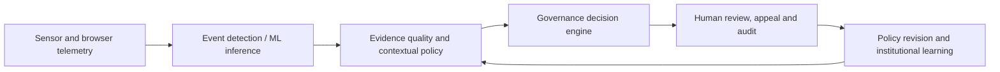

# ConsciousAI | AI Governance, Algorithmic Management and Institutional Leadership

## Research Update | October 23, 2026

**GRI comparative institutional research:** [Brazil 2026: AI, Electoral Institutions and Platform Governance](GRI-Research-Journey/Integrated-Research-Journey/2026-10-23-brazil-election-ai-platform-governance-tam505.md) connects graduate-level institutional analysis informed by Thunderbird School of Global Management at Arizona State University with the AI Paradox and [Uber and Lyft algorithmic management research](GRI-Research-Journey/Algorithmic-Management/Uber-Lyft-Research/README.md), including [Appendix A: Driver Interview 0107](GRI-Research-Journey/Algorithmic-Management/Uber-Lyft-Research/appendix-a-interview-0107-2026-10-23.md). The Brazil case records reported allegations, responses and verification requirements without treating disputed political claims as established facts. The driver interview is GRI approved qualitative evidence; participant perceptions are not independently verified platform mechanisms. These are independent GRI studies informed by graduate coursework, not university or faculty endorsements.

## Current Research | Institutional Cybersecurity and AI Governance

**Research update · 22 October 2026**  
GRI's ongoing institutional recovery research examines critical PHP security vulnerabilities, verified remediation, operational resilience, and the governance of increasingly autonomous systems. The analysis applies the Nelson Model within GRI's independent research framework and distinguishes documented evidence from emerging hypotheses.

[**Explore the Digital Bretton Woods research and evidence register →**](GRI-Research-Journey/Integrated-Research-Journey/Digital-Bretton-Woods/README.md)

## Research Integration | IFC Accountability, Institutional Incentives and AI

[**IFC Performance Standards, Nelson's Three Worldviews and the AI Compliance Paradox →**](GRI-Research-Journey/Integrated-Research-Journey/2026-10-23-ifc-incentives-performance-standards-ai-governance-crosswalk.md) connects the IFC's 2012 environmental and social safeguards, a separately attributed 2018 external opinion on AIMM incentives, and Thunderbird global political economy teaching to GRI's independent hypotheses on algorithmic management, delegated agent authority, stakeholder harms and contestable institutional decisions. The research note distinguishes primary policy, advocacy interpretation and unvalidated GRI extensions; it does not imply IFC or university endorsement.

## The AI Paradox | Institutional Power in the Fourth Industrial Revolution

**What happens when intelligence, capital, data and automation amplify institutional power faster than human governance can adapt?**

Grand Research Institute connects historical political economy, global management, public institutions and emerging AI systems through an original research architecture: **Access → Capability → Authority → Consequences → Feedback**. From international financial crises and cross-border bargaining to algorithmic management, autonomous systems and global AI infrastructure, the research examines who gains effective power, how it is exercised and whether institutions can remain accountable.

**[Explore the Institutional Power Amplification Framework →](GRI-Research-Journey/Integrated-Research-Journey/2026-10-19-institutional-power-amplification-framework.md)** · **[Global Government Research →](GRI-Research-Journey/Integrated-Research-Journey/2026-10-19-global-government-ai-governance-evidence-and-instruments.md)**

**ConsciousAI** is a research repository within the Grand Research Institute ecosystem. It documents inquiry into artificial intelligence, algorithmic management, institutional governance, technological innovation, and human oversight. The repository brings together research publications, case studies, empirical observations, and selected project resources. It is not presented as a deployed ethics auditing service or a formal standards setting body.

## Applied AI Research | From Sensor Data to Accountable Decisions

**ConsciousAI includes inspectable research code—not only policy analysis.** Grand Research Institute is investigating how machine-learning observations become organizational decisions, and how executable governance can constrain those decisions before they affect people.

| Implemented research module | What visitors can inspect | Evidence status |
| --- | --- | --- |
| [**Motion Classification**](GRI-Research-Journey/Research-Governance/Motion-Classification/README.md) | Six-axis IMU feature extraction, Random Forest with probability calibration, synthetic data generation, evaluation and tests | Source committed; synthetic-only; real-world accuracy not validated |
| [**Academic Integrity & AI-Assisted Learning**](GRI-Research-Journey/Research-Governance/Academic-Integrity/README.md) | Syllabus-governed AI learning, course-specific ethics and authorization, verified error-feedback pathways, plus a Python policy engine and browser telemetry prototype | Source committed; no student monitoring deployment or misconduct detection claim |
| [**Executable Governance**](GRI-Research-Journey/Research-Governance/Executable-Governance/README.md) | Versioned decision rules, event schema, audit digests, synthetic experiments and SVG chart generator | Source committed; offline research; no production safety authorization |

**The shared research question:** When does a technically observable event become an exercise of institutional authority, and what evidence, authorization, review and accountability must exist before an intervention?

The applications span driver safety, platform work, university assessment policies, fleet management and AI agents. In educational settings, the aim is to support **permitted and transparent AI-assisted learning** while protecting academic integrity, procedural fairness and student rights. Neither browser tab changes nor motion classifications establish human intent or misconduct.

**[Explore the Living Algorithmic Governance research synthesis →](GRI-Research-Journey/Integrated-Research-Journey/2026-10-21-algorithmic-governance-living-research.md)** · **[Research Journey →](GRI-Research-Journey/Integrated-Research-Journey/README.md)**

**Implementation transparency:** These modules contain code and tests, but the GitHub commits alone do not establish successful CI execution, independent scientific validation, university adoption or real-world deployment.

## GRI Institutional AI Governance & Assurance

[**Explore the independent governance and assurance research portfolio**](GRI-Research-Journey/institutional-ai-governance-assurance/README.md). This portfolio incorporates the Treasury AI label verification case as an exploratory research study alongside agentic controls, cybersecurity assurance, and institutional risk analysis. It does not imply U.S. Treasury affiliation or endorsement.

## Institutional Research | Start Here

**[Grand Research Institute — Institutional Research Brief →](GRI-Research-Journey/Institutional-Research-Brief/README.md)**

A concise, evidence qualified entry point for government, institutional, academic, and organizational readers. It connects the AI Paradox, the Legitimacy Paradox, algorithmic management, global governance, and the underlying research archive.

**[Explore the Master Research Portfolio](GRI-Research-Journey/Grand-Research-Institute-Research-Portfolio/README.md)** · **[Integrated Research Journey](GRI-Research-Journey/Integrated-Research-Journey/README.md)** · **[Cambodian Antiquities and Institutional Legitimacy](GRI-Research-Journey/Integrated-Research-Journey/Legitimacy-Paradox-Cambodian-Antiquities.md)**

## Historical Foundations | From Human Leadership to AI Governance

GRI's formal research journey began in **2021**, but the practical experience informing it extends to **Grand Advertising in the 1990s**, where founder David Grand worked with leadership development, training, motivation, organizational advancement, and performance management in sales operations. Subsequent international business and management experience, together with graduate study at Thunderbird School of Global Management at Arizona State University, informs the present research into algorithmic management, human judgment, and institutional governance. These historical foundations are **practitioner experience**, not claims that GRI conducted formal research in the 1990s.

[Explore the research chronology, evidence status and scholarly foundations](GRI-Research-Journey/Grand-Research-Institute-Research-Portfolio/README.md).

## Research and Institutional Leadership

**Grand Research Institute (GRI)** is an independent research organization founded by David Grand. This repository documents an evolving research program beginning in 2021, connecting global management, algorithmic decision systems, institutional political economy and accountable AI.

**For government and institutional leaders:** [Global AI and SI governance research](GRI-Research-Journey/Institutional-Governance/Global-AI-SI-Governance/README.md) and [Living AI Ecosystem: information mobility and institutional adaptation](GRI-Research-Journey/Living-AI-Ecosystem/README.md).

**For academic researchers:** [Consolidated research portfolio, methods and evidence limits](GRI-Research-Journey/Grand-Research-Institute-Research-Portfolio/README.md), [institutional leadership monograph](GRI-Research-Journey/Algorithmic-Management-Institutional-Leadership/README.md), and [October 2026 AI Paradox research edition](Research-Journey/AI-Leadership/Algorithmic-Management/2026-10-15-anatomy-of-ai-decision/OCTOBER_2026_RESEARCH_EDITION.md).

**For organizational leaders, collaborators and recruiters:** [Research portfolio and professional scope](GRI-Research-Journey/Grand-Research-Institute-Research-Portfolio/README.md), [algorithmic management field research](GRI-Research-Journey/Algorithmic-Management/Uber-Lyft-Research/), and [applied decision modeling research](GRI-Research-Journey/Algorithmic-Management/Predictive-Modeling-and-Human-Decisions/README.md).

**For readers exploring the creative research ecosystem:** [The Back Door website](https://back-door-october-4-original.vercel.app/) and [Sunday Funday](https://www.youtube.com/@grandresearchinstitute).

**Research integrity:** GRI distinguishes peer-reviewed external scholarship, independent working papers, documented observations, conceptual illustrations, exploratory protocols and future research. References to Thunderbird School of Global Management at Arizona State University identify academic context, not university endorsement of GRI publications.

### Featured Research | October 2026

- [**The AI Paradox | Illustrated Research PDF**](GRI-Research-Journey/GRI%20AI%20October%202026.pdf)
- [**Living AI Ecosystem | New Research Collection**](GRI-Research-Journey/Living-AI-Ecosystem/README.md)
- [**Research Journey | Master Portfolio and Index**](GRI-Research-Journey/Grand-Research-Institute-Research-Portfolio/README.md)

---

## Related Creative and Public Engagement Projects

The following projects are distinct from GRI's empirical research and are not presented as institutional findings.

### The Back Door | Website

Explore the world of *The Back Door*, the upcoming novel by David Grand, author of *From Code to Consciousness*. A fictional thriller about artificial intelligence, infrastructure, and power, its story feels closer to reality every day.

**[OPEN WEBSITE](https://back-door-october-4-original.vercel.app/)**

**[Explore The Back Door Game on ASU Handshake](https://asu.joinhandshake.com/ai-showcase/projects/3505318)**

The game project is active and available through ASU Handshake. The game will continue to evolve with new features and upgrades.

[View The Back Door Website Source](THE-BACK-DOOR-ORIGINAL-WEBSITE)

### Sunday Funday | Grand Research Institute

Explore conversations on artificial intelligence, leadership, management, and governance.

**[Watch Sunday Funday on YouTube](https://www.youtube.com/@grandresearchinstitute)**

## Mission

To advance responsible artificial intelligence through transparent governance, empirical research, and accountable technological innovation.

ConsciousAI, developed within the Grand Research Institute research ecosystem, connects AI ethics, algorithmic management, institutional accountability, and human oversight through open research, practical tools, and global collaboration.

Our mission is to ensure that as artificial intelligence assumes greater responsibility for decisions affecting individuals, organizations, and society, human judgment, transparency, and institutional accountability remain central to its development and deployment.

From Code to Consciousness: Advancing the science, management, and governance of responsible AI.

## Research Areas

- **Algorithmic Management:** Platform labor, incentive structures, automated decision systems, and management accountability.
- **Institutional Governance:** Human authorization, organizational oversight, transparency, and governance of autonomous systems.
- **Empirical Research:** Documented observations, case studies, evidence limitations, and reproducible analytical methods where practical.
- **Global Leadership and Strategy:** The interaction of technological change with institutions, economic development, and international governance.
- **AI Ethics and Accountability:** Research questions concerning bias, verification, responsibility, and meaningful human control.

These are research priorities, not claims that operational software tools or community governance mechanisms have been deployed.

## Research Foundations: *From Code to Consciousness*

*From Code to Consciousness* by David Grand provides an intellectual foundation for ongoing research conducted through the Grand Research Institute.

The ConsciousAI repository documents an evolving research journey examining artificial intelligence, algorithmic management, institutional governance, technological innovation, and global leadership.

Research draws upon professional experience, graduate academic studies, published literature, empirical observations, and documented case studies. The objective is to develop evidence based analysis of how increasingly autonomous systems influence human decision making, organizational accountability, economic structures, and institutional authority.

## Conscious AI Framework: Transparency, Truth, and the Future of AI

This research area examines transparency, evidence quality, governance, and accountability in artificial intelligence. Relevant initiatives and institutional approaches may be considered as comparative cases; their inclusion does not imply endorsement, affiliation, or formal collaboration.

This project covers:

- The importance of open source AI models  
- Challenges with current proprietary AI  
- Our Conscious AI framework for ethical AI development  
- Academic literature and institutional research relevant to responsible AI  
- A roadmap for international cooperation and AI governance  

*How AI can serve humanity’s collective good with transparency and responsibility.*

## ConsciousAI | Global Intelligence Research Systems

The **[GRI Global Intelligence dashboard](https://gri-global-intelligence.onrender.com/dashboard)** is now publicly hosted, connecting institutional governance, AI engineering, algorithmic management, economic research and documented global events through a visual research interface.

- **[Ethical Intelligence API](GRI-Research-Journey/Research-Governance/ConsciousAI-Research-Systems/Ethical-Intelligence-API.md)** — An implemented research API prototype for evidence completeness, provenance and accountability assessment. It is not an enterprise auditing certification service.
- **[Transparency Graph](GRI-Research-Journey/Research-Governance/ConsciousAI-Research-Systems/Transparency-Graph.md)** — An interactive, hosted research graph connecting documented events, organizations, cases, institutional questions and evidence status.
- **[Global Policy and Event Tracker](GRI-Research-Journey/Research-Governance/ConsciousAI-Research-Systems/POLICY-INGESTION.md)** — A live dashboard with documented events and a configured scheduled U.S. Federal Register metadata collector. Candidate records require verification; comprehensive continuous global legislative ingestion is still in development.
- **[Global Economic and Institutional Intelligence](GRI-Research-Journey/Research-Governance/ConsciousAI-Research-Systems/ECONOMIC-INTELLIGENCE.md)** — A research framework drawing on the Nelson Model connecting economic indicators, institutions, policy decisions and managerial adaptation. International economic feed ingestion remains a development objective.

**[Explore the live dashboard](https://gri-global-intelligence.onrender.com/dashboard)** · **[View the research system, source registries and code](GRI-Research-Journey/Research-Governance/ConsciousAI-Research-Systems/README.md)**

**Operational distinction:** The dashboard is deployed; its API and visual graph use the current research datasets. Full enterprise auditing, human-verified worldwide legal coverage, and continuous ingestion of every international economic source are not represented as complete.

## Research Use and Contributions

Readers can review the linked research materials, examine stated evidence and limitations, and propose corrections or substantive additions through GitHub issues when enabled. Contributions should distinguish observations from hypotheses and conclusions and cite original sources where available.

## Grand Research Institute | Research Journey

ConsciousAI incorporates the Grand Research Institute's ongoing research into artificial intelligence, algorithmic management, institutional governance, autonomous mobility, and human oversight.

### Featured Research | The AI Paradox — October 15, 2026

[**Download the Complete 21-Page Illustrated PDF**](GRI-Research-Journey/GRI%20AI%20October%202026.pdf)

**[Read The AI Paradox: October 2026 Research Edition](Research-Journey/AI-Leadership/Algorithmic-Management/2026-10-15-anatomy-of-ai-decision/OCTOBER_2026_RESEARCH_EDITION.md)**

David Grand and the Grand Research Institute connect a contemporaneous Thunderbird faculty discussion with original longitudinal research into Uber algorithmic management, AI decision anatomy, workforce adaptation, agentic authority and institutional governance. This is the foundational installment of an evolving research series, with future updates planned through April 2027.

### Research Journey

[**Research Journey**](GRI-Research-Journey/Grand-Research-Institute-Research-Portfolio)

Explore the Grand Research Institute's consolidated research portfolio, founder mission, AI governance frameworks, continuing research development, and supporting research publications.

### Algorithmic Management, Institutional Leadership and the AI Paradox

[**Read the GRI Research Monograph**](GRI-Research-Journey/Algorithmic-Management-Institutional-Leadership/README.md)

A comprehensive Grand Research Institute leadership and management synthesis drawing on approximately five years of research, with a strong academic concentration over the past two years. Includes the full research paper and a separate companion for charts and visual materials.

### Predictive Modeling, Adaptive Learning and Human Decisions

[**Read the GRI AI Forecasting and Algorithmic Management Study**](GRI-Research-Journey/Algorithmic-Management/Predictive-Modeling-and-Human-Decisions/README.md) examines prospective forecast evaluation, algorithmic learning, calibrated uncertainty, human reliance, and governance. This is an exploratory research protocol, not a validated prediction accuracy study.

### Apple, China and Institutional Leadership

[**Apple in China: Leadership, Institutional Governance, and the AI Era**](GRI-Research-Journey/Global-Leadership/Apple-China-Institutional-Leadership/README.md)

An ongoing Grand Research Institute case connecting Apple's China operations, Doug Guthrie's executive education experience, Patrick McGee's historical investigation, and institutional leadership analysis informed by Thunderbird's global management perspective.

### Global AI and SI Governance Research

[**Read the Global AI and SI Governance Research Framework**](GRI-Research-Journey/Institutional-Governance/Global-AI-SI-Governance/README.md)

Living comparative research on jurisdictional AI governance, accountable autonomous agents, continuous boundary testing, institutional liability, and versioned evidence. Companion PDF and graphics are tracked as separate artifacts.

### Digital Platform Visibility Research

[GRI Observational Study 001: Organic Visibility and Algorithmic Amplification](GRI-Research-Journey/Algorithmic-Management/Digital-Platform-Visibility/observational-study-001-organic-visibility.md) records a baseline social video observation and an academic protocol for tracking platform distribution without causal overstatement.

### Algorithmic Management Research

**Enterprise AI and managerial accountability:** [Uber engineering, MCP Gateway and Software Factory comparative study](GRI-Research-Journey/Algorithmic-Management-Institutional-Leadership/Uber-Engineering-AI-Paradox-Operational-Management-2026.md) connects managed agents and engineering controls with GRI's rideshare observations and institutional leadership framework.

Explore GRI's longitudinal Uber and Lyft research, including the approximately $20 gross earnings hypothesis, economic analysis, documented field observations, and governance implications.

[View GRI Algorithmic Management Research](GRI-Research-Journey/Algorithmic-Management/Uber-Lyft-Research)

**Chicago Lyft Paired Trip Case Study:** [Read the GRI analysis of consecutive rides and estimated platform fee asymmetry](GRI-Research-Journey/Algorithmic-Management/Uber-Lyft-Research/case-study-002-chicago-consecutive-lyft-rides.md). A matched observational example highlighting transparency and management accountability, with explicit limits on causal inference.

**Research Lead:** David Grand | Grand Research Institute  
**Research Program:** 2021 to Present | Ongoing Longitudinal Research  
**Research Scope:** Foundational inquiry since 2021, with subsequent field studies, published work, institutional analysis, and evolving research protocols. Individual studies retain their own documented dates; 2026 marks the formalization of several current investigations, not the beginning of the research program.

**ConsciousAI research systems:** [Ethical Intelligence API, Transparency Graph and AI Policy Tracker](GRI-Research-Journey/Research-Governance/ConsciousAI-Research-Systems/README.md) are now established as linked research specifications with an initial evidence registry and API contract. These are development assets, not deployed services.
